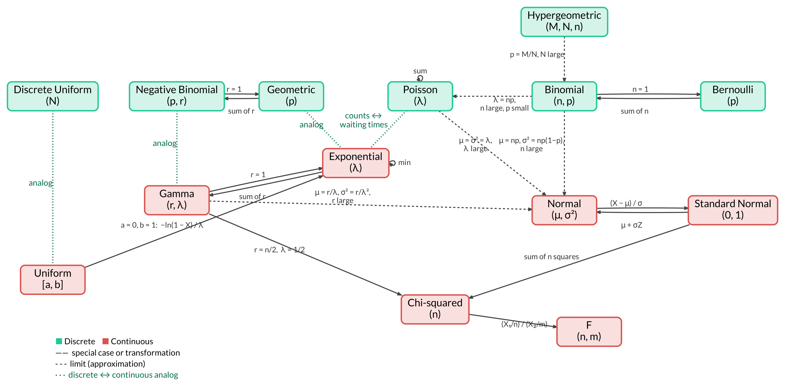

This map shows how the named distributions from Lessons 12 and 13 connect to each other. [Teal boxes]{style="color:#20c997;"} are [**discrete**]{style="color:#20c997;"} random variables and [red boxes]{style="color:#d9534f;"} are [**continuous**]{style="color:#d9534f;"} random variables.

{fig-align="center" width="100%"}

-   **Solid lines** are special cases and transformations. For example, a Binomial with $n = 1$ is a Bernoulli, and the sum of $r$ independent Exponentials is a Gamma.
-   **Dashed lines** are limits, which we use as approximations. For example, a Binomial with large $n$ and small $p$ is approximately Poisson with $\lambda = np$.
-   [**Dotted green lines**]{style="color:#006a4e;"} connect discrete and continuous analogs. For example, the Geometric counts *trials* until the first success, and the Exponential measures *time* until the first event.

## Where we saw each relationship

| Relationship | Where |
|----|----|
| Binomial is a sum of $n$ independent Bernoullis | Lesson 12 |
| Negative Binomial is a sum of $r$ independent Geometrics | Lesson 12 |
| Sum of independent Poissons is Poisson | Lesson 12, Theorem 1 |
| Hypergeometric $\approx$ Binomial with $p = M/N$ when $N$ is large | Lesson 12 |
| Binomial $\approx$ Poisson with $\lambda = np$ when $n$ is large and $p$ is small | Lesson 12 |
| Uniform$[0,1]$ to Exponential: $-\ln(1-X)/\lambda$ (inverse CDF method) | Lesson 9 |
| Gamma is a sum of $r$ independent Exponentials | Lesson 13 |
| Minimum of independent Exponentials is Exponential | Lesson 13, Theorem 1 |
| Geometric and Exponential, Negative Binomial and Gamma, Discrete and Continuous Uniform are analogs | Lessons 12 and 13 |
| Poisson counts events in a fixed time; Exponential is the waiting time between them | Lesson 13 |
| Standardizing a Normal: $Z = (X - \mu)/\sigma$ | Lesson 13 |
| Sum of $n$ squared standard Normals is Chi-squared($n$) | Lesson 13 |
| Ratio of Chi-squared RVs, each divided by its degrees of freedom, is $F$ | Lesson 13 |
| Chi-squared($n$) is a Gamma with $r = n/2$ and $\lambda = 1/2$ | Extra |
| Binomial, Poisson, and Gamma are approximately Normal when $n$, $\lambda$, or $r$ is large | Lesson 17 (Central Limit Theorem) |

*Adapted from Leemis, L. M. (1986). Relationships among common univariate distributions. The American Statistician, 40(2), 143–146.*
