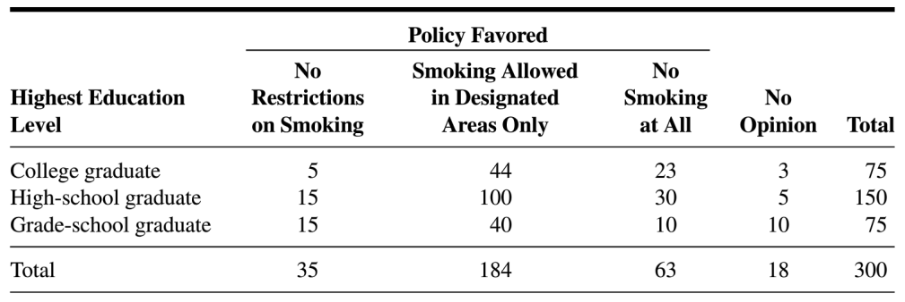

<!--
HOW TO USE THIS FILE
- Put your name in the "author" line at the very top.
- Type your answers after each "Answer:" line.
- Put R code inside the gray code chunks (between ```{r} and ```).
- You don't need to change anything between the --- lines at the top (YAML)
  or any line starting with :::
- Click the arrow next to "Render" and choose "Render HTML" or
  "Render Typst" (Typst makes a PDF). Submit that file.
-->

```{r}
#| label: "setup"
#| include: false

knitr::opts_chunk$set(echo = TRUE)

# Uses the course date file when it's available;
# otherwise falls back to the due date below.
if (requireNamespace("here", quietly = TRUE) &&
    file.exists(here::here("class_dates.R"))) {
  source(here::here("class_dates.R"))
} else {
  hw5 <- as.Date("2026-11-22")
}
```

::: {.callout-tip appearance="minimal"}
**Due `r format(hw5, "%m/%d")` at 11pm**
:::

## Assignment information

### Lessons covered

-   Lesson 11: Variance
-   Lesson 12: Important discrete RVs
-   Lesson 13: Important continuous RVs
-   Lesson 14: Transformations of distributions
-   Lesson 15: Joint distributions

### Directions

**Please turn in this homework on Brightspace.** Please submit your homework as a pdf or html file. You can type your work in this file and render it, or submit a single file with photos of your written work or any other method that can be turned into a pdf. Please let me know if you prefer to submit a physical copy, we can arrange for a physical "turn in" during Monday's class.

**Get the .qmd file:** You can download this homework as a `.qmd` file from [GitHub](https://github.com/nwakim/BSTA_550_26F/blob/main/homework/HW_05.qmd). On that page, click the download button ("Download raw file") near the top right of the file.

*You must show all of your work to receive credit.*

Extra problems do not need to be turned in!

::: {.callout-warning collapse="false"}
#### If you are editing this file to turn in

If you are editing this `.qmd` file, then you will see a section right below the YAML called "HOW TO USE THIS FILE." Please follow those instructions to make sure you are not deleting essential parts of this file. When you render, that section will not show up.
:::

::: {.callout-note collapse="false"}
#### AI Use Statement

**Using AI is not required in this class.** If you *did* use an AI tool (ChatGPT, Claude, Copilot, Gemini, an RStudio assistant, etc.) on this homework, add a brief AI Use Statement at the very top of your submission. Include:

-   **Which tool(s)** you used
-   **What for** (a sentence or two, with question numbers)
-   **Where** it contributed to any written interpretations (if at all)
-   *You do NOT need to link your conversation.*

For example:

> *AI Use Statement: Claude was used to explain an error message in Question 3. All statistical reasoning, code review, and conclusions are my own.*

OR

> *AI Use Statement: AI was not used in this assignment.*

Before using AI, check the table of allowed uses in the [Generative AI Policy](https://nwakim.github.io/BSTA_550_26F/syllabus.html#generative-ai-policy). For homework, AI can help you *understand* (explain an error or a concept, check an answer you already worked out, give feedback on your own writing), but it should not do the problem for you. A half-finished answer that shows your thinking is always better than a polished one from AI!
:::

## Questions

**Load packages.** This chunk is done for you. Run it before any of the R code below.

```{r}
#| label: "load-packages"
#| message: false

library(tidyverse)
```

### Lesson 11: Variance

Questions 1–7 practice expected values of functions of RVs and variance (Lesson 11). Questions 1, 2, 5, 6, and 7 revisit setups from Homework 4, so you can reuse your expected values from there.

### 1. Asthma ER visits (revisited)

Suppose that for adults with asthma, the number of emergency room (ER) visits for asthma in a year, $X$, has the following pmf:

| $x$ | 0 | 1 | 2 | 3 |
|:---:|:---:|:---:|:---:|:---:|
| $p_X(x)$ | 0.50 | 0.30 | 0.15 | 0.05 |

and $p_X(x) = 0$ for any other value of $x$. In Homework 4, you found $\mathbb{E}[X]$.

#### Part a

Find $\mathbb{E}[X^2]$. Is $\mathbb{E}[X^2]$ equal to $\left(\mathbb{E}[X]\right)^2$?

***Answer:***

#### Part b

Find $Var(X)$ two ways: with the definition, $Var(X) = \mathbb{E}\left[(X - \mathbb{E}[X])^2\right]$, and with the computation formula, $Var(X) = \mathbb{E}[X^2] - \left(\mathbb{E}[X]\right)^2$. Then find $SD(X)$.

***Answer:***

#### Part c

Suppose each ER visit costs a patient a \$250 copay, plus every patient pays a \$100 yearly fee. So the patient's yearly cost is $C = 250X + 100$. Find $SD(C)$.

-   *Hint:* You can use the result for $Var(aX+b)$ (Lesson 11, Lemma 7). You will prove this result in Question 4!

***Answer:***

#### Part d

Simulate 10,000 adults with asthma to check your answers to Parts a and b.

**Step 1: Set up.** This chunk is done for you. Run it before the others.

```{r}
#| label: "q1d-setup"

set.seed(2222)    # so you get the same "random" adults each time
reps <- 10000     # number of simulated adults

# probability of 0, 1, 2, and 3 ER visits
visit_probs <- c(0.50, 0.30, 0.15, 0.05)
```

**Step 2: Simulate.** Simulate the number of ER visits, $X$, for each of the 10,000 adults.

-   *Hint:* You can reuse your code from Homework 4. Or follow Lesson 10, Example 2 (the not-so-fair die): start with `tibble(sim = 1:reps)`, then use `mutate()` and `sample()` with the possible values `0:3`, `replace = TRUE`, and `prob = visit_probs`.

***Answer:***

```{r}
#| label: "q1d-simulate"

# Your code here

```

**Step 3: Summarize.** Use `summarise()` to approximate $\mathbb{E}[X^2]$, $Var(X)$, and $SD(X)$ from your simulation.

-   *Hint:* Follow the card example in Lesson 11 ("The variance from our simulation"). `mean(X^2)` approximates $\mathbb{E}[X^2]$, `mean((X - mean(X))^2)` approximates $Var(X)$, and `sqrt()` takes the square root.

***Answer:***

```{r}
#| label: "q1d-summarize"

# Your code here

```

Are your simulated answers close to your answers in Parts a and b? (They do not need to match exactly!)

***Answer:***

### 2. Medication absorption (revisited)

Suppose the proportion $X$ of a medication dose that is absorbed in the first hour has pdf $$f_X(x) = \begin{cases} 3x^2 & \text{if } 0 \leq x \leq 1 \\ 0 & \text{otherwise} \end{cases}$$ In Homework 4, you found $\mathbb{E}[X]$.

#### Part a

Find $\mathbb{E}[X^2]$.

***Answer:***

#### Part b

Find $Var(X)$ and $SD(X)$.

***Answer:***

#### Part c

Simulate 10,000 values of $X$ with the inverse CDF method from Lesson 9, and use them to check your answers to Parts a and b.

-   *Hint:* You can reuse your simulation from Homework 4 ($x = u^{1/3}$). Then use `summarise()` to approximate $\mathbb{E}[X^2]$, $Var(X)$, and $SD(X)$, like in Question 1.

***Answer:***

```{r}
#| label: "q2c-simulate"

set.seed(3131)
reps <- 10000

# Your code here

```

Are your simulated answers close to your answers in Parts a and b? (They do not need to match exactly!)

***Answer:***

### 3. Variance of an exponential RV

Let $f_X(x)=\lambda e^{-\lambda x}$ for $x>0$, where $\lambda>0$.

#### Part a

Show $Var(X)=\dfrac{1}{\lambda^2}$. You may use the result from class for $\mathbb{E}[X]$ without first proving it.

-   *Hint:* Start by finding $\mathbb{E}[X^2]$. You will need integration by parts (Lesson 10, Example 6) twice.

***Answer:***

#### Part b

Now let $\lambda = 0.5$. Simulate 10,000 values of $X$ and check that your simulated mean and variance are close to $\mathbb{E}[X] = \dfrac{1}{\lambda}$ and $Var(X) = \dfrac{1}{\lambda^2}$.

-   *Hint:* Use the code from Lesson 10 ("Picking up our exponential simulation from Lesson 9"), but change $\lambda$ from 2 to 0.5. With $\lambda = 0.5$, the inverse CDF is $x = -\ln(1-u)/0.5$. In R, $\ln$ is `log()`. Then use `summarise()` like in Question 1.

***Answer:***

```{r}
#| label: "q3b-simulate"

set.seed(5151)
reps <- 10000

# Your code here

```

### 4. Variance of a linear function

Prove that for a random variable $X$ and constants $a$ and $b$, $$Var(aX+b)=a^2Var(X).$$

-   *Hint:* Use the computation formula from Lesson 11 with $aX+b$ in place of $X$: $Var(aX+b) = \mathbb{E}\left[(aX+b)^2\right] - \left(\mathbb{E}[aX+b]\right)^2$. Then expand the squares and use $\mathbb{E}[aX+b] = a\mathbb{E}[X] + b$ from Lesson 10.

***Answer:***

### 5. The sample mean (revisited)

Let $\overline{X}$ be the random variable for the sample mean, $\overline{X}=\dfrac{\sum_{i=1}^nX_i}{n}$, where the $X_i$ are i.i.d. random variables with common mean $\mu$ and variance $\sigma^2$. In Homework 4, you found $\mathbb{E}[\overline{X}]$. Find $Var(\overline{X})$.

***Answer:***

### 6. Shipping containers (revisited)

A shipping company handles containers in three different sizes: (1) 27 $ft^3$ (3 x 3 x 3), (2) 125 $ft^3$, and (3) 512 $ft^3$. Let $X_i$ ($i = 1, 2, 3$) denote the number of type $i$ containers shipped during a given week. Suppose that $\mu_1 =200,\sigma_1=10,\mu_2 =250,\sigma_2=12,\mu_3 =100,\sigma_3=8$.

#### Part a

Assuming that $X_1,X_2,X_3$ are independent, calculate the variance of the total volume shipped.

***Answer:***

#### Part b

Would your calculation necessarily be correct if the $X_i$'s were not independent? Explain. How is this different from your answer for the expected value in Homework 4?

***Answer:***

### 7. Waiting for the bus (revisited)

Suppose your waiting time for a bus in the morning is uniformly distributed on \[0, 8\] (minutes), whereas waiting time in the evening is uniformly distributed on \[0, 10\] (minutes) independent of morning waiting time. *Make sure to FIRST set up an equation for the total waiting time in each question before calculating its variance.* *You may use results from class for the expected value and variance of uniform RVs without proving them.*

#### Part a

If you take the bus each morning and evening for a week (7 days), what is the variance of your total waiting time?

***Answer:***

#### Part b

What is the variance of the difference between morning and evening waiting times on a given day?

***Answer:***

#### Part c

What is the variance of the difference between total morning waiting time and total evening waiting time for a particular week?

***Answer:***

#### Part d

Simulate 10,000 weeks of bus rides to check your answers to Parts a and c.

**Step 1: Set up.** This chunk is done for you. Run it before the others.

```{r}
#| label: "q7d-setup"

set.seed(6161)  # so you get the same "random" weeks each time
reps <- 10000   # number of simulated weeks
n_days <- 7     # number of days in a week
```

**Step 2: Simulate and find the weekly totals.** You can reuse your code from Homework 4 to make the `morning` and `evening` waiting times, then find the weekly `total` and `difference`.

-   *Hint:* Start with `expand_grid(sim = 1:reps, day = 1:n_days)`, then use `mutate()` with `runif(n(), min = 0, max = 8)` and `runif(n(), min = 0, max = 10)`. Then `group_by(sim)` and `summarise()` with `total = sum(morning + evening)` and `difference = sum(morning) - sum(evening)`.

***Answer:***

```{r}
#| label: "q7d-simulate"

# Your code here

```

**Step 3: Summarize.** Approximate the variance of the total waiting time and of the difference.

-   *Hint:* Use `summarise()` with `mean((total - mean(total))^2)`, like in Question 1.

***Answer:***

```{r}
#| label: "q7d-summarize"

# Your code here

```

Are your simulated answers close to your answers in Parts a and c? (They do not need to match exactly!)

***Answer:***

### Lessons 12–16

### 8. Sum of binomials

Let $X_i\sim$ Binomial($n_i,p$) be independent r.v.'s for $i=1,\ldots,m$.

#### Part a

What does the r.v. $X=\sum_{i=1}^mX_i$ count, and what is the distribution of $X$? Make sure to specify the parameters of $X$'s distribution.

***Answer:***

#### Part b

Find $\mathbb{E}[X]$. *Make sure to show your work for Parts b and c. However, you may use without proof what you know about the mean and variance of each* $X_i$.

***Answer:***

#### Part c

Find $Var(X)$.

***Answer:***

### 9. Voters at a polling station

Suppose that voters arrive at a polling station at the rate of 120 per hour. For each of the following parts, [give the name and parameter(s) of the distribution]{.underline} to be used to model the event and [set up the expression]{.underline} to find the specified probability. *You do not need to compute the probability.*

#### Part a

The probability that the next voter will arrive in less than 30 seconds.

***Answer:***

#### Part b

The probability that 200 voters will arrive within two hours of each other.

***Answer:***

#### Part c

The probability that the $50^{th}$ voter will arrive in between 15 and 30 minutes.

***Answer:***

### 10. Pizza delivery

Suppose that the times until Hector, Ivan, and Jacob's pizza arrives are independent exponential random variables, each with average of 20 minutes. Find the probability that none of the waiting times exceed 20 minutes, i.e., find $P(\max(X, Y,Z) \leq 20)$.

***Answer:***

### 11. Smoking policy and education

The following table shows the results of a survey in which the subjects were a sample of 300 adults residing in a certain metropolitan area. Each subject was asked to indicate which of three policies they favored with respect to smoking in public places. (Table is from *Biostatistics: A Foundation for Analysis in the Health Sciences*, 10th Edition, Daniel, Wayne W.; Cross, Chad L., pg. 630)

{fig-align="center" width="6in"}

Let $X=$ highest education level and $Y=$ policy favored. We can let $X=1$ for college graduate, $X=2$ for high-school graduate, etc., and similarly for $Y$, or just keep the category names for the different levels of $X$ and $Y$.

#### Part a

Make a table for the joint pmf $p_{X,Y}(x,y)$ and briefly describe in words what the values are the probability of.

***Answer:***

#### Part b

Find the marginal pmf $p_{X}(x)$ and briefly describe in words what the values are the probability of.

***Answer:***

#### Part c

Find the marginal pmf $p_{Y}(y)$ and briefly describe in words what the values are the probability of.

***Answer:***

#### Part d

Make a table for the joint cdf $F_{X,Y}(x,y)$ and briefly describe in words what the values are the probability of.

***Answer:***

#### Part e

Find the marginal cdf $F_{X}(x)$ and briefly describe in words what the values are the probability of.

***Answer:***

#### Part f

Find the marginal cdf $F_{Y}(y)$ and briefly describe in words what the values are the probability of.

***Answer:***

### 12. Maximum of i.i.d. RVs

Let $X_1, X_2, \ldots, X_n$ be i.i.d. random variables with common pdf $f_X(x)$ and cdf $F_X(x)$. Find the pdf for the random variable $Z$, where $Z = \max(X_1, X_2, \ldots, X_n)$.

***Answer:***

### 13. Minimum of a uniform and an exponential

Let $X$ and $Y$ be independent random variables with respective pdf's $f_X(x)=\frac{1}{5}$, for $0\leq x\leq 5$, and $f_Y(y)=2e^{-2y}$, for $y>0$.

#### Part a

Find the joint distribution $f_{X,Y}(x,y)$.

***Answer:***

#### Part b

Find the probability that $X$ is less than $Y$.

***Answer:***

#### Part c

Let $Z$ be the random variable that is the smaller of $X$ and $Y$. Find the cumulative distribution function for $Z$.

***Answer:***

#### Part d

Find the pdf for $Z$.

***Answer:***

### 14. CDF of a ratio

Suppose that the random variables $X$ and $Y$ have joint density $f_{X,Y}(x,y)$, for $0<x<1$, and $\frac{1}{2}<y<1$. Set up the equation for the cdf of $Z$, where $Z=X/Y$.

-   *Hint:* First determine what the possible values for $Z$ are. Then make a sketch of the domain of the joint pdf and shade in the region representing the cdf of $Z$ for different values of $z$. Make sure to pay close attention to how the region we need to integrate over changes as $z$ changes. The cdf has two different cases depending on the value of $z$. Plug in specific values of $z$ and shade in the region representing the cdf to see why two different cases are needed.

***Answer:***

## Extra problems

**You do NOT need to complete the extra problems!**

### 1. The sample proportion (revisited)

Let $\hat{p}$ be the random variable for the sample proportion, $\hat{p}=\dfrac{X}{n}$, where $X$ is the number of successes in a random sample of size $n$. Assume the probability of success is $p$. Find $Var(\hat{p})$.

### 2. Freddy and Jane's winnings

Freddy and Jane have entered a game in which they each win between 0 and 2 dollars. If $X$ is the amount Freddy wins, and $Y$ is the amount that Jane wins, they believe that the joint density of their winnings will be $$f_{X,Y}(x, y) = \dfrac{1}{4}xy \text{ for } 0 \leq x \leq 2 \text{ and } 0 \leq y \leq 2$$ and $f_{X,Y}(x, y) = 0$ otherwise. Find the probability that their combined winnings exceed 2, i.e., find $P(X + Y > 2)$.
