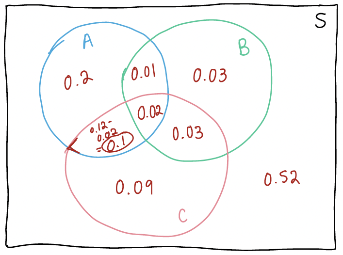

```{=html}
<style>
div.answer { background-color: #f8eded; border-left: 4px solid #8B0000; border-radius: 5px; padding: 1em 1.25em; margin-bottom: 1em; }
</style>
```

Below are some select answers from the homework.

```{r}
#| label: "setup"
#| include: false

knitr::opts_chunk$set(echo = TRUE)
library(tidyverse)
```

## Questions

### 1. Health conditions in US adults

Suppose the following are the percentage of US adults with the following conditions:

-   $A$: Hypertension 33%
-   $B$: Diabetes 9%
-   $C$: Metabolic syndrome 24%
-   $A$ or $B$: 39%
-   $A$ or $C$: 45%
-   $B$ or $C$: 28%
-   $A$ or $B$ or $C$: 48%

#### Part a

Make a Venn diagram of the 3 conditions labeling the percentage (or probability) for *ALL* of the 8 "sections". *Hint: Start from the last condition and work your way up!*

::: answer
{width="500"}
:::

#### Part b

For each of the following (1. - 7. below), ($i$) write out the event using unions, intersections, and/or complements of the events $A$, $B$, and $C$ (this is NOT finding the probability, that's in $ii$); ($ii$) find the probability of the event; and ($iii$) write a sentence explaining what the probability is of in terms of the context of the problem.

1.  $\mathbb{P}$(event at least one of the 3)
2.  $\mathbb{P}$(event none)
3.  $\mathbb{P}$(event $A$ only)
4.  $\mathbb{P}$(event exactly one)
5.  $\mathbb{P}$(event $A$ and $B$)
6.  $\mathbb{P}$(event $A$ and $B$ but not $C$)
7.  $\mathbb{P}$(event all 3)

::: answer
Answers for part (ii) for each:

1.  0.48
2.  0.52
3.  0.2
4.  0.32
5.  0.03
6.  0.01
7.  0.02
:::

### 2. Guessing on an exam

While taking a probability exam, you come to three questions that you have no clue how to answer. You would have known the answers if you had taken the time to study the night before instead of going to a party, but you did not make a good life choice, and you vow to never party on a school night again if you fail this exam. Each question on the exam is multiple choice with the correct answer being either a, b, c, d, or e. (Your guesses are independent.) What is the probability that:

#### Part a

you randomly guess the right answer to all three questions?

#### Part b

you randomly guess the right answer to none of the three questions?

#### Part c

you randomly guess the right answer to exactly one of the three questions?

::: answer
0.384

If you have the right answer to (c), then you should be able to figure out the rest (see (e)).
:::

#### Part d

you randomly guess the right answer to exactly two of the three questions?

#### Part e

Do the probabilities in parts a–d sum to 1?

### 3. Pairwise vs. mutual independence

Recall from class that we defined events $A$, $B$, and $C$ to be mutually independent if both (1) and (2) below hold. The point of this exercise is to show that $(1)\nRightarrow (2)$ and $(2)\nRightarrow (1).$

$$\begin{array}{cl}
(1) & \mathbb{P}(A\cap B)=\mathbb{P}(A)\,\mathbb{P}(B) \\
    & \mathbb{P}(A\cap C)=\mathbb{P}(A)\,\mathbb{P}(C) \\
    & \mathbb{P}(B\cap C)=\mathbb{P}(B)\,\mathbb{P}(C) \\[6pt]
(2) & \mathbb{P}(A\cap B\cap C)=\mathbb{P}(A)\,\mathbb{P}(B)\,\mathbb{P}(C)
\end{array}$$

#### Part a

Suppose two different fair dice are rolled. Let events $A$, $B$, and $C$ be defined in the following way:

$$\begin{array}{cl}
A: & \text{Roll a total of 7} \\
B: & \text{First die is a 6} \\
C: & \text{Second die is a 2}
\end{array}$$

Show that condition $(1)$ holds, but that condition $(2)$ does not.

::: answer
(2) does not hold because $0 \neq \dfrac{1}{216}$
:::

#### Part b

Suppose two different fair dice are rolled. Let events $A$, $B$, and $C$ be defined in the following way:

$$\begin{array}{cl}
A: & \text{Roll a 1 or 2 on the first die} \\
B: & \text{Roll a 3, 4, or 5 on the second die} \\
C: & \text{Roll a total of 4, 11, or 12}
\end{array}$$

Show that condition $(2)$ holds, but that condition $(1)$ does not.

::: answer
(1) does not hold because $\mathbb{P}(B \cap C) \neq \mathbb{P}(B)\,\mathbb{P}(C)$
:::

### 4. Parity of spinning

A spinner has the left side (numbers 1, 2, 3, 4, and 5) colored red and the right side colored white (numbers 6, 7, 8, and 9), with all numbers equally likely.

#### Part a

What is the probability the spinner lands on an odd number?

::: answer
5/9
:::

#### Part b

Given that the spinner landed on an odd number, what is the chance the spinner landed on a white number?

::: answer
2/5
:::

#### Part c

Given that the spinner landed on a white number, what is the chance it landed on an odd number?

::: answer
2/4
:::

#### Part d

Check your answers to Parts a–c by simulating 10,000 spins in R.

::: answer
We'll all have slightly different answers, but they should be close to $5/9 \approx 0.556$, $2/5 = 0.4$, and $2/4 = 0.5$.

**Step 1: Set up**

```{r}
#| label: "q4-setup"

set.seed(4444)
reps <- 10000
```

**Step 2: Simulate**

```{r}
#| label: "q4-simulate"

spins <- expand_grid(sim = 1:reps) |>               # one row per simulated spin
  mutate(spin = sample(1:9, n(), replace = TRUE))   # each row gets a number from 1 to 9
```

**Step 3: Define the events**

```{r}
#| label: "q4-events"

spin_events <- spins |>
  mutate(odd = spin %in% c(1, 3, 5, 7, 9),   # TRUE when the spin is odd
         white = spin >= 6)                   # TRUE when the spin is 6, 7, 8, or 9

head(spin_events)
```

**Step 4: Summarize**

```{r}
#| label: "q4-summarize"

# Part a: proportion of spins that are odd
spin_events |>
  summarise(p_odd = mean(odd))

# Part b: keep only the odd spins, then find the proportion that are white
spin_events |>
  filter(odd) |>
  summarise(p_white_given_odd = mean(white))

# Part c: keep only the white spins, then find the proportion that are odd
spin_events |>
  filter(white) |>
  summarise(p_odd_given_white = mean(odd))
```

Parts b and c are different because they condition on different events: given odd, we look at the 5 odd numbers (2 of them are white); given white, we look at the 4 white numbers (2 of them are odd).
:::

### 5. Cookies

Consider a jar of 9 chocolate chip and 11 peanut butter cookies. You randomly select 2 cookies to eat. All possible choices are equally likely.

#### Part a

What is the probability that the 2 you select will both be chocolate chip? *Calculate your answer "by hand."*

::: answer
0.189
:::

#### Part b

What is the probability that at least one of your cookies will be peanut butter? *Calculate your answer "by hand," then verify your answer by simulating the experiment in R 10,000 times.*

::: answer
0.811

We'll all have slightly different simulation answers, but they should be close to 0.811.

**Step 1: Set up**

```{r}
#| label: "q5-setup"

set.seed(6666)
reps <- 10000
jar <- c(rep("CC", 9), rep("PB", 11))   # 9 chocolate chip and 11 peanut butter
jar
```

**Step 2: Simulate**

```{r}
#| label: "q5b-simulate"

two_cookies <- expand_grid(sim = 1:reps, draw = 1:2) |>     # 2 draws per simulation
  group_by(sim) |>                                           # draw separately within each simulation
  mutate(cookie = sample(jar, n(), replace = FALSE)) |>      # 2 cookies, no cookie drawn twice
  ungroup()

head(two_cookies)
```

**Step 3: Summarize**

```{r}
#| label: "q5b-summarize"

pb_results <- two_cookies |>
  group_by(sim) |>                                    # one simulation at a time
  summarise(at_least_one_pb = any(cookie == "PB"))    # TRUE if either cookie is peanut butter

pb_results |>
  summarise(prob_at_least_one_pb = mean(at_least_one_pb))
```
:::

#### Part c

What is the probability that the last 2 cookies left in the jar (after 18 have been eaten) will be chocolate chip? (Is this answer the same or different than Part a? Why or why not?) *Calculate your answer "by hand," then verify your answer by simulating the experiment in R 10,000 times.*

::: answer
0.189

We'll all have slightly different simulation answers, but they should be close to 0.189.

**Step 2: Simulate** (same set-up as Part b)

```{r}
#| label: "q5c-simulate"

whole_jar <- expand_grid(sim = 1:reps, draw = 1:20) |>     # 20 draws per simulation
  group_by(sim) |>
  mutate(cookie = sample(jar, n(), replace = FALSE)) |>     # eat the whole jar in a random order
  ungroup()
```

**Step 3: Summarize**

```{r}
#| label: "q5c-summarize"

last_two_results <- whole_jar |>
  group_by(sim) |>
  summarise(last_two_cc = cookie[19] == "CC" & cookie[20] == "CC")   # last 2 left are both CC

last_two_results |>
  summarise(prob_last_two_cc = mean(last_two_cc))
```
:::

### 6. Raffle tickets

There are 30 raffle tickets in a bowl. Three winning tickets will be selected. Each ticket can win at most one prize. How many ways can the prizes be distributed if the following additional information is known?

#### Part a

All 3 winners receive goldfish (the goldfish are indistinguishable).

::: answer
4060
:::

#### Part b

The 1st winner receives a car, the 2nd a bicycle, and the 3rd a goldfish.

::: answer
24,360
:::

### 7. Defective pills

A new drug is packaged to contain 30 pills in a bottle. Suppose that 98% of all bottles contain no defective pills, 1.5% contain one defective pill, and 0.5% contain two defective pills. Two pills from a bottle are randomly selected and tested. What is the probability that there are 2 defective pills in the bottle given that exactly one of the two tested pills is defective?

::: answer
0.3916
:::

## Extra problems

**You do NOT need to complete the extra problems!**

### 1. Weather

The weather on any given day can either be sunny, cloudy, or partially cloudy. Each day is also classified as dry or rainy. The probability of a sunny day is 0.48, and the probability of a cloudy day is 0.39. The probability of having a sunny and dry day is 0.48. The probability of a cloudy and dry day is 0.14. The probability of a partially cloudy and dry day is 0.09.

#### Part a

Find the probability of a dry day.

::: answer
0.71
:::

#### Part b

Find the probability of a rainy day.

::: answer
0.29
:::

#### Part c

Find the probability of a sunny day given that it is a dry day.

::: answer
48/71
:::

#### Part d

Find the probability of a dry day given that it is a sunny day.

::: answer
1
:::

#### Part e

Find the probability of a cloudy day given that it is a rainy day.

::: answer
25/29
:::

#### Part f

Find the probability that it is a rainy day given that it is a cloudy day.

::: answer
25/39
:::

### 2. Coins

Judith has a penny, nickel, dime, and quarter in her pocket. So does Joe. They both reach into their pockets and choose a coin (all four coins are equally likely to be selected). Let $X$ be the larger value (in cents) of the coins selected by Judith and Joe. For reference, the penny is 1 cent, nickel is 5 cents, dime is 10 cents, and quarter is 25 cents.

#### Part a

How many possible combinations are there for the pair of Judith's and Joe's selected coins? (Hint: we know to whom each coin belongs)

::: answer
16
:::

#### Part b

Define the sample space for $X$ in this experiment.

#### Part c

Find the probability for each possible value of $X$.

::: answer
For one, $\mathbb{P}(X=10) = \dfrac{5}{16}$
:::

#### Part d

Find the probability of the event that Judith's coin is worth more than Joe's.

::: answer
0.375
:::

### 4. Calculus review

#### Part a

$$\int_0^yc(x+y)dx$$

::: answer
$c(\frac{y^{2}}{2}+y^{2})$
:::

#### Part b

$$\frac{d}{dx}\bigg(\frac{4}{9}x^2y^2+\frac{5}{9}xy^4\bigg)$$

::: answer
$\frac{8}{9}xy^{2}+\frac{5}{9}y^{4}$
:::

#### Part c

$$\frac{d}{dy}\bigg(\frac{4}{9}x^2y^2+\frac{5}{9}xy^4\bigg)$$

::: answer
$\frac{8}{9}x^{2}y+\frac{20}{9}xy^{3}$
:::

#### Part d

$$\int_0^y2e^{-x}e^{-y}dx$$

::: answer
$-2e^{-2y}+2e^{-y}$
:::

#### Part e

$$\int_0^\infty xye^{-(x+y)}dy$$

::: answer
$xe^{-x}$
:::

#### Part f

$$\int_x^{2x} 2e^{-(x+3y)}dy$$

::: answer
$-\frac{2}{3}(e^{-7x}-e^{-4x})$
:::

#### Part g

Find the area of the region bounded by the graphs of $f(x)=2-x^2$ and $g(x)=x$ by integrating with respect to $x$.

::: answer
$\frac{9}{2}$
:::

#### Part h

Find the area of the region bounded by the graphs of $f(x)=2-x^2$ and $g(x)=x$ by integrating with respect to $y$.

::: answer
$\frac{9}{2}$
:::

#### Part i

Find the area of the region bounded by the graphs of $x=3-y^2$ and $y=x-1$ by integrating with respect to $x$.

::: answer
$\frac{9}{2}$
:::

#### Part j

Find the area of the region bounded by the graphs of $x=3-y^2$ and $y=x-1$ by integrating with respect to $y$.

::: answer
$\frac{9}{2}$
:::
