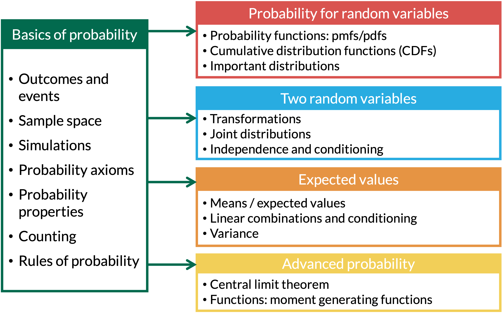

```{r setup, include=FALSE}
library(here)
source(here("class_dates.R"))

library(tidyverse)
```

# Learning Objectives

1. Define the expected value for discrete and continuous RVs

2. Calculate the expected value (mean) of a single discrete RV

3. Calculate the expected value (mean) of a single continuous RV

4. Calculate expected value for the sum of discrete or continuous RVs


## Where are we?

{fig-align="center"}

# Learning Objectives

::: lob
1. Define the expected value for discrete and continuous RVs
:::

2. Calculate the expected value (mean) of a single discrete RV

3. Calculate the expected value (mean) of a single continuous RV

4. Calculate expected value for the sum of discrete or continuous RVs


## What is an expected value?

::: columns
::: {.column width="50%"}
::: proof1
::: proof-title
Definition: Expected value of **discrete** RV
:::

::: proof-cont
The [**expected value**]{style="color:#E89543;"} of a [**discrete RV**]{style="color:#20c997;"} $X$ that takes on values $x_1, x_2, \ldots, x_n$ is $$\mathbb{E}[X] = \sum_{i=1}^n x_ip_X(x_i)$$ where $n$ can be $\infty$
:::
:::
:::


::: {.column width="50%"}
::: theorem
::: thm-title
Definition: Expected value of **continuous** RV
:::

::: thm-cont
The [**expected value**]{style="color:#E89543;"} of a [**continuous RV**]{style="color:#d9534f;"} $X$ is $$\mathbb{E}[X] = \displaystyle\int_{-\infty}^\infty xf_X(x) dx$$ where we adjust the integrand based on the bounds of $X$
:::
:::
:::

:::


## Our good and fair friend, the 6-sided die

::: example
::: ex-title
Example 1
:::

::: ex-cont
Suppose you roll a fair 6-sided die. What value do you expect to get?
:::
:::


Let $X$ be the value rolled. Since the die is fair, $p_X(x) = \frac{1}{6}$ for $x = 1, 2, \ldots, 6$.

$$
\begin{aligned}
\mathbb{E}[X] &= \sum_{i=1}^{6} x_i\,p_X(x_i) \\
&= 1\left(\tfrac{1}{6}\right) + 2\left(\tfrac{1}{6}\right) + 3\left(\tfrac{1}{6}\right) + 4\left(\tfrac{1}{6}\right) + 5\left(\tfrac{1}{6}\right) + 6\left(\tfrac{1}{6}\right) \\
&= \frac{1 + 2 + 3 + 4 + 5 + 6}{6} = \frac{21}{6} = 3.5
\end{aligned}
$$

-   3.5 is the long-run average: if we roll the die many, many times, the average of the rolls will be close to 3.5

# Learning Objectives

1. Define the expected value for discrete and continuous RVs

::: lob
2. Calculate the expected value (mean) of a single discrete RV
:::

3. Calculate the expected value (mean) of a single continuous RV

4. Calculate expected value for the sum of discrete or continuous RVs

## Our good and not-so-fair friend, the 6-sided die

::: columns
::: {.column width="30%"}
::: example
::: ex-title
Example 2
:::

::: ex-cont
Suppose the die is 6-sided, but not fair. And the probabilities of each side are distributed as:

| $x$ | $p_X(x)$ |
|-----|----------|
| 1   | 0.10     |
| 2   | 0.05     |
| 3   | 0.02     |
| 4   | 0.30     |
| 5   | 0.50     |
| 6   | 0.03     |

What value do you expect to get on a roll?
:::
:::
:::
:::

## Let's simulate our not-so-fair die

- Same idea as Lesson 2: simulate many rolls, then summarize
- `prob` gives the probability of each side, like the unfair coin in Lesson 1

```{r}
set.seed(1026) # <1>
reps <- 10000 # <2>
die_probs <- c(0.10, 0.05, 0.02, 0.30, 0.50, 0.03) # <3>

X_sims <- tibble(sim = 1:reps) |> # <4>
  mutate(X = sample(1:6, n(), replace = TRUE, # <5>
                    prob = die_probs)) # <5>
```

1. Set the seed so we get the same random rolls every time we run the code.
2. Save the number of simulations as `reps`, so it is easy to change later.
3. The probability of rolling 1, 2, 3, 4, 5, and 6, from the table in Example 2.
4. `tibble()` makes a table with one row per simulation, numbered 1 to 10,000. The pipe `|>` passes it to the next line.
5. `mutate()` adds a column `X` with one roll per row. `prob = die_probs` makes 5 come up half the time, 4 about 30% of the time, and so on.

::: columns
::: column

- Average of the 10,000 simulated rolls:

```{r}
X_sims |> # <6>
  summarise(average = mean(X)) # <6>
```

6. Collapse the 10,000 simulated values of `X` into one number: their average.

:::
::: column 

 

::: proof1
::: proof-cont
From Example 2, $\mathbb{E}[X] = 1(0.10) + 2(0.05) + 3(0.02) + 4(0.30) + 5(0.50) + 6(0.03) = 4.14$

The simulated average is very close!
:::
:::
:::
:::

## The running average settles at $\mathbb{E}[X]$

- The [**expected value**]{style="color:#E89543;"} is the long-run average: after many rolls, the average of the rolls gets close to 4.14 (dashed line)

```{r}
#| code-fold: true
#| code-summary: "Show/Hide Code for the running average plot"
#| fig-width: 10
#| fig-height: 5.5
#| fig-align: center

X_sims |> # <1>
  mutate(running_avg = cumsum(X) / sim) |> # <2>
  ggplot(aes(x = sim, y = running_avg)) + # <3>
  geom_line(color = "#006a4e", linewidth = 1) + # <4>
  geom_hline(yintercept = 4.14, linetype = "dashed") + # <5>
  labs(x = "Number of rolls", # <6>
       y = "Average so far") + # <6>
  theme_minimal(base_size = 26) # <7>
```

1. Start with the 10,000 simulated rolls.
2. `cumsum(X)` adds up the rolls so far (the running total). Dividing by `sim`, the number of rolls so far, gives the average so far.
3. Start a plot with the number of rolls on the x-axis and the average so far on the y-axis. Layers are added with `+`.
4. Connect the averages with a line.
5. Add a dashed horizontal line at the exact expected value, 4.14.
6. Add a title and axis labels.
7. Use a simple theme with larger text so the plot is readable on slides.

## Expected value of a Bernoulli distribution

::: columns
::: {.column width="50%"}
::: example
::: ex-title
Example 3
:::

::: ex-cont
Suppose $$X = \left\{
        \begin{array}{ll}
            1 & \quad \mathrm{with\ probability}\ p \quad\mathrm{(success)}\\
            0 & \quad \mathrm{with\ probability}\ 1-p \quad\mathrm{(failure)}
        \end{array}
    \right.$$ Find the expected value of $X$.
:::
:::
:::
:::

## Let's slightly change our random variable

::: columns
::: {.column width="40%"}
::: example
::: ex-title
Example 4
:::

::: ex-cont
Suppose $$X = \left\{
        \begin{array}{ll}
            1 & \quad \mathrm{with\ probability}\ p \\
            -1 & \quad \mathrm{with\ probability}\ 1-p 
        \end{array}
    \right.$$ Find the expected value of $X$.
:::
:::
:::
:::

## Bullseye! 🎯 {visibility="hidden"}

::: columns
::: {.column width="30%"}
::: example
::: ex-title
Example 5
:::

::: ex-cont
Suppose I throw darts at a dartboard until I hit the bullseye, and that my probability of hitting the bullseye is $p$. Suppose further that all of my throws are independent, and that the probability of a bullseye never changes, no matter how many times I throw a dart. How many times should I expect to have to throw the dart until I hit the bullseye?
:::
:::
:::
:::

## Ghost! 👻 {visibility="hidden"}

::: columns
::: {.column width="30%"}
::: example
::: ex-title
Example 6
:::

::: ex-cont
A ghost is trick-or-treating. It comes to a house where it is known that there are 30 candies in the bag and only one is a watermelon Jolly Rancher, which is the ghost's favorite. The ghost takes pieces of candy without replacement until it gets the watermelon Jolly Rancher. How many pieces of candy do we expect the ghost to take?
:::
:::
Can we model this with a distribution?
:::

:::

## Some remarks on last two examples {visibility="hidden"}

Both examples are repeated random processes. They are fundamentally different though:

-   The bullseye example is "*with replacement*" since the probability of success remains constant.

-   The ghost trick-or-treating example is *without replacement*, and thus the probability of success changes with each trial.

# Learning Objectives

1. Define the expected value for discrete and continuous RVs

2. Calculate the expected value (mean) of a single discrete RV

::: lob
3. Calculate the expected value (mean) of a single continuous RV
:::

4. Calculate expected value for the sum of discrete or continuous RVs

## Expected Value of the Uniform Distribution

::: columns
::: {.column width="30%"}
::: example
::: ex-title
Example 5
:::
::: ex-cont
Let $f_X(x)= \frac{1}{b-a}$, for $a \leq x \leq b$.
Find $\mathbb{E}[X]$.
:::
:::

```{r}
#| echo: false
#| fig-width: 7
#| fig-height: 5.5

# Uniform pdf on [a, b], drawn with a = 1, b = 3 so the height is 1/(b - a) = 0.5
ggplot() +
  geom_rect(aes(xmin = 1, xmax = 3, ymin = 0, ymax = 0.5), fill = "lightblue") +
  geom_segment(aes(x = 0.5, xend = 3.5, y = 0, yend = 0)) +
  scale_x_continuous(breaks = c(1, 3), labels = c("a", "b"), limits = c(0.5, 3.5)) +
  scale_y_continuous(breaks = c(0, 0.5), labels = c("0", "1/(b-a)"), limits = c(0, 0.65)) +
  labs(x = "x", y = expression(f[X](x))) +
  theme_minimal(base_size = 36)
```

:::
:::

## Expected Value of the Exponential Distribution

::: columns
::: {.column width="30%"}
::: example
::: ex-title
Example 6
:::
::: ex-cont
Let $f_X(x)= \lambda e^{-\lambda x}$, for $x > 0$ and
$\lambda> 0$. Find $\mathbb{E}[X]$.
:::
:::

::: theorem
::: thm-title
Integrating by Parts
:::
::: thm-cont
$\displaystyle\int_a^b u dv = uv\bigg|^b_a - \displaystyle\int_a^b vdu$
:::
:::

:::
:::

## Picking up our exponential simulation from Lesson 9

- In Lesson 9 (Example 4), we simulated $X$ with pdf $f_X(x) = 2e^{-2x}$: Example 6 with $\lambda = 2$
- Same code as Lesson 9, so we get the same 10,000 simulated values

```{r}
set.seed(2026) # <1>
reps <- 10000 # <1>
exp_sims <- tibble(u = runif(n = reps, min = 0, max = 1)) |> # <2>
  mutate(x = -log(1 - u) / 2) # <2>
```

1. Same seed and number of simulations as Lesson 9, so `exp_sims` matches the values we saw there.
2. Same as Lesson 9: simulate a uniform $U$ between 0 and 1, then plug it into the inverse CDF, $x = -\ln(1-u)/2$.

::: columns
::: column

- New step: the average of the 10,000 simulated values

```{r}
exp_sims |> # <3>
  summarise(average = mean(x)) # <3>
```

3. The only new code: collapse the simulated values of `x` into their average, just like the die rolls.

:::
::: column

 

::: proof1
::: proof-cont
From Example 6, $\mathbb{E}[X] = \frac{1}{\lambda} = \frac{1}{2}$

The simulated average is very close!
:::
:::
:::
:::


# Learning Objectives

1. Define the expected value for discrete and continuous RVs

2. Calculate the expected value (mean) of a single discrete RV

3. Calculate the expected value (mean) of a single continuous RV

::: lob
4. Calculate expected value for the sum of discrete or continuous RVs
:::

## Revisiting our two card draw

::: columns
::: {.column width="40%"}
::: example
::: ex-title
Example 7
:::

::: ex-cont
Suppose you draw 2 cards from a standard deck of cards *with* replacement. Let $X$ be the number of hearts you draw. Find $\mathbb{E}[X]$.
:::
:::

::: example
::: ex-cont
<font size=6ex>Recall Binomial RV with $n=2$:

$$p_X(x) = {2 \choose x}p^x(1-p)^{2-x} \text{  for } x = 0, 1, 2$$

</font>
:::
:::

:::
:::

## What if we draw A LOT of cards? {visibility="hidden"}

::: columns
::: {.column width="40%"}
::: example
::: ex-title
Example 8
:::

::: ex-cont
What is the expected number of hearts in Example 7 if you draw 200 cards?
:::
:::

::: example
::: ex-cont
<font size=6ex>Recall Binomial RV with $n=200$:

$$p_X(x) = {200 \choose x}p^x(1-p)^{200-x}$$
$$\text{  for } x = 0, 1, 2, ..., 200$$

</font>
:::
:::

:::
:::

## Sums of Random Variables

::: definition
::: def-title
Theorem: Sum of random variables
:::

::: def-cont
For RVs (discrete or continuous) $X_i$ and constants $a_i$, $i=1,2,\dots, n$, $$\mathbb{E}\Bigg[\sum_{i=1}^n a_iX_i\Bigg] = \sum_{i=1}^n a_i\mathbb{E}[X_i] .$$ **Remark:** The theorem holds for infinitely many RVs $X_i$ as well.
:::
:::

-   For two RVs, $X$ and $Y$:
    -   We can say $E[X+Y] = E[X] + E[Y]$
    -   ... and constant numbers $a$ and $b$, we can also say $E[aX+bY] = aE[X] + bE[Y]$
    -   We can also also say $E[X-Y] = E[X] - E[Y]$, since $b=-1$

## Corollaries from Theorem

::: columns
::: {.column width="50%"}
::: proposition
::: prop-title
Function with two constants
:::

::: prop-cont
For a RV $X$, and constants $a$ and $b$, $$\mathbb{E}[aX+b] = a\mathbb{E}[X] + b.$$
:::
:::
:::

::: {.column width="50%"}
::: proposition
::: prop-title
Expected value of sum of identically distributed RVs
:::

::: prop-cont
If $X_i$, $i=1,2,\dots, n$, are identically distributed RV's, then $$\mathbb{E}\bigg[\sum_{i=1}^n X_i\bigg] = n\mathbb{E}[X_1] .$$
:::
:::
:::
:::

## Cost of hotel rooms

::: columns
::: {.column width="40%"}
::: example
::: ex-title
Example 8
:::

::: ex-cont
A tour group is planning a visit to the city of Minneapolis and needs to book 30 hotel rooms. The average price of a room is \$200. In addition, there is a 10% tourism tax for each room. What is the expected cost for the 30 hotel rooms?
:::
:::
:::
:::

## Let's simulate the cost of hotel rooms

- Assume each room is equally likely to cost \$180, \$200, or \$220, so the average price is \$200

::: columns
::: {.column width="60%"}

```{r}
reps <- 10000 # <1>
n_rooms <- 30 # <1>
room_prices <- c(180, 200, 220) # <2>

rooms <- expand_grid(sim = 1:reps, room = 1:n_rooms) |> # <3>
  mutate(price = sample(room_prices, n(), replace = TRUE), # <4>
         cost = 1.1 * price) # <5>

cost_sims <- rooms |> # <6>
  group_by(sim) |> # <6>
  summarise(total_cost = sum(cost)) # <6>
```

1. Save the settings: 10,000 simulations of booking 30 rooms.
2. The possible room prices. Their average is \$200.
3. Same as the dice in Lesson 2: one row for every room in every simulation.
4. Give each room a random price from `room_prices`.
5. Add the 10% tax: each room costs 1.1 times its price.
6. Add up the 30 room costs in each simulation to get the total cost.

:::
::: {.column width="40%"}

- Average total cost over the 10,000 simulations:

```{r}
cost_sims |> # <7>
  summarise(average = mean(total_cost)) # <7>
```

7. Collapse the 10,000 simulated total costs into their average.

 

::: proof1
::: proof-cont
From Example 8, $\mathbb{E}\left[\sum_{i=1}^{30} 1.1X_i\right] = 30(1.1)(200) = \$6600$
:::
:::

- Any room prices with an average of \$200 give the same expected total. Try changing `room_prices`!

:::
:::

# Learning Objectives

1. Define the expected value for discrete and continuous RVs

2. Calculate the expected value (mean) of a single discrete RV

3. Calculate the expected value (mean) of a single continuous RV

4. Calculate expected value for the sum of discrete or continuous RVs

