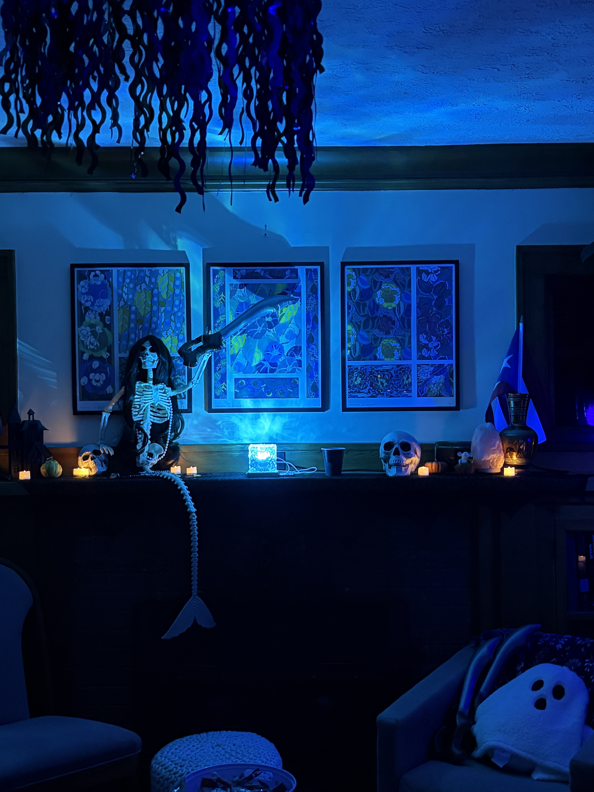

```{r setup, include=FALSE}
library(here)
source(here("class_dates.R"))
```

## Announcements

{fig-align="center" width="1000"}

- Quiz 2 opens on Wednesday

## Key Dates

- Checkpoint 1 resubmission due 11/4! (on Brightspace)
- Homework 4 due `r hw4 %>% format("%m/%d")` at 11pm
- Quiz 2 opens on `r q2_open %>% format("%m/%d")` at 3pm
  - Closes `r q2_close %>% format("%m/%d")` at 11pm
