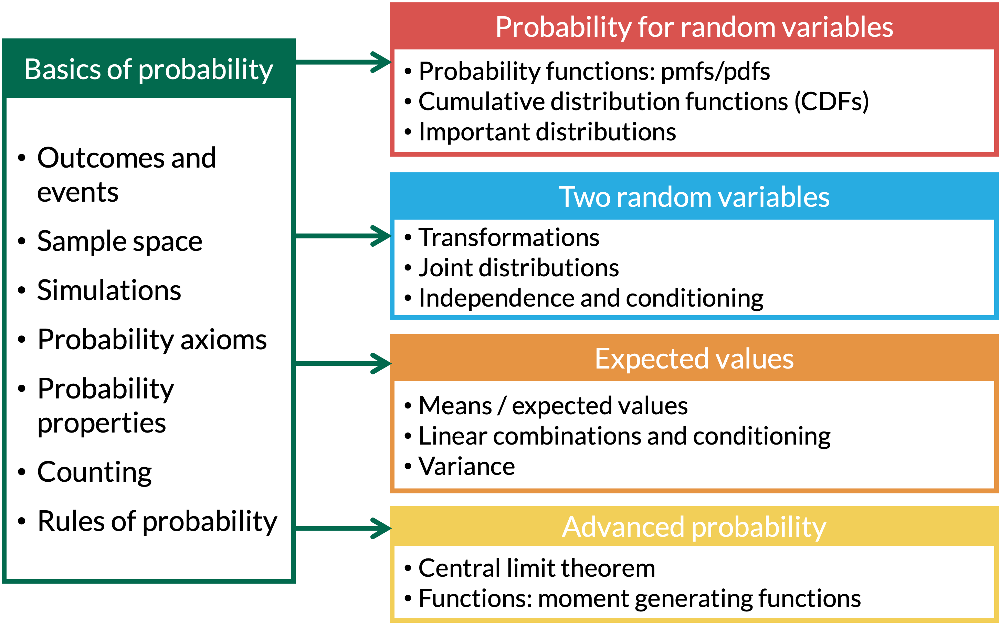

```{r setup, include=FALSE}
library(here)
source(here("class_dates.R"))

library(tidyverse)
```

# Learning Objectives

1.  Distinguish between Bernoulli, Binomial, Geometric, Hypergeometric,
    Discrete Uniform, Negative Binomial, and Poisson distributions when
    reading a word problem.
2.  Identify the variable and the parameters in a word problem, and
    state what the variable and parameters mean.
3.  Use the formulas for the pmf/CDF, expected value, and variance to
    answer questions and find probabilities.

## Where are we?

{fig-align="center"}

# Bernoulli RVs

## Properties of Bernoulli RVs

-   **Scenario:** One trial, with outcome success or failure
-   Shorthand: $X \sim \text{Bernoulli}(p)$

$$
X = \left\{
        \begin{array}{ll}
            1 & \quad \mathrm{with\ probability}\ p \quad \\
            0 & \quad \mathrm{with\ probability}\ 1-p \quad
        \end{array}
    \right.
$$

$$
p_X(x) = P(X=x) = p^x(1-p)^{1-x} \text{ for } x=0,1
$$

$$\text{E}(X) = p$$

$$\text{Var}(X) = pq = p(1-p) \quad \text{ where } q = 1-p$$

## Bernoulli RVs we've already seen

-   We've seen a few examples of Bernoulli distributions:

    -   **Lesson 1:** Toss one coin. Success is heads, so $p = \frac{1}{2}$

    -   **Lesson 7, Example 1 (falls in older adults):** Whether one
        older adult has at least one fall in a year, $p = 0.25$

    -   **Lesson 10, Example 3:** The general Bernoulli RV, where we
        found $\text{E}(X) = p$

    -   **Lesson 11, Example 2 (card example):** Draw one card, and
        $X = 1$ if it is a heart, $p = \frac{1}{4}$

    -   **Lesson 11, Example 5 (ghost problem):** The ghost grabs one
        candy, and $Y = 1$ if it is a chocolate, $p = \frac{10}{60} = \frac{1}{6}$

# Binomial RVs {#chapter-15-binomial-RVs .unnumbered}

## Properties of Binomial RVs

-   **Scenario:** There are $n$ independent trials, each resulting in a
    success or failure, with constant probability, $p$, in each trial.
    We are counting the number of successes (or failures).

-   Shorthand: $X \sim \text{Binomial}(n, p)$

-   A [**binomial random variable**]{style="color:#20c997;"} is the
    **sum of** $n$ **independent Bernoulli RVs**

$$
X = \text{Number of successes of } n \text{ independent trials}
$$

$$
p_X(x) = P(X=x) = {n \choose x}p^x(1-p)^{n-x} \text{ for } x=0,1,2,  ..., n
$$

$$\text{E}(X) = np$$ $$\text{Var}(X) = npq = np(1-p)$$

## Ghost problem revisited

::::::: columns
:::::: {.column width="35%"}
::::: example
::: ex-title
Example 1
:::

::: ex-cont
Recall the ghost problem from Lesson 11 (Example 5). The bag of candy
has 10 chocolates, 20 lollipops, and 30 laffy taffies. The ghost grabs a
handful of five pieces of candy ***with*** replacement.

-   Let $Y$ be the number of chocolates the ghost takes.

-   What is the distribution of $Y$?

-   Find the mean and variance of $Y$.
:::
:::::
::::::
:::::::

## Binomial distribution: R commands

Recap from Lesson 7. R commands with their [input]{style="color:#BF396F"} and [output]{style="color:#367B79"}:

| R code | What does it return? | What do we use it for? |
|--------------|-------------------------------|---------------------------|
| `rbinom()` | returns [sample of random variables]{style="color:#367B79"} with [specified binomial distribution]{style="color:#BF396F"} | Simulate a Binomial RV |
| `dbinom()` | returns [probability]{style="color:#367B79"} of getting [certain number of successes]{style="color:#BF396F"} | $P(X = x)$ |
| `pbinom()` | returns [cumulative probability]{style="color:#367B79"} of getting [certain number or less]{style="color:#BF396F"} successes | $P(X \leq x)$ (or $P(X > x)$ if we add `lower.tail = FALSE`) |
| `qbinom()` | returns [number of successes]{style="color:#367B79"} corresponding to [desired quantile]{style="color:#BF396F"} | Goes the other direction: we give it a probability $p$ and it returns the value $k$ where $P(X \leq k) = p$ |

-   A Bernoulli RV is a binomial RV with $n = 1$, so we use the same
    commands with `size = 1`

```{r}
dbinom(1, size = 1, prob = 10/60) # <1>
```

1.  The ghost grabs one candy, and a chocolate is a success:
    $P(X = 1)$ with $p = \frac{10}{60}$. `size = 1` means one trial.

## Ghost problem revisited: simulate it

:::::::: columns
:::::: {.column width="54%"}
::::: example
::: ex-title
Example 1
:::

::: ex-cont
Simulate $Y$, the number of chocolates in 5 pieces, 10,000 times. Do
the mean and variance match $np = \frac{5}{6} \approx 0.833$ and
$np(1-p) = \frac{25}{36} \approx 0.694$?
:::
:::::

```{r}
set.seed(1104) # <1>
reps <- 10000 # <2>
n_candy <- 5 # <3>
p <- 10 / 60 # <3>

ghost_sims <- tibble(sim = 1:reps) |> # <4>
  mutate(
    Y = rbinom(n(), size = n_candy, prob = p) # <5>
    ) 
```

1.  Set the seed once, so we all get the same random numbers.
2.  The number of simulations.
3.  The two parameters: $n = 5$ pieces of candy, and $p = \frac{10}{60}$
    chance that each piece is a chocolate.
4.  `tibble()` makes a table with one row per simulation, like the
    not-so-fair die in Lesson 10.
5.  `rbinom()` draws one value of $Y$ for every row. `n()` is the number
    of rows, `size` is $n$, and `prob` is $p$. No need to draw each
    candy: `rbinom()` gives the number of chocolates directly!
::::::

::: {.column width="1%"}
:::

::: {.column width="45%"}
```{r}
ghost_sims |> # <1>
  summarise( # <1>
    average  = mean(Y), # <2>
    variance = mean((Y - mean(Y))^2), # <3>
    prob_1   = mean(Y == 1) # <4>
  )
```

1.  One row of summaries for the 10,000 simulated values of $Y$.
2.  Estimates $\text{E}(Y) = np$.
3.  Estimates $\text{Var}(Y) = np(1-p)$ (same formula as Lesson 11).
4.  The proportion of simulations with exactly 1 chocolate, which
    estimates $P(Y = 1)$.

 

::: fact
::: fact-title
Connecting to Lesson 11
:::

::: fact-cont
In Lesson 11 we found the variance by adding up 5 Bernoulli variances.
Now the binomial formula does it in one step!
:::
:::
:::
::::::::

# Geometric RVs {#chapter-16-geometric-RVs .unnumbered}

## Geometric RVs

-   **Scenario:** There are repeated independent trials, each resulting
    in a success or failure, with constant probability of success for
    each trial. We are counting the number of trials until the first
    success.

    -   For example, toss a coin until we get heads: H, or TH, or TTH,
        or TTTH, ...

-   Shorthand: $X \sim \text{Geo}(p)$ or $X \sim \text{Geometric}(p)$ or
    $X \sim \text{G}(p)$

::::: columns
::: {.column width="50%"}
**$X =$ Number of trials needed for first success** (count $x$
*includes* the success)

$$p_X(x) = P(X=x) = (1-p)^{x-1}p \quad \text{for } x=1,2,3,\ldots$$

$$F_X(x) = P(X\leq x) = 1-(1-p)^x \quad \text{for } x=1,2,3,\ldots$$

$$E(X)=\dfrac{1}{p} \qquad Var(X)= \dfrac{1-p}{p^2}$$
:::

::: {.column width="50%"}
**$X =$ Number of failures before first success** (count $x$ *does not
include* the success)

$$p_X(x) = P(X=x) = (1-p)^{x}p \quad \text{for } x=0,1,2,\ldots$$

$$F_X(x) = P(X\leq x) = 1-(1-p)^{x+1} \quad \text{for } x=0,1,2,\ldots$$

$$E(X)=\dfrac{1-p}{p} \qquad Var(X) = \dfrac{1-p}{p^2}$$
:::
:::::

## Bullseye (1/4)

::::::: columns
:::::: {.column width="100%"}
::::: example
::: ex-title
Example 2
:::

::: ex-cont
We throw darts at a dartboard until we hit the bullseye. Assume throws
are independent and the probability of hitting the bullseye is 0.01 for
each throw.

1.  What is the pmf for the number of throws needed to hit the bullseye?

2.  What are the mean and variance for the number of throws needed to
    hit the bullseye?

3.  Find the probability that our first bullseye:

    -   is on one of the first fifty tries

    -   is after the $50^{th}$ try, given that it did not happen on the
        first 20 tries
:::
:::::
::::::
:::::::

## Bullseye (2/4)

::::::: columns
:::::: {.column width="35%"}
::::: example
::: ex-title
Example 2
:::

::: ex-cont
We throw darts at a dartboard until we hit the bullseye. Assume throws
are independent and the probability of hitting the bullseye is 0.01 for
each throw.

1.  What is the pmf for the number of throws needed to hit the bullseye?
:::
:::::
::::::
:::::::

## Bullseye (3/4)

::::::: columns
:::::: {.column width="35%"}
::::: example
::: ex-title
Example 2
:::

::: ex-cont
We throw darts at a dartboard until we hit the bullseye. Assume throws
are independent and the probability of hitting the bullseye is 0.01 for
each throw.

2.  What are the mean and variance for the number of throws needed to
    hit the bullseye?
:::
:::::
::::::
:::::::

## Bullseye (4/4)

::::::: columns
:::::: {.column width="35%"}
::::: example
::: ex-title
Example 2
:::

::: ex-cont
We throw darts at a dartboard until we hit the bullseye. Assume throws
are independent and the probability of hitting the bullseye is 0.01 for
each throw.

3.  Find the probability that our first bullseye:

    -   is on one of the first fifty tries

    -   is after the $50^{th}$ try, given that it did not happen on the
        first 20 tries
:::
:::::
::::::
:::::::

## Memoryless property for Geometric RVs

If we know $X$ is greater than some number (aka given $X >j$), then the
probability of $X > k+j$ is just the probability that $X>k$. 

 

This is the
[**memoryless**]{style="color:#29abe0;"} property.

 

$P(X > k+j |X > j) = P(X > k)$

$$ P(X > k+j |X > j) = \dfrac{P(X>k+j \text{ and } X>j)}{P(X>j)} = \dfrac{P(X>k+j)}{P(X>j)} = \dfrac{(1-p)^{k+j}}{(1-p)^{j}} = (1-p)^{k} $$

## Geometric distribution: R commands

R commands with their [input]{style="color:#BF396F"} and [output]{style="color:#367B79"}:

| R code | What does it return? | What do we use it for? |
|--------------|-------------------------------|---------------------------|
| `rgeom()` | returns [sample of random variables]{style="color:#367B79"} with [specified geometric distribution]{style="color:#BF396F"} | Simulate a Geometric RV |
| `dgeom()` | returns [probability]{style="color:#367B79"} of getting [certain number of failures]{style="color:#BF396F"} before the first success | $P(X = x)$ |
| `pgeom()` | returns [cumulative probability]{style="color:#367B79"} of getting [certain number of failures or less]{style="color:#BF396F"} | $P(X \leq x)$ (or $P(X > x)$ if we add `lower.tail = FALSE`) |
| `qgeom()` | returns [number of failures]{style="color:#367B79"} corresponding to [desired quantile]{style="color:#BF396F"} | Goes the other direction: we give it a probability and it returns the value $k$ where $P(X \leq k)$ reaches it |

-   **Careful:** R counts the **failures** before the first success
    (the right column of our table). If $X$ counts the **trials**, use
    $x - 1$:

```{r}
pgeom(50 - 1, prob = 0.01) # <1>
```

1.  Bullseye: $P(X \leq 50)$ where $X$ is the number of throws. 50
    throws means at most 49 misses before the first bullseye.

## Let's simulate the bullseye example (1/2)

:::::::: columns
:::::: {.column width="62%"}
-   `rgeom()` simulates a geometric RV directly, so we don't need to
    act out every throw

```{r}
p <- 0.01 # <1>

bullseye_sims <- tibble(sim = 1:reps) |> # <2>
  mutate(
    misses = rgeom(n(), prob = p), # <3>
    X = misses + 1 # <4>
  )
```

1.  The probability of a bullseye on each throw.
2.  One row per simulation, like the ghost example. `reps` is still
    10,000.
3.  `rgeom()` draws one value for every row. `n()` is the number of rows
    and `prob` is $p$. **Careful:** R counts the **misses** (failures)
    before the first bullseye.
4.  Add 1 for the throw that hit the bullseye, so `X` is the number of
    throws, our $X$.
::::::

::: {.column width="38%"}
-   The first few simulated values:

```{r}
bullseye_sims # <1>
```

1.  Each row is one simulation. `misses` is R's count of failures, and
    `X` is the throw number of the first bullseye.
:::
::::::::

## Let's simulate the bullseye example (2/2)

:::::::: columns
:::::: {.column width="55%"}
```{r}
bullseye_sims |> # <1>
  summarise( # <1>
    average       = mean(X), # <2>
    variance      = mean((X - mean(X))^2), # <2>
    prob_first_50 = mean(X <= 50) # <3>
  )
```

1.  One row of summaries for the 10,000 simulated values of $X$.
2.  Compare with $E(X) = \frac{1}{0.01} = 100$ and
    $Var(X) = \frac{0.99}{0.01^2} = 9900$.
3.  The proportion of simulations where the first bullseye was on one of
    the first 50 throws, which estimates $P(X \leq 50)$.

 

-   By hand: $P(X \leq 50) = 1 - 0.99^{50} \approx 0.395$
::::::

::: {.column width="45%"}
-   Check the [**memoryless**]{style="color:#29abe0;"} property

```{r}
bullseye_sims |> # <1>
  filter(X > 20) |> # <1>
  summarise(prob_after_50 = mean(X > 50)) # <2>

bullseye_sims |> # <3>
  summarise(prob_after_30 = mean(X > 30)) # <3>
```

1.  Keep only the simulations where the first 20 throws were all misses
    ($X > 20$).
2.  Among those, the proportion with $X > 50$ estimates
    $P(X > 50 | X > 20)$.
3.  Using all simulations, the proportion with $X > 30$ estimates
    $P(X > 30)$.

-   Both are close to $0.99^{30} \approx 0.740$
:::
::::::::

# Negative Binomial RVs

## Properties of Negative Binomial RVs

-   **Scenario:** There are repeated independent trials, each resulting
    in a success or failure, with constant probability of success for
    each trial. We are counting the number of trials until the $r^{th}$
    success.
-   Shorthand: $X \sim \text{NegBin}(p, r)$ or $X \sim \text{NB}(p, r)$
-   Negative binomial is sum of $r$ geometric distributions

$$
X = \text{Number of independent trials until } r^{th} \text{ success}
$$

$$ p_X(x) = P(X=x) = {x-1 \choose r-1}(1-p)^{x-r}p^r \text{ for } x = r, r+1, r+2, ...$$

$$ E(X) = \dfrac{r}{p} \qquad Var(X) = \dfrac{rq}{p^2} = \dfrac{r(1-p)}{p^2}$$

## Hitting more than 1 bullseye

::::::: columns
:::::: {.column width="35%"}
::::: example
::: ex-title
Example 3
:::

::: ex-cont
Consider again the bullseye example, where we throw darts at a dartboard
until we hit the bullseye. Assume throws are independent and the
probability of hitting the bullseye is 0.01 for each throw.

1.  What is the expected value and variance of the number of throws
    needed to hit 5 bullseyes?
:::
:::::
::::::
:::::::

## Hitting more than 1 bullseye

::::::: columns
:::::: {.column width="35%"}
::::: example
::: ex-title
Example 3
:::

::: ex-cont
Consider again the bullseye example, where we throw darts at a dartboard
until we hit the bullseye. Assume throws are independent and the
probability of hitting the bullseye is 0.01 for each throw.

2.  What is the probability that the $5^{th}$ bullseye is on the
    $20^{th}$ throw?
:::
:::::
::::::
:::::::

## Negative binomial distribution: R commands

R commands with their [input]{style="color:#BF396F"} and [output]{style="color:#367B79"}:

| R code | What does it return? | What do we use it for? |
|--------------|-------------------------------|---------------------------|
| `rnbinom()` | returns [sample of random variables]{style="color:#367B79"} with [specified negative binomial distribution]{style="color:#BF396F"} | Simulate a Negative Binomial RV |
| `dnbinom()` | returns [probability]{style="color:#367B79"} of getting [certain number of failures]{style="color:#BF396F"} before the $r^{th}$ success | $P(X = x)$ |
| `pnbinom()` | returns [cumulative probability]{style="color:#367B79"} of getting [certain number of failures or less]{style="color:#BF396F"} | $P(X \leq x)$ (or $P(X > x)$ if we add `lower.tail = FALSE`) |
| `qnbinom()` | returns [number of failures]{style="color:#367B79"} corresponding to [desired quantile]{style="color:#BF396F"} | Goes the other direction: we give it a probability and it returns the value $k$ where $P(X \leq k)$ reaches it |

-   **Careful:** like the geometric, R counts the **failures**. If $X$
    counts the **trials**, use $x - r$. `size` is $r$, the number of
    successes.

```{r}
dnbinom(20 - 5, size = 5, prob = 0.01) # <1>
```

1.  $P(X = 20)$: the $5^{th}$ bullseye on the $20^{th}$ throw means 15
    misses and 5 bullseyes.

## Hitting more than 1 bullseye: simulate it

:::::::: columns
:::::: {.column width="55%"}
::::: example
::: ex-title
Example 3
:::

::: ex-cont
Simulate $X$, the number of throws needed to hit 5 bullseyes, 10,000
times. Do the mean and variance match $\frac{r}{p} = 500$ and
$\frac{r(1-p)}{p^2} = 49500$?
:::
:::::

```{r}
r <- 5 # <1>

bullseye5_sims <- tibble(sim = 1:reps) |> # <2>
  mutate(
    misses = rnbinom(n(), size = r, prob = p), # <3>
    X = misses + r # <4>
  )
```

1.  The number of bullseyes we need, $r = 5$. `p` is still 0.01 from
    the first bullseye simulation.
2.  One row per simulation, like the other examples.
3.  `rnbinom()` draws one value for every row. `size` is $r$ and `prob`
    is $p$. **Careful:** like `rgeom()`, R counts the **misses** before
    the $5^{th}$ bullseye.
4.  Add the 5 throws that hit, so `X` is the number of throws.
::::::

::: {.column width="1%"}
:::

::: {.column width="44%"}
```{r}
bullseye5_sims |> # <1>
  summarise( # <1>
    average  = mean(X), # <2>
    variance = mean((X - mean(X))^2), # <2>
    prob_20  = mean(X == 20) # <3>
  )
```

1.  One row of summaries for the 10,000 simulated values of $X$.
2.  Estimates of $E(X)$ and $Var(X)$.
3.  The proportion of simulations where the $5^{th}$ bullseye was on the
    $20^{th}$ throw, which estimates $P(X = 20)$.

 

-   `prob_20` is 0! $P(X = 20) \approx 0.00000033$ is so small that
    10,000 simulations never see it. For very rare events, use
    `dnbinom()` instead.
:::
::::::::

# 5 minute break

# Poisson RVs

## Properties of Poisson RVs

-   **Scenario:** We are counting the number of successes in a
    [**fixed time period (or fixed space)**]{style="color:#006a4e;"},
    which has a constant [**rate**]{style="color:#006a4e;"}
    ($\lambda$) of successes
-   Shorthand: $X \sim \text{Poisson}(\lambda)$ or
    $X \sim \text{Pois}(\lambda)$

$$
X = \text{Number of successes in a given period (or given space)}
$$

$$ p_X(x) = P(X=x) = \dfrac{e^{-\lambda}\lambda^x}{x!} \text{ for } x = 0, 1, 2,3, ...$$

$$ \text{E}(X) = \lambda$$

$$\text{Var}(X) = \lambda$$

## Distinguishing between Binomial and Poisson RVs

::::::: columns
:::::: {.column width="48%"}
::::: theorem
::: thm-title
Binomial: $X\sim \text{Binomial}(n,p)$
:::

::: thm-cont
-   $X$ models the number of successes ...

-   in $n$ independent (Bernoulli) trials ...

-   that each have the same **probability** of success, $p$
:::
:::::
::::::

:::::: {.column width="4%"}
::::::

:::::: {.column width="48%"}
::::: definition
::: def-title
Poisson: $X\sim \text{Poisson}(\lambda)$
:::

::: def-cont
-   $X$ models the number of successes ...

-   in a **fixed time period** (or space), instead of $n$ discrete
    independent trials ...

-   that happen at a constant [**rate**]{style="color:#006a4e;"},
    $\lambda$, instead of a probability
:::
:::::
::::::
:::::::

## Examples of Poisson RVs

-   Number of visitors to an emergency room in an hour during a weekend
    night

-   Number of study participants enrolled in a study per week

-   Number of pedestrians walking through a square mile

-   Number of babies born with a cleft palate within 1 year (rare
    events)

-   Any more?

## Emergency Room Visitors

::::::: columns
:::::: {.column width="35%"}
::::: example
::: ex-title
Example 4
:::

::: ex-cont
Suppose an emergency room has an average of 50 visitors per day. Find
the following probabilities.

1.  Probability of 30 visitors in a day.

2.  Probability of 8 visitors in an hour.
:::
:::::
::::::
:::::::

## Poisson distribution: R commands

R commands with their [input]{style="color:#BF396F"} and [output]{style="color:#367B79"}:

| R code | What does it return? | What do we use it for? |
|--------------|-------------------------------|---------------------------|
| `rpois()` | returns [sample of random variables]{style="color:#367B79"} with [specified Poisson distribution]{style="color:#BF396F"} | Simulate a Poisson RV |
| `dpois()` | returns [probability]{style="color:#367B79"} of getting [certain number of successes]{style="color:#BF396F"} in the time period | $P(X = x)$ |
| `ppois()` | returns [cumulative probability]{style="color:#367B79"} of getting [certain number or less]{style="color:#BF396F"} successes | $P(X \leq x)$ (or $P(X > x)$ if we add `lower.tail = FALSE`) |
| `qpois()` | returns [number of successes]{style="color:#367B79"} corresponding to [desired quantile]{style="color:#BF396F"} | Goes the other direction: we give it a probability and it returns the value $k$ where $P(X \leq k)$ reaches it |

-   The only parameter is the rate, `lambda` $= \lambda$. Make sure it
    matches the time period in the question!

## Emergency Room Visitors: in R

:::::::: columns
:::::: {.column width="55%"}
::::: example
::: ex-title
Example 4
:::

::: ex-cont
Suppose an emergency room has an average of 50 visitors per day.

1.  Probability of 30 visitors in a day.
2.  Probability of 8 visitors in an hour.
:::
:::::

- Probability of 30 visitors in a day.

```{r}
dpois(30, lambda = 50) # <1>
```

1.  `dpois()` gives $P(X = x)$ for a Poisson RV, like `dbinom()` did for
    the binomial. Here $x = 30$ and $\lambda = 50$ visitors per day.

- Probability of 8 visitors in an hour.

```{r}
lambda_hour <- 50 / 24 # <2>
dpois(8, lambda = lambda_hour) # <3>
```


2.  Change the rate to match the time period: 50 visitors per day is
    $\frac{50}{24} \approx 2.083$ visitors per hour.
3.  $P(X = 8)$ when $X$ counts visitors in one hour.
::::::

::: {.column width="45%"}
::::: fact
::: fact-title
Change $\lambda$, not $X$
:::

::: fact-cont
When the time period changes, change the **rate** $\lambda$ to match it.

-   Right way: $\lambda = \frac{50}{24}$ visitors per hour, and find
    $P(X = 8)$
-   Wrong way: keep $\lambda = 50$ per day and find
    $P(X = 8 \cdot 24) = P(X = 192)$
:::
:::::
:::
::::::::

## Combining independent Poisson distributions

::::: theorem
::: thm-title
Theorem 1
:::

::: thm-cont
If $X\sim Pois(\lambda_1)$ and $Y\sim Pois(\lambda_2)$ are independent
of each other, then $$Z=X+Y\sim Pois(\lambda_1 + \lambda_2)$$
:::
:::::

## Two emergency rooms

::::::: columns
:::::: {.column width="35%"}
::::: example
::: ex-title
Example 5
:::

::: ex-cont
Suppose emergency room 1 has an average of 50 visitors per day, and
emergency room 2 has an average of 70 visitors per day, independently of
each other. What is the probability distribution that models the total
number of visitors to both?
:::
:::::
::::::
:::::::

## Two emergency rooms: simulate it

:::::::: columns
:::::: {.column width="52%"}
::::: example
::: ex-title
Example 5
:::

::: ex-cont
Simulate one day of visitors at each emergency room 10,000 times. Does
the total, $Z = X + Y$, have the mean and variance of a
$\text{Pois}(120)$?
:::
:::::

```{r}
er_sims <- tibble(sim = 1:reps) |> # <1>
  mutate(
    X = rpois(n(), lambda = 50), # <2>
    Y = rpois(n(), lambda = 70), # <3>
    Z = X + Y # <4>
  )
```

1.  One row per simulated day.
2.  `rpois()` draws the number of visitors to emergency room 1 for
    every row. `n()` is the number of rows and `lambda` is the rate,
    $\lambda_1 = 50$ visitors per day.
3.  The same for emergency room 2, with $\lambda_2 = 70$. The two rooms
    are drawn separately, so they are independent.
4.  The total number of visitors to both rooms.
::::::

::: {.column width="2%"}
:::

::: {.column width="46%"}
```{r}
er_sims |> # <1>
  summarise( # <1>
    average  = mean(Z), # <2>
    variance = mean((Z - mean(Z))^2) # <3>
  )
```

1.  One row of summaries for the 10,000 simulated totals.
2.  Estimates $\text{E}(Z) = \lambda_1 + \lambda_2 = 120$.
3.  Estimates $\text{Var}(Z)$, which is also 120 for a Poisson.

 

-   For a Poisson RV, the mean and the variance are both $\lambda$
-   Both are close to 120, just like Theorem 1 says!
:::
::::::::

## Poisson Approximation of the Binomial

Both Poisson and Binomial RVs are counting the number of successes

-   If for a Binomial RV

    -   the number of trials $n$ is very large, and

    -   the probability of success $p$ is small (close to 0),

-   Then the Poisson distribution can be used to approximate Binomial
    probabilities

    -   and we use $\lambda = np$

    -   If $p$ is close to 1, count the failures instead, with
        $\lambda = n(1-p)$

-   **Rule of thumb:** We can use the Poisson approximation when
    $n \geq 20$ and $p \leq 0.05$, or when $n \geq 100$ and $np \leq 10$

## Medical lab errors

:::::::: columns
:::::: {.column width="35%"}
::::: example
::: ex-title
Example 6
:::

::: ex-cont
Suppose that in the long run, errors in a medical testing lab are made
0.1% of the time. Find the probability that fewer than 4 mistakes are
made in the next 2,000 tests.

1.  Find the probability using the Binomial distribution.

2.  Approximate the probability in part (1) using the Poisson
    distribution.
:::
:::::
::::::

::: {.column width="60%"}
To do for extra practice - will also see a similar problem in BSTA 511

-   *Hint:* `pbinom()` and `ppois()` give $P(X \leq x)$
:::
::::::::

# Hypergeometric RVs {#chapter-19-hypergeometric-RVs .unnumbered}

## Hypergeometric RVs

-   **Scenario:** There are a fixed number of successes and failures
    (which are known in advance), from which we make $n$ draws
    [**without replacement**]{style="color:#E25D3B;"}. We are counting
    the number of successes from the $n$ trials.
    -   There is a finite population of $N$ items
    -   Each item in the population is either a success or a failure,
        and there are $M$ successes total (and $N-M$ failures).
    -   We randomly select (sample) $n$ items from the population
        without replacement
-   Shorthand: $X \sim \text{Hypergeo}(M, N, n)$

::::: columns
::: column
$$
X = \text{Number of successes in } n \text{ draws}
$$

$$
p_X(x) = P(X=x) = \dfrac{{M \choose x}{N-M \choose n-x}}{{N \choose n}}
$$
$$\text{ for } x \text{ integer-valued } \\ \max(0, n-(N-M)) \leq x \leq \min(n, M)$$
:::

::: column
$$\text{E}(X) =\dfrac{nM}{N}$$

$$\text{Var}(X) = n \dfrac{M}{N} \bigg(1- \dfrac{M}{N} \bigg)\bigg(\dfrac{N-n}{N-1} \bigg)$$
:::
:::::

## Wolf population

::::::: columns
:::::: {.column width="35%"}
::::: example
::: ex-title
Example 7
:::

::: ex-cont
A wildlife biologist is using mark-recapture to research a wolf
population. Suppose a specific study region is known to have 24 wolves,
of which 11 have already been tagged. If 5 wolves are randomly captured,
what is the probability that 3 of them have already been tagged?
:::
:::::
::::::
:::::::

## Hypergeometric distribution: R commands

R commands with their [input]{style="color:#BF396F"} and [output]{style="color:#367B79"}:

| R code | What does it return? | What do we use it for? |
|--------------|-------------------------------|---------------------------|
| `rhyper()` | returns [sample of random variables]{style="color:#367B79"} with [specified hypergeometric distribution]{style="color:#BF396F"} | Simulate a Hypergeometric RV |
| `dhyper()` | returns [probability]{style="color:#367B79"} of getting [certain number of successes]{style="color:#BF396F"} in $n$ draws | $P(X = x)$ |
| `phyper()` | returns [cumulative probability]{style="color:#367B79"} of getting [certain number or less]{style="color:#BF396F"} successes | $P(X \leq x)$ (or $P(X > x)$ if we add `lower.tail = FALSE`) |
| `qhyper()` | returns [number of successes]{style="color:#367B79"} corresponding to [desired quantile]{style="color:#BF396F"} | Goes the other direction: we give it a probability and it returns the value $k$ where $P(X \leq k)$ reaches it |

-   **Careful:** R uses different letters than we do. In R, `m` $= M$
    (successes), `n` $= N - M$ (**failures**), and `k` $= n$ (draws):
    `dhyper(x, m = M, n = N - M, k = n)`

## Wolf population: simulate it

:::::::: columns
:::::: {.column width="45%"}
-   `rhyper()` captures 5 of the 24 wolves
    [**without replacement**]{style="color:#E25D3B;"} for us

```{r}
M <- 11 # <1>
N <- 24 # <1>
n_captured <- 5 # <1>

wolf_sims <- tibble(sim = 1:reps) |> # <2>
  mutate(
    X = rhyper(
      n(), 
      m = M, 
      n = N - M, 
      k = n_captured
      ) # <3>
  )
```

1.  The parameters: $M = 11$ tagged wolves, $N = 24$ wolves in total,
    and $n = 5$ wolves captured.
2.  One row per simulation, like the ghost and bullseye examples.
3.  `rhyper()` draws the number of tagged wolves for every row. The
    first input is how many values to draw (`n()`, the number of rows).
    **Careful:** in R, `m` is the number of successes ($M$), `n` is the
    number of **failures** ($N - M$), and `k` is the number of draws.
::::::

::: {.column width="2%"}

:::

::: {.column width="53%"}
```{r}
wolf_sims |> # <1>
  summarise( # <1>
    average = mean(X), # <2>
    prob_3  = mean(X == 3) # <3>
  )
```

1.  One row of summaries for the 10,000 simulated values of $X$.
2.  Compare with $E(X) = \frac{5 \cdot 11}{24} \approx 2.29$.
3.  The proportion of simulations with exactly 3 tagged wolves, which
    estimates $P(X = 3)$.

-   The exact answer, two ways:

```{r}
choose(11, 3) * choose(13, 2) / choose(24, 5) # <1>
dhyper(3, m = 11, n = 13, k = 5) # <2>
```

1.  The pmf by hand: `choose(top, bottom)` is ${top \choose bottom}$.
2.  `dhyper()` does the same thing. Careful: in R, `m` is the number of
    successes ($M$), `n` is the number of **failures** ($N - M$), and
    `k` is the number of draws ($n$).
:::
::::::::

## Binomial approximation of the hypergeometric RV

Suppose a hypergeometric RV $X$ has the following properties:

-   the population size $N$ is really big,

-   and the number of items $n$ selected is small (relative to $N$)

-   **Rule of thumb:** $\dfrac{n}{N}<0.05$ (equivalently, $N>20n$)

Then, in this case, making $n$ draws from the population doesn't change
the probability of success much, and the **hypergeometric RV can be
approximated by a** [**binomial RV**]{style="color:#20c997;"} with
$p = \frac{M}{N}$

-   $\frac{M}{N}$ is like $p$ in the binomial: the binomial has a
    constant $p$

## Wolf population revisited

::::::: columns
:::::: {.column width="28%"}
::::: example
::: ex-title
Example 8
:::

::: ex-cont
Suppose a specific study region is known to have 2400 wolves, of which
1100 have already been tagged.

1.  If 50 wolves are randomly captured, what is the probability that 20
    of them have already been tagged?

2.  Approximate the probability in part (1) using the binomial
    distribution.
:::
:::::
::::::
:::::::

## Wolf population revisited: check in R

:::::::: columns
:::::: {.column width="28%"}
::::: example
::: ex-title
Example 8
:::

::: ex-cont
Suppose a specific study region is known to have 2400 wolves, of which
1100 have already been tagged.

1.  If 50 wolves are randomly captured, what is the probability that 20
    of them have already been tagged?

2.  Approximate the probability in part (1) using the binomial
    distribution.
:::
:::::
::::::

::: {.column width="72%"}
```{r}
dhyper(20, m = 1100, n = 1300, k = 50) # <1>
dbinom(20, size = 50, prob = 1100 / 2400) # <2>
```

1.  The exact hypergeometric probability: 1,100 tagged, 1,300 untagged,
    and 50 captured.
2.  The binomial approximation with $p = \frac{M}{N} = \frac{1100}{2400}$.

-   Check the rule of thumb: $N = 2400 > 20n = 1000$
-   The two probabilities are very close!
:::
::::::::

# Discrete Uniform RVs {#chapter-20-discrete-uniform-RVs .unnumbered}

## Discrete Uniform RVs

-   **Scenario:** There are $N$ possible outcomes, which are all equally
    likely.
-   Shorthand: $X \sim \text{Uniform}(N)$

$$
X = \text{Outcome of interest, with } x=1, 2, ..., N
$$

$$
p_X(x) = P(X=x) = \dfrac{1}{N} \text{ for } x=1, 2, 3, ..., N
$$

$$\text{E}(X) =\dfrac{N+1}{2}$$

$$\text{Var}(X) = \dfrac{N^2 -1}{12}$$

## What discrete uniform RVs have we seen already?

::::::: columns
:::::: {.column width="35%"}
::::: example
::: ex-title
Example 9
:::

::: ex-cont
Examples of discrete uniform RVs
:::
:::::

 

-   In R: every time we used `sample(1:N, ...)` without `prob`, we
    simulated a discrete uniform RV!
::::::
:::::::
