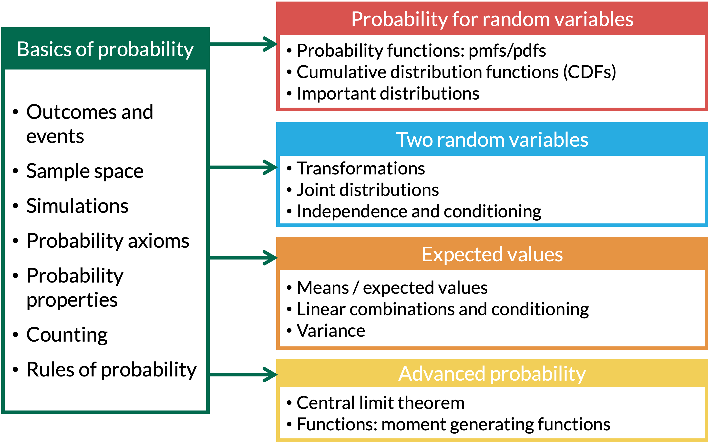

# Learning Objectives

1.  Distinguish between Uniform, Exponential, Gamma, and Normal distributions when
    reading a word problem.
2.  Identify the variable and the parameters in a word problem, and state what
    the variable and parameters mean.
3.  Use the formulas for the pdf/CDF, expected value, and variance to
    answer questions and find probabilities.

## Where are we?

```{r setup, include=FALSE}
library(here)
source(here("class_dates.R"))

library(tidyverse)
```

```{css, echo=FALSE}
/* Ribbons for the X / pmf / CDF / E(X) / Var(X) rows on the properties slides */
.ribbon {
  display: flex;
  align-items: stretch;
  min-height: 110px;
  margin: 12px 0;
  border-radius: 8px;
  overflow: hidden;
}
.ribbon .rib-label {
  flex: 0 0 72px;
  position: relative;
  container-type: size;  /* lets the label text scale with the box */
  color: #fff;
  font-weight: 700;
}
/* Rotate the label and center it both ways in the dark box */
.ribbon .rib-label p {
  position: absolute;
  top: 50%;
  left: 50%;
  transform: translate(-50%, -50%) rotate(-90deg);
  white-space: nowrap;
  line-height: 1;
}
/* As large as fits: limited by the box height (text length) and width */
.rib-x   .rib-label p { font-size: min(70cqh, 75cqw); }
.rib-pmf .rib-label p, .rib-pdf .rib-label p { font-size: min(46cqh, 72cqw); }
.rib-cdf .rib-label p { font-size: min(40cqh, 72cqw); }
.rib-e   .rib-label p { font-size: min(29cqh, 72cqw); }
.rib-var .rib-label p { font-size: min(21cqh, 72cqw); }
.ribbon .rib-body {
  flex: 1;
  display: flex;
  flex-direction: column;
  justify-content: center;
  padding: 4px 28px;
}
.ribbon p { margin: 0 !important; }
.ribbon .rib-body .math.display { margin: 0; }
.ribbon mjx-container[display="true"] { margin: 0.2em 0 !important; }
.ribbon .rib-range { font-size: 0.8em; }
.ribbon .rib-body p:has(.rib-range) { text-align: center; }
.rib-x   .rib-label { background-color: #006a4e; }
.rib-x   .rib-body  { background-color: #d6ebe4; }
.rib-pmf .rib-label, .rib-pdf .rib-label { background-color: #E25D3B; }
.rib-pmf .rib-body, .rib-pdf .rib-body { background-color: #fbe1d9; }
.rib-cdf .rib-label { background-color: #20c997; }
.rib-cdf .rib-body  { background-color: #d4f4ea; }
.rib-e   .rib-label { background-color: #E89543; }
.rib-e   .rib-body  { background-color: #fbecdb; }
.rib-var .rib-label { background-color: #29abe0; }
.rib-var .rib-body  { background-color: #d8eff9; }
/* Tighter ribbons for the two-column slides */
.rib-compact .ribbon { margin: 8px 0; min-height: 100px; }
.rib-compact .ribbon .rib-label { flex-basis: 60px; }
.rib-compact .ribbon .rib-body { padding: 2px 16px; font-size: 0.8em; }
```

{fig-align="center"}

# Continuous uniform RVs

## Properties of continuous uniform RVs

-   **Scenario:** Events are [**equally likely**]{style="color:#d9534f;"} to happen anywhere or anytime in an interval of values

-   Shorthand: $X \sim \text{U}[a,b]$

:::::::: {.columns .rib-compact}
::::::: {.column width="49%"}
::: {.ribbon .rib-x}
::: rib-label
$X$
:::

::: rib-body
$X$ = a value in the interval $[a, b]$, where every value is equally likely
:::
:::

::: {.ribbon .rib-pdf}
::: rib-label
pdf
:::

::: rib-body
$$f_X(x) = \dfrac{1}{b-a}, \text{ for }a \leq x \leq b$$
:::
:::

::: {.ribbon .rib-cdf}
::: rib-label
CDF
:::

::: rib-body
$$
F_X(x) = \int_a^x f_X(s)\,ds = \left\{
        \begin{array}{ll}
            0 & \quad x<a \quad \\
            \dfrac{x-a}{b-a} & \quad a \leq x \leq b\quad \\
            1 & \quad x>b \quad
        \end{array}
    \right.
$$
:::
:::

:::::::

::::::: {.column width="2%"}
:::::::

::::::: {.column width="49%"}
::: {.ribbon .rib-e}
::: rib-label
$\text{E}(X)$
:::

::: rib-body
$$\text{E}(X) = \int_a^b x f_X(x)\,dx = \dfrac{a+b}{2}$$
:::
:::

::: {.ribbon .rib-var}
::: rib-label
$\text{Var}(X)$
:::

::: rib-body
$$\text{Var}(X) = \dfrac{(b-a)^2}{12}$$
:::
:::

:::::::
::::::::

-   Like every [**continuous RV**]{style="color:#d9534f;"}: $P(X = x) = 0$ for any single value $x$

## Identifying continuous uniform RV from word problems

-   Look for some indication that all events are **equally likely**

    -   Could also say "uniformly distributed"

-   Look for an interval

    -   **Time example:** Customer in your store will approach the cash register in next 30 minutes. Approaching the register throughout the 30 minutes is equally likely.

    -   **Length example:** You have a 12 inch string that you need to cut. You are equally likely to cut anywhere on the string.

-   Different than the [**discrete**]{style="color:#20c997;"} uniform

    -   Discrete usually includes a *countable* number of events that are equally likely

    -   Continuous is not countable

        -   Exact time and length can be measured with infinite decimal places

## Bird on a wire (TB 31.5)

::: columns
::: {.column width="30%"}
::: example
::: ex-title
Example 1
:::

::: ex-cont
A bird lands at a location that is Uniformly distributed along an electrical wire of length 150 feet. The wire is stretched tightly between two poles. What is the probability that the bird is 20 feet or
less from one or the other of the poles?
:::
:::
:::
:::

## Uniform distribution: R commands

R commands with their [input]{style="color:#BF396F"} and [output]{style="color:#367B79"}:

| R code | What does it return? | What do we use it for? |
|--------------|-------------------------------|---------------------------|
| `runif()` | returns [sample of random variables]{style="color:#367B79"} with [specified uniform distribution]{style="color:#BF396F"} | Simulate a Uniform RV |
| `dunif()` | returns [density]{style="color:#367B79"} $f_X(x)$ at a [certain value]{style="color:#BF396F"} | $f_X(x)$: the height of the pdf, **not** a probability |
| `punif()` | returns [cumulative probability]{style="color:#367B79"} of getting a [certain value or less]{style="color:#BF396F"} | $P(X \leq x)$ (or $P(X > x)$ if we add `lower.tail = FALSE`) |
| `qunif()` | returns [value]{style="color:#367B79"} corresponding to [desired quantile]{style="color:#BF396F"} | Inverse CDF: we give it a probability $p$ and it returns the value $t$ where $P(X \leq t) = p$ |

-   Parameters: `min` $= a$ and `max` $= b$

## Helpful R code

Let's say we're looking at equally likely arrival times between 10 am and 11 am. Let $X$ = minutes after 10 am, so $X \sim \text{U}[0, 60]$ (10 am is $X = 0$, 11 am is $X = 60$).

-   If we want to know the probability that someone arrives at 10:30am or earlier, $P(X \leq 30)$:

```{r}
punif(q = 30, min = 0, max = 60) # <1>
```

1. `punif()` is the CDF, $F_X(30) = P(X \leq 30)$. `min` and `max` are $a$ and $b$.

-   If we want to know the time, say $t$, where the probability of arriving at $t$ or earlier is 0.35 (inverse CDF):

```{r}
qunif(p = 0.35, min = 0, max = 60) # <1>
```

1. `qunif()` is the inverse CDF: it finds $t$ with $P(X \leq t) = 0.35$. So $t = 21$, or 10:21 am.

-   If we want to know the probability that someone arrives between 10:14 and 10:16 am:

```{r}
punif(q = 16, min = 0, max = 60) - punif(q = 14, min = 0, max = 60) # <1>
```

1. $P(14 \leq X \leq 16) = F_X(16) - F_X(14)$: the CDF at 16 minus the CDF at 14.

-   If we want to sample 20 arrival times from the distribution:

```{r}
runif(n = 20, min = 0, max = 60) # <1>
```

1. `runif()` draws 20 random values, like in Lesson 8. None of them repeat exactly, because $P(X = x) = 0$.

## Bird on a wire: check with a simulation

::: columns
::: {.column width="62%"}

```{r}
set.seed(1109) # <1>
reps <- 10000 # <2>

bird_sims <- tibble( # <3>
  x = runif(n = reps, min = 0, max = 150) # <3>
  ) # <3>

bird_sims |> # <4>
  summarise( # <4>
    prob_near_pole = mean(x <= 20 | x >= 130) # <5>
  )
```

1. Set the random seed once, so we get the same simulation every time.
2. Save the number of simulations as `reps`, so it is easy to change later.
3. Simulate 10,000 landing spots, $X$ = feet from the left pole, with `runif()` from Lesson 8.
4. Collapse the 10,000 landing spots into one row of summaries.
5. The vertical bar `|` means "or": `TRUE` when the bird is within 20 feet of the left pole **or** the right pole. `mean()` of `TRUE`/`FALSE` is the proportion of simulations where that happens.

:::

::: {.column width="38%"}

 

::: proof1
::: proof-cont
Exact: $P(X \leq 20) + P(X \geq 130) = 2 \cdot \dfrac{20}{150} \approx 0.2667$
:::
:::

:::
:::

# Exponential RVs

## Properties of exponential RVs

-   **Scenario:** Modeling the time until the next (first) event

-   [**Continuous**]{style="color:#d9534f;"} analog to the [**discrete**]{style="color:#20c997;"} geometric distribution!

-   Shorthand: $X \sim \text{Exp}(\lambda)$

    -   $\lambda$ = the **rate**: average number of events (successes) per unit of time

:::::::: {.columns .rib-compact}
::::::: {.column width="49%"}
::: {.ribbon .rib-x}
::: rib-label
$X$
:::

::: rib-body
$X$ = time until the next (first) event
:::
:::

::: {.ribbon .rib-pdf}
::: rib-label
pdf
:::

::: rib-body
$$f_X(x) = \lambda e^{-\lambda x}\text{ for } x>0, \lambda>0$$
:::
:::

::: {.ribbon .rib-cdf}
::: rib-label
CDF
:::

::: rib-body
$$
F_X(x) = \left\{
        \begin{array}{ll}
            0 & \quad x<0 \quad \\
            1 - e^{-\lambda x} & \quad x\geq0 \\
        \end{array}
    \right.
$$
:::
:::

:::::::

::::::: {.column width="2%"}
:::::::

::::::: {.column width="49%"}
::: {.ribbon .rib-e}
::: rib-label
$\text{E}(X)$
:::

::: rib-body
$$\text{E}(X) = \dfrac{1}{\lambda}$$
:::
:::

::: {.ribbon .rib-var}
::: rib-label
$\text{Var}(X)$
:::

::: rib-body
$$\text{Var}(X) = \dfrac{1}{\lambda^2}$$
:::
:::

:::::::
::::::::

## Memoryless Property

 

If $b>0$,

$$P(X > a +b | X> a) = P(X > b)$$

 

-   **This can be interpreted as:**

    -   If you have waited $a$ seconds (or any other measure of time) without a success

    -   Then the probability that you have to wait $b$ more seconds is the same as the probability of waiting $b$ seconds initially.

## Identifying exponential RV from word problems

-   Look for time between events/successes

-   Look for a rate of the events over time period

-   How does it differ from the geometric distribution?

    -   Geometric is *number of trials* until first success

    -   Exponential is *time* until first success

-   Relation to the Poisson distribution?

    -   When the time between arrivals is exponential, the number of arrivals in a fixed time interval is Poisson with the mean $\lambda$

## Transformation of independent exponential RVs

::: columns
::: {.column width="30%"}

We'll use the **CDF method** (more in Lesson 14):

::: example
::: ex-title
Example 2
:::

::: ex-cont
Let $X_i \sim \textrm{Exp}(\lambda_i)$ be independent RVs, for $i=1 \ldots n$. Find the pdf for the first of the arrival times.
:::
:::
:::
:::

## Exponential distribution: R commands

R commands with their [input]{style="color:#BF396F"} and [output]{style="color:#367B79"}:

| R code | What does it return? | What do we use it for? |
|--------------|-------------------------------|---------------------------|
| `rexp()` | returns [sample of random variables]{style="color:#367B79"} with [specified exponential distribution]{style="color:#BF396F"} | Simulate a Exponential RV |
| `dexp()` | returns [density]{style="color:#367B79"} $f_X(x)$ at a [certain value]{style="color:#BF396F"} | $f_X(x)$: the height of the pdf, **not** a probability |
| `pexp()` | returns [cumulative probability]{style="color:#367B79"} of getting a [certain value or less]{style="color:#BF396F"} | $P(X \leq x)$ (or $P(X > x)$ if we add `lower.tail = FALSE`) |
| `qexp()` | returns [value]{style="color:#367B79"} corresponding to [desired quantile]{style="color:#BF396F"} | Inverse CDF: we give it a probability $p$ and it returns the value $t$ where $P(X \leq t) = p$ |

-   Parameters: `rate` $= \lambda$

## Helpful R code

Let's say we're sitting at the bus stop, measuring the time until our bus arrives. We know the bus comes every 10 minutes on average, so $\lambda = 1/10$ bus per minute.

-   If we want to know the probability that the bus arrives in the next 5 minutes, $P(X \leq 5)$:

```{r}
pexp(q = 5, rate = 1/10) # <1>
```

1. `pexp()` is the CDF. `rate` is $\lambda$: 1 bus per 10 minutes.

-   If we want to know the time, say $t$, where the probability of the bus arriving at $t$ or earlier is 0.35 (inverse CDF):

```{r}
qexp(p = 0.35, rate = 1/10) # <1>
```

1. `qexp()` is the inverse CDF: it finds $t$ with $P(X \leq t) = 0.35$.

-   If we want to know the probability that the bus arrives between 3 and 5 minutes:

```{r}
pexp(q = 5, rate = 1/10) - pexp(q = 3, rate = 1/10) # <1>
```

1. $P(3 \leq X \leq 5) = F_X(5) - F_X(3)$.

-   If we want to sample 20 bus arrival times from the distribution:

```{r}
rexp(n = 20, rate = 1/10) # <1>
```

1. `rexp()` draws 20 random waiting times. Its `r` stands for "random", like `runif()`.

## Memoryless property: check with a simulation

-   We've already waited $a = 3$ minutes. Is the chance of waiting $b = 5$ **more** minutes the same as $P(X > 5)$?

::: columns
::: {.column width="62%"}

```{r}
bus_sims <- tibble( # <1>
  x = rexp(n = reps, rate = 1/10) # <1>
  ) # <1>

bus_sims |> # <2>
  summarise( # <2>
    prob_over_5   = mean(x > 5), # <3>
    prob_5_more   = mean(x > 8) / mean(x > 3) # <4>
  )
```

1. Simulate 10,000 waiting times for the bus, $X \sim \text{Exp}(1/10)$.
2. One row with a column for each probability.
3. $P(X > 5)$: the proportion of waits longer than 5 minutes.
4. $P(X > 3 + 5 \mid X > 3) = P(X > 8) / P(X > 3)$, the same conditional probability recipe as Lesson 9.

:::

::: {.column width="38%"}

 

::: proof1
::: proof-cont
Exact: both are $e^{-5/10} \approx 0.6065$
:::
:::

-   At home: try other values of $a$, like `mean(x > 15) / mean(x > 10)`

:::
:::

# Gamma RVs

## Properties of gamma RVs

-   **Scenario:** Modeling the time until the $r^{th}$ event.
-   Continuous analog to the Negative Binomial distribution
-   Shorthand: $X \sim \text{Gamma}(r, \lambda)$ or $X \sim \text{Gamma}(\alpha, \beta)$
-   Same as the sum of $r$ independent waiting times: $X = \sum_{i=1}^r Y_i$, where $Y_i \sim \text{Exp}(\lambda)$

:::::::: {.columns .rib-compact}
::::::: {.column width="49%"}
::: {.ribbon .rib-x}
::: rib-label
$X$
:::

::: rib-body
$X$ = time until the $r^{th}$ event
:::
:::

::: {.ribbon .rib-pdf}
::: rib-label
pdf
:::

::: rib-body
$$f_X(x) = \dfrac{\lambda^r}{\Gamma(r)}x^{r-1} e^{-\lambda x}\text{ for } x>0, \lambda>0$$

[where $\Gamma(r) = (r-1)!$]{.rib-range}
:::
:::

::: {.ribbon .rib-cdf}
::: rib-label
CDF
:::

::: rib-body
$$
F_X(x) = \left\{
        \begin{array}{ll}
            0 & \quad x<0 \quad \\
            1 - e^{-\lambda x}\displaystyle\sum_{j=0}^{r-1}\dfrac{(\lambda x)^j}{j!}  & \quad x\geq0 \\
        \end{array}
    \right.
$$
:::
:::

:::::::

::::::: {.column width="2%"}
:::::::

::::::: {.column width="49%"}
::: {.ribbon .rib-e}
::: rib-label
$\text{E}(X)$
:::

::: rib-body
$$\text{E}(X) = \dfrac{r}{\lambda}$$
:::
:::

::: {.ribbon .rib-var}
::: rib-label
$\text{Var}(X)$
:::

::: rib-body
$$\text{Var}(X) = \dfrac{r}{\lambda^2}$$
:::
:::

:::::::
::::::::

Common to see $\alpha = r$ and $\beta = 1/\lambda$

## Identifying gamma RV from word problems

-   Gamma distribution with $r=1$ is same as exponential (both [**continuous**]{style="color:#d9534f;"})

    -   Just like Negative Binomial with $r=1$ is same as the geometric distribution (both [**discrete**]{style="color:#20c997;"})

-   Similar to exponential

    -   Look for time between or until events/successes
        -   BUT now we are measuring time until more than 1 success
    -   Look for a rate of the events over time period

## Sending money orders

::: columns
::: {.column width="30%"}
::: example
::: ex-title
Example 3
:::

::: ex-cont
On average, someone sends a money order once per 15 minutes. What is the probability someone sends 10 money orders in less than 3 hours?
:::
:::
:::
:::

## Gamma distribution: R commands

R commands with their [input]{style="color:#BF396F"} and [output]{style="color:#367B79"}:

| R code | What does it return? | What do we use it for? |
|--------------|-------------------------------|---------------------------|
| `rgamma()` | returns [sample of random variables]{style="color:#367B79"} with [specified gamma distribution]{style="color:#BF396F"} | Simulate a Gamma RV |
| `dgamma()` | returns [density]{style="color:#367B79"} $f_X(x)$ at a [certain value]{style="color:#BF396F"} | $f_X(x)$: the height of the pdf, **not** a probability |
| `pgamma()` | returns [cumulative probability]{style="color:#367B79"} of getting a [certain value or less]{style="color:#BF396F"} | $P(X \leq x)$ (or $P(X > x)$ if we add `lower.tail = FALSE`) |
| `qgamma()` | returns [value]{style="color:#367B79"} corresponding to [desired quantile]{style="color:#BF396F"} | Inverse CDF: we give it a probability $p$ and it returns the value $t$ where $P(X \leq t) = p$ |

-   Parameters: `shape` $= r$ and `rate` $= \lambda$ (or `scale` $= \beta = 1/\lambda$)

## Helpful R code

Let's say we're sitting at the bus stop, measuring the time until 4 buses arrive. We know the bus comes every 10 minutes on average.

-   If we want to know the probability that the 4 buses arrive in the next 50 minutes:

::: columns
::: column
```{r}
pgamma(q = 50, rate = 1/10, shape = 4) # <1>
```

1. `rate` is $\lambda$ and `shape` is $r$.
:::
::: column
```{r}
pgamma(q = 50, scale = 10, shape = 4) # <1>
```

1. Same answer: `scale` is $\beta = 1/\lambda$, so `scale = 10` is the same as `rate = 1/10`.
:::
:::

-   If we want to know the time, say $t$, where the probability of the 4 buses arriving at $t$ or earlier is 0.35:

```{r}
qgamma(p = 0.35, rate = 1/10, shape = 4) # <1>
```

1. `qgamma()` is the inverse CDF, like `qunif()` and `qexp()`.

-   If we want to know the probability that the 4 buses arrive between 30 and 50 minutes:

```{r}
pgamma(q = 50, scale = 10, shape = 4) - pgamma(q = 30, scale = 10, shape = 4) # <1>
```

1. $F_X(50) - F_X(30)$, with the CDF `pgamma()`.

-   If we want to sample 20 arrival times for the 4 buses:

```{r}
rgamma(n = 20, scale = 10, shape = 4) # <1>
```

1. Each value is one realized time until the 4th bus.

## Remarks

-   The parameter $r$ in a Gamma($r$,$\lambda$) distribution does NOT need to be a positive integer

    -   $r$ is usually a positive integer

-   When $r$ is a positive integer, the distribution is sometimes called an Erlang($r$,$\lambda$) distribution

    -   Erlang is a gamma with a whole-number $r$

 

-   When $r$ is any positive real number, we have a general gamma distribution that is usually instead parameterized by $\alpha>0$ and $\beta>0$, where:

    -   $\alpha = \text{shape parameter}$ : same as $r$, the total number of events we must witness

        -   In R code example: 4 buses to wait for (`shape = 4`)

    -   $\beta = \text{scale parameter}$ : same as $1/\lambda$, one over the rate parameter

        -   In R code example: 1 bus per 10 minutes, so `rate = 1/10` or `scale = 10`

        -   In R: `rate = 1/scale`

## Sending money orders: check in R

::: columns
::: {.column width="60%"}

**Example 3:** $X$ = hours until the 10th money order. 1 per 15 minutes is $\lambda = 4$ per hour.

```{r}
pgamma(q = 3, shape = 10, rate = 4) # <1>
```

1. $P(X \leq 3)$ for $X \sim \text{Gamma}(10, 4)$. Keep the units the same: time in hours, so the rate is per hour.

:::
:::

## Gamma as a sum of exponentials: simulate

::::: proposition
::: prop-title
1.  Set up
:::
:::::

-   Wait for 4 buses, one after another. Simulate the total wait $X \sim \text{Gamma}(4, 1/10)$ directly with `rgamma()`, and as the sum of 4 waits $Y_i \sim \text{Exp}(1/10)$.

::::: proof1
::: proof-title
2.  Simulate
:::
:::::

::: columns
::: {.column width="62%"}

```{r}
n_buses <- 4 # <1>

gamma_sims <- tibble(sim = 1:reps) |> # <2>
  mutate(X = rgamma(n(), shape = n_buses, rate = 1/10)) # <2>

waits <- expand_grid(sim = 1:reps, bus = 1:n_buses) |> # <3>
  mutate(wait = rexp(n(), rate = 1/10)) # <3>

sum_sims <- waits |> # <4>
  group_by(sim) |> # <4>
  summarise(Y = sum(wait)) # <4>
```

1. Save the number of buses as `n_buses`, so it is easy to change later.
2. `rgamma()` draws the time until the 4th bus directly: `shape` is $r$ and `rate` is $\lambda$.
3. The long way: one row for every bus in every simulation, each with its own wait from `rexp()`.
4. For each simulation, add up the 4 waits. If the gamma really is a sum of exponentials, `Y` should behave like `X`.

:::

::: {.column width="38%"}

```{r}
head(gamma_sims) # <5>
head(sum_sims) # <6>
```

5. The first 6 values of $X$ from `rgamma()`.
6. The first 6 sums of 4 exponential waits.

:::
:::

## Gamma as a sum of exponentials: summarize

::::: example
::: ex-title
3.  Summarize
:::
:::::

::: columns
::: {.column width="55%"}

```{r}
gamma_sims |> # <1>
  summarise( # <1>
    average = mean(X), # <2>
    std_dev = sd(X), # <2>
    prob_50 = mean(X <= 50) # <3>
  )

sum_sims |> # <4>
  summarise(average = mean(Y), std_dev = sd(Y), prob_50 = mean(Y <= 50)) # <4>
```

1. One row of summaries of the 10,000 values of $X$ from `rgamma()`.
2. Compare with $\text{E}(X) = r/\lambda = 40$ and $SD(X) = \sqrt{r/\lambda^2} = 20$.
3. Compare with `pgamma(q = 50, rate = 1/10, shape = 4)` $\approx 0.7350$.
4. The same summaries for the sums of 4 exponential waits. They match!

::::: extra
::: ext-title
4.  Sensitivity analysis
:::
:::::

-   At home: change to `n_buses <- 1`. Do $X$ and $Y$ look like $\text{Exp}(1/10)$, with average 10?

:::

::: {.column width="45%"}

```{r}
#| code-fold: true
#| code-summary: "Plot code"
#| fig-width: 9
#| fig-height: 7

ggplot(sum_sims, aes(x = Y)) + # <4>
  geom_histogram(aes(y = after_stat(density)), # <5>
                 binwidth = 5, boundary = 0, # <5>
                 color = "black", fill = "lightblue") + # <5>
  geom_line(aes(y = dgamma(Y, rate = 1/10, shape = n_buses)), # <6>
            color = "red", linewidth = 1.5) + # <6>
  labs(title = "Sum of 4 exponential waits (bars)\nand Gamma(4, 1/10) pdf (red)", # <7>
       x = "Minutes until the 4th bus", # <7>
       y = "Density") + # <7>
  theme_minimal(base_size = 22) # <7>
```

4. Start with the 10,000 sums of 4 exponential waits, $Y$.
5. A histogram scaled so the total area is 1, like a pdf (Lesson 8).
6. The exact pdf: `dgamma()` gives $f_X(x)$. It is a density, not $P(X = x)$.
7. Add a title and axis labels, with a clean theme and larger text.

:::
:::

## Additional Resource

-   Another helpful site with R code: <https://rpubs.com/mpfoley73/459051>

# Normal RVs

## Properties of Normal RVs

-   No scenario description here because the Normal distribution is so universal

      -   Central Limit Theorem (Lesson 17) makes it applicable to many types of events

-   Shorthand: $X \sim \text{Normal}(\mu, \sigma^2)$

    -   The second parameter is the **variance** $\sigma^2$, but R's `*norm()` functions use `sd` $= \sigma$

:::::::: {.columns .rib-compact}
::::::: {.column width="49%"}
::: {.ribbon .rib-pdf}
::: rib-label
pdf
:::

::: rib-body
$$f_X(x) = \dfrac{1}{\sqrt{2\pi \sigma^2}}e^{-(x-\mu)^2/(2\sigma^2)}$$

[for $-\infty < x < \infty$]{.rib-range}
:::
:::

:::::::

::::::: {.column width="2%"}
:::::::

::::::: {.column width="49%"}
::: {.ribbon .rib-e}
::: rib-label
$\text{E}(X)$
:::

::: rib-body
$$\text{E}(X) = \mu$$
:::
:::

::: {.ribbon .rib-var}
::: rib-label
$\text{Var}(X)$
:::

::: rib-body
$$\text{Var}(X) = \sigma^2 \qquad \text{SD}(X) = \sigma$$
:::
:::

:::::::
::::::::

-   No closed-form CDF: we use R (or a table) to find probabilities

## Movie night while studying

::: columns
::: {.column width="37%"}
::: example
::: ex-title
Example 4
:::

::: ex-cont
Children's movies run an average of 98 minutes with a standard deviation of 10 minutes. You check out a random movie from the library to entertain your kids so you can study for your test. Assume that your kids will be occupied for the entire length of the movie.

a.  What is the probability that your kids will be occupied for at least the 2 hours you would like to study?

b.  What is range for the bottom quartile (lowest 25%) of time they will be occupied?
:::
:::
:::
:::

## Normal distribution: R commands

R commands with their [input]{style="color:#BF396F"} and [output]{style="color:#367B79"}:

| R code | What does it return? | What do we use it for? |
|--------------|-------------------------------|---------------------------|
| `rnorm()` | returns [sample of random variables]{style="color:#367B79"} with [specified normal distribution]{style="color:#BF396F"} | Simulate a Normal RV |
| `dnorm()` | returns [density]{style="color:#367B79"} $f_X(x)$ at a [certain value]{style="color:#BF396F"} | $f_X(x)$: the height of the pdf, **not** a probability |
| `pnorm()` | returns [cumulative probability]{style="color:#367B79"} of getting a [certain value or less]{style="color:#BF396F"} | $P(X \leq x)$ (or $P(X > x)$ if we add `lower.tail = FALSE`) |
| `qnorm()` | returns [value]{style="color:#367B79"} corresponding to [desired quantile]{style="color:#BF396F"} | Inverse CDF: we give it a probability $p$ and it returns the value $t$ where $P(X \leq t) = p$ |

-   Parameters: `mean` $= \mu$ and `sd` $= \sigma$ (the standard deviation, **not** the variance $\sigma^2$)

## Helpful R code

Let's say we're measuring the high temperature today. The average high temperature on this day across many, many years is 50 degrees with a standard deviation of 4 degrees, so $X \sim \text{Normal}(50, 4^2)$.

-   If we want to know the probability that the high temperature is below 45 degrees:

```{r}
pnorm(q = 45, mean = 50, sd = 4) # <1>
```

1. `pnorm()` is the CDF, $P(X \leq 45)$. Note `sd = 4`, not the variance 16.

-   If we want to know the temperature, say $t$, where the probability that the temperature is at $t$ or lower is 0.35 (inverse CDF):

```{r}
qnorm(p = 0.35, mean = 50, sd = 4) # <1>
```

1. `qnorm()` is the inverse CDF: it finds $t$ with $P(X \leq t) = 0.35$.

-   If we want to know the probability that the temperature is between 45 and 50 degrees:

```{r}
pnorm(q = 50, mean = 50, sd = 4) - pnorm(q = 45, mean = 50, sd = 4) # <1>
```

1. $P(45 \leq X \leq 50) = F_X(50) - F_X(45)$.

-   If we want to sample 20 days' temperature (over the years) from the distribution:

```{r}
rnorm(n = 20, mean = 50, sd = 4) # <1>
```

1. `rnorm()` draws 20 random high temperatures.

## Movie night while studying: check in R

::: columns
::: {.column width="60%"}

**Example 4:** $X$ = movie length in minutes, $X \sim \text{Normal}(98, 10^2)$. Watch the units: 2 hours is 120 minutes.

```{r}
pnorm(q = 120, mean = 98, sd = 10, lower.tail = FALSE) # <1>
qnorm(p = 0.25, mean = 98, sd = 10) # <2>
```

1. Part a: $P(X \geq 120)$. `lower.tail = FALSE` gives the upper tail, $P(X > q)$, instead of the CDF. Same as `1 - pnorm(q = 120, mean = 98, sd = 10)`.
2. Part b: the bottom quartile is $X \leq t$, where $P(X \leq t) = 0.25$.

:::
:::

## Movie night while studying: simulate it

:::::::: columns
:::::: {.column width="55%"}
::::: example
::: ex-title
Example 4
:::

::: ex-cont
Simulate the lengths of 10,000 random movies. Do we get about
$P(X \geq 120) \approx 0.0139$ and a bottom quartile that ends near 91.26
minutes?
:::
:::::

```{r}
movie_sims <- tibble(sim = 1:reps) |> # <1>
  mutate(
    X = rnorm(n(), mean = 98, sd = 10) # <2>
  )
```

1.  One row per simulated movie. `reps` is still 10,000.
2.  `rnorm()` draws one movie length for every row. `n()` is the number of
    rows, `mean` is $\mu = 98$, and `sd` is $\sigma = 10$.
::::::

::: {.column width="1%"}
:::

::: {.column width="44%"}
```{r}
movie_sims |> # <1>
  summarise( # <1>
    prob_2_hours    = mean(X >= 120), # <2>
    bottom_quartile = quantile(X, 0.25) # <3>
  )
```

1.  One row of summaries for the 10,000 simulated movie lengths.
2.  The proportion of movies that last at least 120 minutes, which
    estimates $P(X \geq 120)$ (part a).
3.  `quantile(X, 0.25)` finds the value with 25% of the simulated lengths
    below it, which estimates $t$ in part b. It is the simulation version
    of `qnorm()`.
:::
::::::::

## Standard Normal Distribution

$$ Z \sim \text{Normal}(\mu = 0, \sigma^2 = 1)$$

-   Used to be more helpful when computing was not as advanced

    -   Use tables of the standard normal

    -   You can convert any normal distribution to a standard normal through transformation

-   For $X \sim \text{Normal}(\mu_X, \sigma_X^2)$: $Z = \dfrac{X - \mu_X}{\sigma_X}$

    -   Comes from $X = \sigma_X Z + \mu_X$

    -   Since $\sigma_X$ and $\mu_X$ are constants, then $E(X) = \sigma_X E(Z) + \mu_X = \mu_X$ and $SD(X) = \sigma_X$

## Chi-squared distribution

::: columns
::: column
-   If $Z \sim \text{Normal}(0,1)$, then $X = Z^2$ has a Chi-squared distribution with 1 degree of freedom

    -   Shorthand: $X \sim \chi^2_{(1)}$

-  If $Z_1, Z_2, \ldots, Z_n$ are independent standard normal RVs, then

    $$X = \sum_{i=1}^n Z_i^2$$

    has a Chi-squared distribution with $n$ degrees of freedom

    -   Shorthand: $X \sim \chi^2_{(n)}$
    -   $X$ is always positive (a sum of squares)

-   A ratio of two independent chi-squared RVs, each divided by its degrees of freedom, has an F distribution: $\dfrac{\chi^2_{(n)}/n}{\chi^2_{(m)}/m} \sim F_{n,m}$
:::

::: column
```{r}
#| echo: false
#| warning: false
#| fig-width: 10
#| fig-height: 8

df_values <- c(2, 3, 5, 10, 20)

chisq_curves <- expand_grid(
  df = df_values,
  x = seq(0, 30, length.out = 1000)
  ) |>
  mutate(density = dchisq(x, df = df))

ggplot(chisq_curves, aes(x = x, y = density, color = factor(df))) +
  geom_line(linewidth = 2) +
  labs(x = "x",
       y = "Density",
       color = NULL) +
  scale_color_discrete(labels = paste("n =", df_values)) +
  theme_minimal(base_size = 30) +
  theme(legend.position = c(0.8, 0.7))
```

:::
:::
