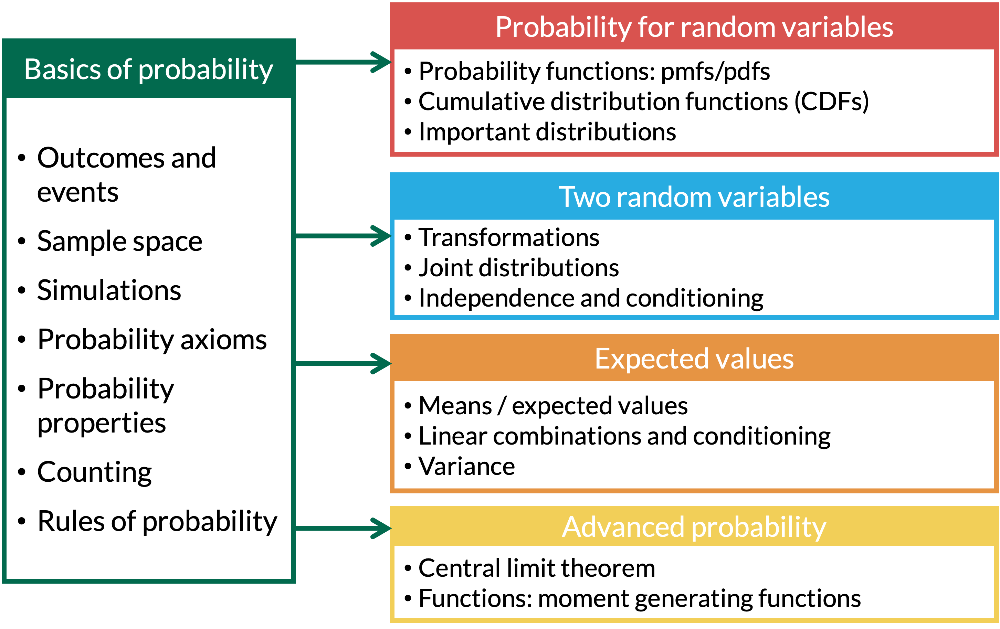
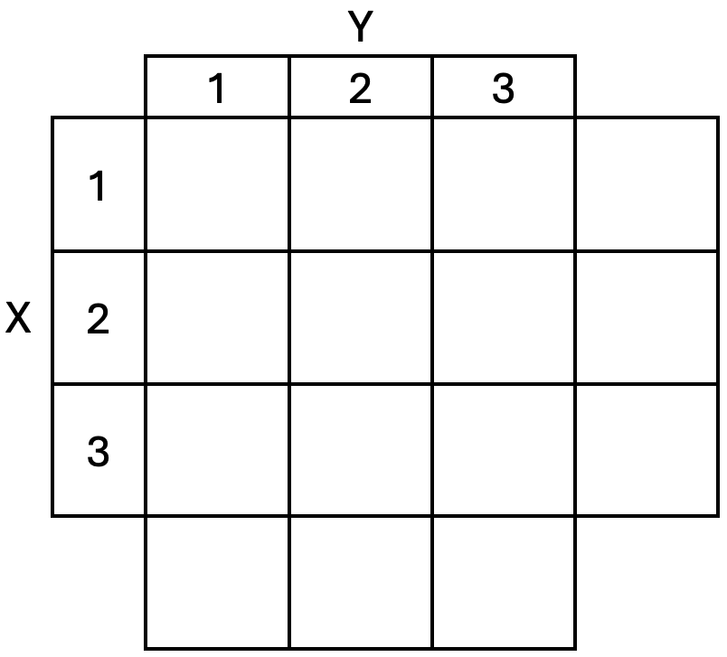

```{r setup, include=FALSE}
library(here)
source(here("class_dates.R"))

library(tidyverse)

theme_set(theme_bw(base_size = 28))
```

# Learning Objectives

1.  Define **joint and marginal** distributions (pmf's, pdf's, and CDF's) for discrete and continuous random variables

2.  Find and simulate **joint and marginal** probabilities and pmf's for discrete random variables

3.  Use simulation to approximate **joint and marginal** probabilities and pdf's for continuous random variables

4.  Use simulation to approximate the distribution of a transformation of two random variables

5.  Use simulation to approximate expected values from a joint distribution

## Where are we?

{fig-align="center"}

# Learning Objectives

::: lob
1.  Define **joint and marginal** distributions (pmf's, pdf's, and CDF's) for discrete and continuous random variables
:::

2.  Find and simulate **joint and marginal** probabilities and pmf's for discrete random variables

3.  Use simulation to approximate **joint and marginal** probabilities and pdf's for continuous random variables

4.  Use simulation to approximate the distribution of a transformation of two random variables

5.  Use simulation to approximate expected values from a joint distribution

## What is a joint distribution?

::::::::::: columns
:::::: {.column width="50%"}
::::: proof1
::: proof-title
Definition: joint pmf
:::

::: proof-cont
The [**joint pmf**]{style="color:#E25D3B;"} of a pair of discrete RV's $X$ and $Y$ is $$\begin{aligned}
p_{X,Y}(x,y) = & \mathbb{P}(X=x \cap Y=y) \\ = & \mathbb{P}(X=x, Y=y)
\end{aligned}$$
:::
:::::
::::::

:::::: {.column width="50%"}
::::: theorem
::: thm-title
Definition: joint pdf
:::

::: thm-cont
The [**joint pdf**]{style="color:#E25D3B;"} for two continuous RVs ($X$ and $Y$) is $f_{X,Y}(x,y)$, such that we have the following joint probability: $$\begin{aligned}
\mathbb{P}(a \leq X \leq b, & c \leq Y \leq d) = \\ & \int_a^b \int_c^d f_{X,Y}(x,y)dydx
\end{aligned}$$
:::
:::::
::::::
:::::::::::

## Important properties of joint distributions

::::::::::: columns
:::::: {.column width="50%"}
::::: proof1
::: proof-title
Properties of joint pmf's
:::

::: proof-cont
-   A joint pmf $p_{X,Y}(x,y)$ must satisfy the following properties:

    -   $0 \leq p_{X,Y}(x,y) \leq 1$ for all $x, y$

      

    -   $\sum \limits_{\{all\ x\}} \sum \limits_{\{all\ y\}} p_{X,Y}(x,y)=1$
:::
:::::
::::::

:::::: {.column width="50%"}
::::: theorem
::: thm-title
Properties of joint pdf's
:::

::: thm-cont
-   A joint pdf $f_{X,Y}(x,y)$ must satisfy the following properties:

    -   $f_{X,Y}(x,y)\geq 0$ for all $x,y$

      

    -   $\displaystyle\int_{-\infty}^{\infty}\displaystyle\int_{-\infty}^{\infty} f_{X,Y}(x,y)dxdy=1$

  

-   Remember that $f_{X,Y}(x,y)\neq \mathbb{P}(X=x, Y=y)$!!!
:::
:::::
::::::
:::::::::::

## Marginal distributions

::::::::::: columns
:::::: {.column width="50%"}
::::: proof1
::: proof-title
Marginal pmf's
:::

::: proof-cont
Suppose $X$ and $Y$ are discrete RV's, with joint pmf $p_{X,Y}(x,y)$. Then the [**marginal probability mass functions**]{style="color:#E25D3B;"} are

$$p_X(x) = \sum \limits_{\{all\ y\}} p_{X,Y}(x,y)$$

$$p_Y(y) = \sum \limits_{\{all\ x\}} p_{X,Y}(x,y)$$
:::
:::::
::::::

:::::: {.column width="50%"}
::::: theorem
::: thm-title
Marginal pdf's
:::

::: thm-cont
Suppose $X$ and $Y$ are continuous RV's, with joint pdf $f_{X,Y}(x,y)$. Then the [**marginal probability density functions**]{style="color:#E25D3B;"} are $$\begin{aligned}
f_X(x)&= \int_{-\infty}^{\infty} f_{X,Y}(x,y)dy\\
f_Y(y)&= \int_{-\infty}^{\infty} f_{X,Y}(x,y)dx
\end{aligned}$$
:::
:::::
::::::
:::::::::::

## Joint cumulative distribution functions (CDFs)

::::::::::: columns
:::::: {.column width="50%"}
::::: proof1
::: proof-title
Joint CDF for discrete RVs
:::

::: proof-cont
The [**joint CDF**]{style="color:#E25D3B;"} of a pair of discrete RV's $X$ and $Y$ is
$$\begin{aligned}
F_{X,Y}(x,y) = &\mathbb{P}(X \leq x\ and\ Y \leq y) \\ = &\mathbb{P}(X \leq x, Y \leq y)
\end{aligned}$$
:::
:::::
::::::

:::::: {.column width="50%"}
::::: theorem
::: thm-title
Joint CDF for continuous RVs
:::

::: thm-cont
The **joint CDF** of continuous random variables $X$ and $Y$, is the function $F_{X,Y}(x,y)$, such that for all real values of $x$ and $y$,
$$\begin{aligned}
F_{X,Y}(x,y)= \mathbb{P}(X \leq x, & Y \leq y) = \\
& \int_{-\infty}^x\int_{-\infty}^y f_{X,Y}(s,t)dtds
\end{aligned}$$
:::
:::::
::::::
:::::::::::

# Learning Objectives

1.  Define **joint and marginal** distributions (pmf's, pdf's, and CDF's) for discrete and continuous random variables

::: lob
2.  Find and simulate **joint and marginal** probabilities and pmf's for discrete random variables
:::

3.  Use simulation to approximate **joint and marginal** probabilities and pdf's for continuous random variables

4.  Use simulation to approximate the distribution of a transformation of two random variables

5.  Use simulation to approximate expected values from a joint distribution

## [Joint distribution for two discrete random variables (1/7)]{style="display: none;"}

::::::: columns
:::::: {.column width="100%"}
::::: example
::: ex-title
Example 1: Two draws without replacement
:::

::: ex-cont
Let $X$ and $Y$ be two random draws from a box containing balls labelled 1, 2, and 3 without replacement.

1.  Find $p_{X,Y}(x,y)$

2.  Find $\mathbb{P}(X+Y=3)$

3.  Find $\mathbb{P}(Y = 1)$

4.  Find $\mathbb{P}(Y \leq 2)$

5.  Find the joint CDF $F_{X,Y}(x,y)$ for the joint pmf $p_{X,Y}(x,y)$

6.  Find the marginal CDFs $F_{X}(x)$ and $F_{Y}(y)$
:::
:::::
::::::
:::::::

## [Joint distribution for two discrete random variables (2/7)]{style="display: none;"}

::::::: columns
:::::: {.column width="35%"}
::::: example
::: ex-title
Example 1: Two draws without replacement
:::

::: ex-cont
Let $X$ and $Y$ be two random draws from a box containing balls labelled 1, 2, and 3 without replacement.

1.  Find $p_{X,Y}(x,y)$

2.  Find $\mathbb{P}(X+Y=3)$
:::
:::::
{width="520"}
::::::
:::::::

## [Joint distribution for two discrete random variables (3/7)]{style="display: none;"}

::::::: columns
:::::: {.column width="35%"}
::::: example
::: ex-title
Example 1: Two draws without replacement
:::

::: ex-cont
Let $X$ and $Y$ be two random draws from a box containing balls labelled 1, 2, and 3 without replacement.

3.  Find $\mathbb{P}(Y = 1)$

4.  Find $\mathbb{P}(Y \leq 2)$
:::
:::::
{width="520"}
::::::
:::::::

## [Joint distribution for two discrete random variables (4/7): simulate]{style="display: none;"}

:::: example
::: ex-cont
1.  Check the joint pmf with simulation: draw two balls from the box, many times.
:::
::::

::::::: columns
::::: {.column width="55%"}
```{r}
set.seed(1111) # <1>
reps <- 100000 # <2>

ex1_sims <- expand_grid( # <3>
    sim = 1:reps, # <3>
    draw = 1:2 # <3>
  ) |>
  group_by(sim) |> # <4>
  mutate(ball = sample(1:3, size = n())) |> # <5>
  summarise( # <6>
    x = first(ball), # <6>
    y = last(ball) # <6>
  )
```

1.  Set the random seed once, so we get the same simulation every time.
2.  Save the number of simulations as `reps`, so it is easy to change later.
3.  One row per draw: 2 draws for each of the 100,000 simulations, like in Lesson 2.
4.  Work within each simulation separately.
5.  `n()` is 2 here (two draws per simulation). With no `replace = TRUE`, `sample()` draws **without** replacement, so the two balls are different, just like the box.
6.  One row per simulation: `first()` is the first ball drawn ($X$) and `last()` is the second ($Y$).
:::::

::: {.column width="45%"}
```{r}
ex1_sims |> # <7>
  group_by(x, y) |> # <7>
  summarise( # <8>
    prob = n() / reps, # <8>
    .groups = "drop" # <8>
  )
```

7.  One group for each pair $(x, y)$ that showed up in the simulations.
8.  `n()` counts the simulations in each group. Dividing by `reps` gives relative frequencies: this approximates the joint pmf. `.groups = "drop"` removes the grouping when we are done.

- Pairs like $(1, 1)$ never show up, so $p_{X,Y}(1,1) = 0$
:::
:::::::

## [Joint distribution for two discrete random variables (5/7): simulate]{style="display: none;"}

:::: example
::: ex-cont
Parts 2 to 4: check $\mathbb{P}(X+Y=3)$, $\mathbb{P}(Y = 1)$, and $\mathbb{P}(Y \leq 2)$ with simulation.
:::
::::

::::::: columns
::::: {.column width="55%"}
```{r}
ex1_sims |> # <1>
  summarise( # <1>
    prob_sum_3 = mean(x + y == 3), # <1>
    prob_Y_1 = mean(y == 1), # <2>
    prob_Y_le_2 = mean(y <= 2) # <2>
  )
```

1.  Reuse the 100,000 simulated pairs. `mean()` of a `TRUE`/`FALSE` condition is the proportion of simulations where it is `TRUE`: this approximates $\mathbb{P}(X+Y=3)$.
2.  Marginal probabilities only use the `y` column.
:::::

::: {.column width="45%"}
:::: proof1
::: proof-cont
For reference, the exact answers are $p_{X,Y}(x,y) = \frac16 \approx 0.1667$ for each possible pair, $\mathbb{P}(X+Y=3) = \mathbb{P}(Y=1) = \frac13$, and $\mathbb{P}(Y \leq 2) = \frac23$
:::
::::
:::
:::::::

## [Joint distribution for two discrete random variables (6/7)]{style="display: none;"}

::::::: columns
:::::: {.column width="35%"}
::::: example
::: ex-title
Example 1: Two draws without replacement
:::

::: ex-cont
Let $X$ and $Y$ be two random draws from a box containing balls labelled 1, 2, and 3 without replacement.

5.  Find the joint CDF $F_{X,Y}(x,y)$ for the joint pmf $p_{X,Y}(x,y)$
:::
:::::
{width="520"}
::::::
:::::::

## [Joint distribution for two discrete random variables (7/7)]{style="display: none;"}

::::::: columns
:::::: {.column width="35%"}
::::: example
::: ex-title
Example 1: Two draws without replacement
:::

::: ex-cont
Let $X$ and $Y$ be two random draws from a box containing balls labelled 1, 2, and 3 without replacement.

6.  Find the marginal CDFs $F_{X}(x)$ and $F_{Y}(y)$
:::
:::::
{width="520"}
::::::
:::::::

## Quick remarks on the joint and marginal CDF

-   $F_X(x)$: rightmost column of the CDF table (where the $Y$ values are largest)

-   $F_Y(y)$: bottom row of the table (where the $X$ values are largest)

-   $F_X(x)=\lim\limits_{y\rightarrow\infty}F_{X, Y}(x,y)$

-   $F_Y(y)=\lim\limits_{x\rightarrow\infty}F_{X, Y}(x,y)$

# Learning Objectives

1.  Define **joint and marginal** distributions (pmf's, pdf's, and CDF's) for discrete and continuous random variables

2.  Find and simulate **joint and marginal** probabilities and pmf's for discrete random variables

::: lob
3.  Use simulation to approximate **joint and marginal** probabilities and pdf's for continuous random variables
:::

4.  Use simulation to approximate the distribution of a transformation of two random variables

5.  Use simulation to approximate expected values from a joint distribution

## Our main tool for joint distributions: simulate pairs

::::: definition
::: def-title
The simulation method for joint distributions
:::

::: def-cont
To learn about $X$ and $Y$ with joint pdf $f_{X,Y}(x,y)$:

1.  **Possible values:** Draw the region where $f_{X,Y}(x,y) > 0$

2.  **Simulate:** Simulate many *pairs* $(x, y)$: one row per simulation, with an `x` column and a `y` column

3.  **Summarize:**
    - Joint probabilities: `mean(x <= 1 & y <= 0.5)` approximates $\mathbb{P}(X \leq 1, Y \leq 0.5)$
    - Marginal distribution of $X$: use only the `x` column (histogram of `x`)
:::
:::::

  

- Same [**simulation method**]{style="color:#E25D3B;"} as Lesson 14, now with two columns
- Most joint pdfs have no `r*()` function, so we use [**grid sampling**]{style="color:#E25D3B;"} from Lesson 14, in 2D (next slide)

## 2D grid sampling: the steps {#grid-sampling-2d}

- Same idea as Lesson 14: a box of tickets, where tickets in taller parts of the pdf are more likely to be drawn
- Now each ticket is a **point** $(x, y)$

::::: columns
::: {.column width="55%"}
1.  **Find the possible values** of $(X, Y)$: the region where $f_{X,Y}(x,y) > 0$

2.  **Make a grid:** many evenly spaced points that cover the region, made with `expand_grid()`. Each point is a ticket in the box

3.  **Find the joint pdf's height** at each ticket

4.  **Draw many tickets with replacement:** `slice_sample()` draws whole rows (points). Each draw is one simulated pair $(x, y)$

    - Each ticket has a chance of being drawn proportional to its height

5.  **Check:** the simulated points should pile up where the pdf is tall
:::

::: {.column width="45%"}
```{r}
#| echo: false
#| fig-width: 9
#| fig-height: 7

small_grid_2d <- expand_grid(
    x = seq(0, 2, by = 0.25),
    y = seq(0, 1, by = 0.125)
  ) |>
  mutate(height = 3/2 * y^2)

ggplot(small_grid_2d, aes(x = x, y = y, size = height)) +
  geom_point(color = "#29abe0") +
  scale_size_area(max_size = 12) +
  labs(subtitle = "A small grid for f(x, y) = (3/2) y^2",
       x = "x", y = "y", size = "Height")
```

*Bigger dots: taller pdf, so more likely to be drawn. A real grid has about 1,000,000 tickets*
:::
:::::

## [Example 2: Joint pdf (1/3)]{style="display: none;"}

::::::: columns
:::::: {.column width="30%"}
::::: example
::: ex-title
Example 2: Joint pdf on a rectangle
:::

::: ex-cont
Let $f_{X,Y}(x,y)= \frac32 y^2$, for $0 \leq x \leq 2, \ 0 \leq y \leq 1$.

1.  Shade the event $\{0 \leq X \leq 1, 0 \leq Y \leq \frac12\}$. Approximate its probability with simulation.
2.  Use simulation to look at the marginal distributions of $X$ and $Y$.
:::
:::::
::::::

:::::: {.column width="30%"}
```{r}
#| echo: false
#| fig-width: 6
#| fig-height: 5.5

domain_2 <- ggplot() +
  annotate("rect", xmin = 0, xmax = 2, ymin = 0, ymax = 1,
           fill = "#29abe0", alpha = 0.15) +
  scale_x_continuous(breaks = c(0, 1, 2), limits = c(0, 2)) +
  scale_y_continuous(breaks = c(0, 0.5, 1), limits = c(0, 1)) +
  labs(x = "x", y = "y")
domain_2
```
::::::
:::::::

## [Example 2: Joint pdf (2/3): simulate]{style="display: none;"}

:::: example
::: ex-cont
1.  Shade the event $\{0 \leq X \leq 1, 0 \leq Y \leq \frac12\}$. Approximate its probability with simulation.
:::
::::

::::::: columns
::::: {.column width="55%"}
```{r}
ex2_grid <- expand_grid( # <1>
    x = seq(0, 2, length.out = 1001), # <1>
    y = seq(0, 1, length.out = 1001) # <1>
  ) |>
  mutate(height = 3/2 * y^2) # <2>

ex2_sims <- ex2_grid |> # <3>
  slice_sample( # <3>
    n = reps, # <3>
    weight_by = height, # <4>
    replace = TRUE # <3>
  )

ex2_sims |> # <5>
  summarise(prob = mean(x <= 1 & y <= 0.5)) # <5>
```

1.  Steps 1 and 2: `expand_grid()` makes every combination of 1,001 values of $x$ and 1,001 values of $y$: about 1 million tickets covering the rectangle.
2.  Step 3: the joint pdf's height at each ticket.
3.  Step 4: `slice_sample()` draws `reps` rows from the grid, with replacement. Each row drawn is one simulated pair $(x, y)$.
4.  `weight_by` gives each ticket the pdf's height, so taller tickets are more likely to be drawn. It works like `prob` in `sample()`.
5.  `&` means "and": both conditions must be `TRUE`. The proportion approximates $\mathbb{P}(0 \leq X \leq 1, 0 \leq Y \leq \frac12)$.
:::::

::: {.column width="45%"}
:::: proof1
::: proof-cont
For reference, the exact answer is $\mathbb{P}(0 \leq X \leq 1, 0 \leq Y \leq \frac12) = \frac{1}{16} = 0.0625$
:::
::::

  

- The volume under $f_{X,Y}(x,y)$ over the event is the probability (the double integral in the definition)
- The simulation counts the proportion of points that land in the event instead
:::
:::::::

## [Example 2: Joint pdf (3/3): marginals]{style="display: none;"}

:::: example
::: ex-cont
2.  Use simulation to look at the marginal distributions of $X$ and $Y$.
:::
::::

::::: columns
::: {.column width="50%"}
```{r}
#| code-fold: true
#| code-summary: "Plot code"
#| fig-width: 10
#| fig-height: 6

ggplot(ex2_sims, aes(x = x)) + # <1>
  geom_histogram(aes(y = after_stat(density)), # <1>
                 binwidth = 0.05, boundary = 0, # <1>
                 color = "black", fill = "lightblue") + # <1>
  geom_function(fun = function(x) 1/2 + 0 * x, # <2>
                xlim = c(0, 2), # <2>
                color = "red", linewidth = 1.5) + # <2>
  labs(subtitle = "Simulated X (the x column only)", # <3>
       x = "x", y = "Density") # <3>
```

1.  Histogram of only the `x` column, scaled like a pdf. Ignoring `y` gives the marginal distribution of $X$.
2.  For reference, the marginal pdf $f_X(x) = \frac12$ for $0 \leq x \leq 2$, in red. (`0 * x` keeps the line flat.)
3.  Add a subtitle and axis labels.

- $X$ is flat: Uniform$[0, 2]$
:::

::: {.column width="50%"}
```{r}
#| code-fold: true
#| code-summary: "Plot code"
#| fig-width: 10
#| fig-height: 6

ggplot(ex2_sims, aes(x = y)) + # <1>
  geom_histogram(aes(y = after_stat(density)), # <1>
                 binwidth = 0.025, boundary = 0, # <1>
                 color = "black", fill = "#E89543") + # <1>
  geom_function(fun = function(y) 3 * y^2, # <2>
                xlim = c(0, 1), # <2>
                color = "red", linewidth = 1.5) + # <2>
  labs(subtitle = "Simulated Y (the y column only)", # <3>
       x = "y", y = "Density") # <3>
```

1.  Histogram of only the `y` column: the marginal distribution of $Y$.
2.  For reference, the marginal pdf $f_Y(y) = 3y^2$ for $0 \leq y \leq 1$, in red.
3.  Add a subtitle and axis labels.

- $Y$ piles up near 1, where the joint pdf is tallest
:::
:::::

# Learning Objectives

1.  Define **joint and marginal** distributions (pmf's, pdf's, and CDF's) for discrete and continuous random variables

2.  Find and simulate **joint and marginal** probabilities and pmf's for discrete random variables

3.  Use simulation to approximate **joint and marginal** probabilities and pdf's for continuous random variables

::: lob
4.  Use simulation to approximate the distribution of a transformation of two random variables
:::

5.  Use simulation to approximate expected values from a joint distribution

## Recall: simulate, transform, summarize (Lesson 14)

-   Let $M$ be a transformation of $X$ and $Y$: $M = g(X, Y)$

-   $M$ is a random variable, so it has a distribution

-   We use the same [**simulation method**]{style="color:#E25D3B;"} as Lesson 14, now with two columns:

1.  **Possible values:** Find the possible values of $M$ from the region where $f_{X,Y}(x, y) > 0$

2.  **Simulate:** Simulate many pairs $(x, y)$

3.  **Transform:** Apply $g$ to every simulated pair: `mutate(m = g(x, y))`

4.  **Summarize:** `mean(m <= c)` approximates $\mathbb{P}(M \leq c)$, and a histogram of `m` shows its shape

  

-   Rewriting an event about $M$ as a region of $(x, y)$ points checks the simulation, and gives an exact answer when the density is constant (area $\times$ height)

## [Example of a joint pdf with a transformation (1/4)]{style="display: none;"}

::::::: columns
:::::: {.column width="30%"}
::::: example
::: ex-title
Example 3: Constant density on a square
:::

::: ex-cont
Let $X$ and $Y$ have constant density on the square $0 \leq X \leq 4, 0 \leq Y \leq 4$.

1.  Shade the event $|X-Y| < 2$. Find $\mathbb{P}(|X-Y| < 2)$ using areas, and check it with simulation.
:::
:::::
::::::

:::::: {.column width="30%"}
```{r}
#| echo: false
#| fig-width: 6
#| fig-height: 5.5

domain_square <- ggplot() +
  annotate("rect", xmin = 0, xmax = 4, ymin = 0, ymax = 4,
           fill = "#29abe0", alpha = 0.15) +
  scale_x_continuous(breaks = c(0, 2, 4), limits = c(0, 4)) +
  scale_y_continuous(breaks = c(0, 2, 4), limits = c(0, 4)) +
  labs(x = "x", y = "y")
domain_square
```

::::::
:::::::

## [Example of a joint pdf with a transformation (2/4): simulate]{style="display: none;"}

:::: example
::: ex-cont
1.  Shade the event $|X-Y| < 2$. Find $\mathbb{P}(|X-Y| < 2)$ using areas, and check it with simulation.
:::
::::

::::::: columns
::::: {.column width="52%"}
```{r}
ex4_sims <- tibble(sim = 1:reps) |> # <1>
  mutate(
    x = runif(n(), min = 0, max = 4), # <2>
    y = runif(n(), min = 0, max = 4) # <2>
  )

ex4_sims |> # <3>
  summarise(prob = mean(abs(x - y) < 2)) # <3>
```

1.  One row per simulation.
2.  Constant density on the square means every point is equally likely. Picking `x` and `y` each with `runif()` does this, so we don't need a grid. (Lesson 16 explains why this works here, and why it does *not* work for Examples 2 and 4.)
3.  `abs()` is the absolute value. The proportion of simulations with $|X - Y| < 2$ approximates the probability.

:::: proof1
::: proof-cont
For reference, the exact answer is $\mathbb{P}(|X-Y| < 2) = \frac{16 - 2 \cdot 2}{16} = \frac34 = 0.75$: the square's area minus two corner triangles, times the height $\frac{1}{16}$
:::
::::
:::::

::: {.column width="48%"}
```{r}
#| code-fold: true
#| code-summary: "Plot code"
#| fig-width: 10
#| fig-height: 8

ex4_sims |>
  filter(sim <= 2000) |> # <4>
  ggplot(aes(x = x, y = y, color = abs(x - y) < 2)) + # <5>
  geom_point(alpha = 0.6, size = 2) + # <5>
  scale_color_manual(values = c("grey60", "#29abe0")) + # <6>
  coord_equal() + # <7>
  labs(subtitle = "First 2,000 simulated points", # <8>
       x = "x", y = "y", color = "|x - y| < 2") # <8>
```

4.  Plot only the first 2,000 simulations, so the points don't cover each other.
5.  One point per simulated pair, colored by whether it is in the event.
6.  Grey for `FALSE`, blue for `TRUE`.
7.  Make the square look like a square.
8.  Add a subtitle and labels.
:::
:::::::

## [Example of a joint pdf with a transformation (3/4)]{style="display: none;"}

::::::: columns
:::::: {.column width="30%"}
::::: example
::: ex-title
Example 3: Constant density on a square
:::

::: ex-cont
Let $X$ and $Y$ have constant density on the square $0 \leq X \leq 4, 0 \leq Y \leq 4$.

2.  Let $M = \max(X,Y)$. What are the possible values of $M$? Shade the event $M \leq 2$ and find $\mathbb{P}(M \leq 2)$ using areas.
:::
:::::
::::::

:::::: {.column width="30%"}
```{r}
#| echo: false
#| fig-width: 6
#| fig-height: 5.5

domain_square
```

::::::
:::::::

## [Example of a joint pdf with a transformation (4/4): simulate]{style="display: none;"}

:::: example
::: ex-cont
2.  Let $M = \max(X,Y)$. Check $\mathbb{P}(M \leq 2)$ with simulation, and look at the distribution of $M$.
:::
::::

::::::: columns
::::: {.column width="52%"}
```{r}
ex4_sims <- ex4_sims |> # <1>
  mutate(m = pmax(x, y)) # <2>

ex4_sims |> # <3>
  summarise(prob_M = mean(m <= 2)) # <3>
```

1.  Reuse the 100,000 simulated pairs from part 1.
2.  The transformation: `pmax()` takes the larger of `x` and `y` in **each row**. (`max()` would give one number: the largest value in the whole column!)
3.  The proportion of simulations with $M \leq 2$ approximates $\mathbb{P}(M \leq 2)$.

:::: proof1
::: proof-cont
For reference, the exact answer is $\mathbb{P}(M \leq 2) = \mathbb{P}(X \leq 2, Y \leq 2) = \frac{2 \cdot 2}{16} = \frac14$
:::
::::
:::::

::: {.column width="48%"}
```{r}
#| code-fold: true
#| code-summary: "Plot code"
#| fig-width: 10
#| fig-height: 6

ggplot(ex4_sims, aes(x = m)) + # <4>
  geom_histogram(aes(y = after_stat(density)), # <4>
                 binwidth = 0.1, boundary = 0, # <4>
                 color = "black", fill = "lightblue") + # <4>
  geom_function(fun = function(m) m / 8, # <5>
                xlim = c(0, 4), # <5>
                color = "red", linewidth = 1.5) + # <5>
  labs(subtitle = "Simulated M = max(X, Y)", # <6>
       x = "m", y = "Density") # <6>
```

4.  Histogram of the simulated values of $M$, scaled like a pdf.
5.  For reference, the pdf of $M$ in red: $f_M(m) = \frac{m}{8}$ for $0 \leq m \leq 4$. The histogram follows it.
6.  Add a subtitle and axis labels.

- $X$ and $Y$ are flat, but $M$ is not: the larger of two values is more likely to be big
:::
:::::::

# Learning Objectives

1.  Define **joint and marginal** distributions (pmf's, pdf's, and CDF's) for discrete and continuous random variables

2.  Find and simulate **joint and marginal** probabilities and pmf's for discrete random variables

3.  Use simulation to approximate **joint and marginal** probabilities and pdf's for continuous random variables

4.  Use simulation to approximate the distribution of a transformation of two random variables

::: lob
5.  Use simulation to approximate expected values from a joint distribution
:::

## Expected value of one RV from joint pdf

If you have a joint distribution $f_{X,Y}(x,y)$ and want to calculate $\mathbb{E}[X]$,
you have two options:

1.  Find $f_X(x)$ and use it to calculate $\mathbb{E}[X]$.

2.  Calculate $\mathbb{E}[X]$ using the joint density:
    $$\mathbb{E}[X] = \int_{-\infty}^{\infty}\int_{-\infty}^{\infty}x f_{X,Y}(x,y)dydx.$$


You can do the same for $\mathbb{E}[Y]$!

  

-   With simulation, there is a third option: simulate pairs $(x, y)$, then `mean(x)` approximates $\mathbb{E}[X]$. No integral needed!

## [Example 4: Expected value from a joint pdf (1/2)]{style="display: none;"}

::::::: columns
:::::: {.column width="30%"}
::::: example
::: ex-title
Example 4: Expected value from a joint pdf
:::

::: ex-cont
Let $f_{X,Y}(x,y)= 2e^{-(x+y)}$, for $0 \leq x \leq y$. Approximate $\mathbb{E}[X]$ and $\mathbb{E}[Y]$ with simulation.
:::
:::::
::::::

:::::: {.column width="30%"}
```{r}
#| echo: false
#| fig-width: 6
#| fig-height: 5.5

domain_triangle <- ggplot() +
  annotate("polygon", x = c(0, 0, 4), y = c(0, 4, 4),
           fill = "#29abe0", alpha = 0.15) +
  scale_x_continuous(breaks = 0:4, limits = c(0, 4)) +
  scale_y_continuous(breaks = 0:4, limits = c(0, 4)) +
  labs(x = "x", y = "y", subtitle = "(keeps going up and right)")
domain_triangle
```
::::::

:::::: {.column width="40%"}
- Same joint pdf as Example 5 (for home, in the reference slides)
- Possible values: $0 \leq x \leq y$, with no upper limit
  - But $f_{X,Y}(x,y) = 2e^{-(x+y)}$ is almost 0 once $y$ is past 10, so our grid can stop at 10
::::::
:::::::

## [Example 4: Expected value from a joint pdf (2/2): simulate]{style="display: none;"}

:::: example
::: ex-cont
Let $f_{X,Y}(x,y)= 2e^{-(x+y)}$, for $0 \leq x \leq y$. Approximate $\mathbb{E}[X]$ and $\mathbb{E}[Y]$ with simulation.
:::
::::

::::::: columns
::::: {.column width="55%"}
```{r}
ex6_grid <- expand_grid( # <1>
    x = seq(0, 10, length.out = 1001), # <1>
    y = seq(0, 10, length.out = 1001) # <1>
  ) |>
  filter(x <= y) |> # <2>
  mutate(height = 2 * exp(-(x + y))) # <3>

ex6_sims <- ex6_grid |> # <4>
  slice_sample( # <4>
    n = reps, # <4>
    weight_by = height, # <4>
    replace = TRUE # <4>
  )
```

1.  Make a grid of tickets from 0 to 10 in both directions.
2.  Keep only the possible values, where $x \leq y$: a triangle.
3.  The joint pdf's height at each ticket.
4.  Draw `reps` tickets, weighted by height, like Example 2.
:::::

::: {.column width="45%"}
```{r}
ex6_sims |> # <5>
  summarise( # <5>
    avg_X = mean(x), # <5>
    avg_Y = mean(y) # <5>
  )
```

5.  The averages of the `x` and `y` columns approximate $\mathbb{E}[X]$ and $\mathbb{E}[Y]$.

:::: proof1
::: proof-cont
For reference, the exact answers are $\mathbb{E}[X] = \frac12$ and $\mathbb{E}[Y] = \frac32$
:::
::::

  

- `mean(x + y)` would approximate $\mathbb{E}[X + Y]$: transform first, then average
:::
:::::::

## Summary of joint distributions

|   | Discrete $X$ and $Y$ | Continuous $X$ and $Y$ |
|----|----|----|
| Joint distribution | joint pmf: $p_{X,Y}(x,y) = \mathbb{P}(X=x, Y=y)$ | joint pdf $f_{X,Y}(x,y)$: probabilities are volumes (double integrals) |
| Marginal distribution | sum the joint pmf over the other variable | integrate the joint pdf over the other variable |
| Simulate pairs with | `sample()`, like the box | `runif()` for constant density; otherwise 2D grid sampling |
| Summarize | `group_by(x, y)`, `mean(...)` | `mean(...)`, histogram of one column |

  

- The [**joint distribution**]{style="color:#E25D3B;"} describes $X$ and $Y$ together; a [**marginal distribution**]{style="color:#E25D3B;"} describes one of them alone
- With simulation: joint probabilities use both columns, marginals use one column, and transformations add a new column with `mutate()`
- Practice at home: Examples 3 (part 3), 5, and 6 are in the reference slides at the end

# Some more reference slides

## [Example 5: Joint pdf on a triangle (1/2)]{style="display: none;"}

::: {.callout-important appearance="simple" icon="false"}
Do this problem at home for extra practice. I'll add the solution to the annotated notes!
:::

::::::: columns
:::::: {.column width="30%"}
::::: example
::: ex-title
Example 5: Joint pdf on a triangle (for home)
:::

::: ex-cont
Let $f_{X,Y}(x,y)= 2 e^{-(x+y)}$, for $0 \leq x \leq y$.

1.  Use simulation to look at the marginal distributions of $X$ and $Y$.
:::
:::::
::::::

:::::: {.column width="30%"}
```{r}
#| echo: false
#| fig-width: 6
#| fig-height: 5.5

domain_triangle
```
::::::

:::::: {.column width="40%"}
- Hint: Example 4 simulates this same joint pdf. The grid only needs to go up to about 10, because $f_{X,Y}(x,y)$ is almost 0 past there
::::::
:::::::

## [Example 5: Joint pdf on a triangle (2/2)]{style="display: none;"}

::: {.callout-important appearance="simple" icon="false"}
Do this problem at home for extra practice. I'll add the solution to the annotated notes!
:::

::::::: columns
:::::: {.column width="30%"}
::::: example
::: ex-title
Example 5: Joint pdf on a triangle (for home)
:::

::: ex-cont
Let $f_{X,Y}(x,y)= 2 e^{-(x+y)}$, for $0 \leq x \leq y$.

2.  Approximate $\mathbb{P}(Y < 3)$ with simulation.
:::
:::::
::::::

:::::: {.column width="30%"}
```{r}
#| echo: false
#| fig-width: 6
#| fig-height: 5.5

domain_triangle
```
::::::
:::::::

## [Example of a joint pdf with a transformation: part 3 for home]{style="display: none;"}

::::::: columns
:::::: {.column width="30%"}
::::: example
::: ex-title
Example 3: Constant density on a square (for home)
:::

::: ex-cont
Let $X$ and $Y$ have constant density on the square $0 \leq X \leq 4, 0 \leq Y \leq 4$.

3.  Let $Z = \min(X,Y)$. Find $\mathbb{P}(Z \leq 2)$ using areas. Check it with simulation, and look at the distribution of $Z$.
:::
:::::
::::::

:::::: {.column width="30%"}
```{r}
#| echo: false
#| fig-width: 6
#| fig-height: 5.5

domain_square
```

::::::

:::::: {.column width="40%"}
::: {.callout-important appearance="simple" icon="false"}
Do this problem at home for extra practice. I'll add the solution to the annotated notes!
:::

- Hint: start from the code for part 2, and use `pmin()` instead of `pmax()`
::::::
:::::::

## [Last example *for home*: more complicated transformation]{style="display: none;"}

::: {.callout-important appearance="simple" icon="false"}
Do this problem at home for extra practice. I'll add the solution to the annotated notes!
:::

::::::: columns
:::::: {.column width="30%"}
::::: example
::: ex-title
Example 6: Product of two RVs (for home)
:::

::: ex-cont
Let $X$ and $Y$ have joint density $f_{X,Y}(x,y)= \frac85(x+y)$ in the region $0 < x < 1,\ \frac12 < y <1$. Let $Z=XY$.

1.  What are the possible values of $Z$?
2.  Use 2D grid sampling to simulate $Z$. Approximate $\mathbb{P}(Z \leq \frac14)$ and make a histogram of $Z$.
:::
:::::
::::::

:::::: {.column width="30%"}
```{r}
#| echo: false
#| fig-width: 6
#| fig-height: 5.5

ggplot() +
  annotate("rect", xmin = 0, xmax = 1, ymin = 0.5, ymax = 1,
           fill = "#29abe0", alpha = 0.15) +
  scale_x_continuous(breaks = c(0, 0.5, 1), limits = c(0, 1)) +
  scale_y_continuous(breaks = c(0, 0.5, 1), limits = c(0, 1)) +
  labs(x = "x", y = "y")
```

::::::
:::::::

## Double Integrals Mini Lesson (1/3)

::: {.callout-important appearance="simple" icon="false"}
Do this problem at home for extra practice. I'll add the solution to the annotated notes!
:::

::::::: columns
:::::: {.column width="30%"}
::::: example
::: ex-title
Mini Lesson Example 1
:::

::: ex-cont
Solve the following integral: $\displaystyle\int_{2}^{3}\displaystyle\int_{0}^{1} xy dydx$
:::
:::::
::::::
:::::::

## Double Integrals Mini Lesson (2/3)

::: {.callout-important appearance="simple" icon="false"}
Do this problem at home for extra practice. I'll add the solution to the annotated notes!
:::

::::::: columns
:::::: {.column width="30%"}
::::: example
::: ex-title
Mini Lesson Example 2
:::

::: ex-cont
Solve the following integral: $\displaystyle\int_{2}^{3}\displaystyle\int_{0}^{1} (x+y) dydx$
:::
:::::
::::::
:::::::

## Double Integrals Mini Lesson (3/3)

::: {.callout-important appearance="simple" icon="false"}
Do this problem at home for extra practice. I'll add the solution to the annotated notes!
:::

::::::: columns
:::::: {.column width="30%"}
::::: example
::: ex-title
Mini Lesson Example 3
:::

::: ex-cont
Solve the following integral: $\displaystyle\int_{2}^{3}\displaystyle\int_{0}^{1} e^{x+y} dydx$
:::
:::::
::::::
:::::::
