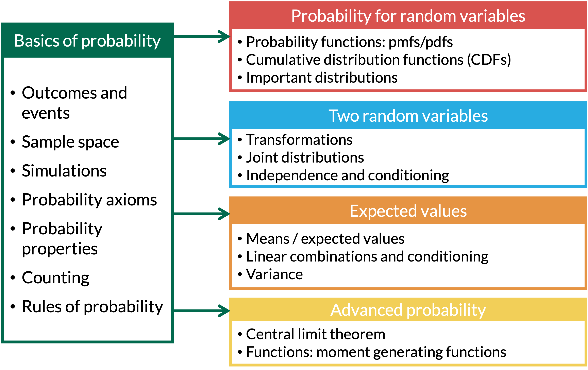
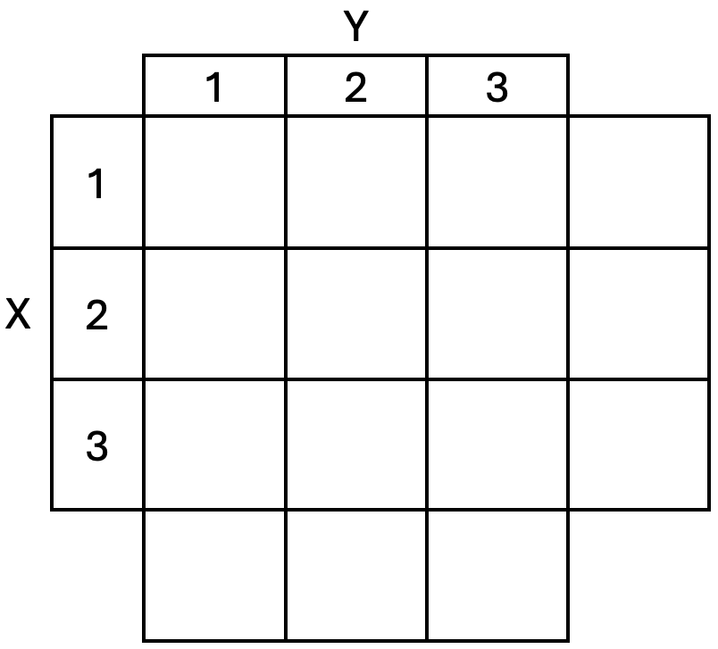

```{r setup, include=FALSE}
library(here)
source(here("class_dates.R"))

library(tidyverse)

theme_set(theme_bw(base_size = 28))

# Draws a static 3D picture of a joint pdf: the domain as a blue floor,
# the pdf as a grey wireframe, and an event's volume in orange
# (same helper as Lesson 15)
draw_pdf_volume <- function(f, x_vals, y_vals, domain_corners,
                            in_domain = function(x, y) rep(TRUE, length(x)),
                            event_corners = NULL,
                            in_event = function(x, y) rep(FALSE, length(x)),
                            flat_top = FALSE,
                            zlim, title = "", theta = 35, phi = 25) {
  heights <- outer(x_vals, y_vals, f)
  heights[!outer(x_vals, y_vals, in_domain)] <- NA

  x_mid <- (head(x_vals, -1) + tail(x_vals, -1)) / 2
  y_mid <- (head(y_vals, -1) + tail(y_vals, -1)) / 2
  facet_in_event <- outer(x_mid, y_mid, in_event) & !flat_top
  facet_colors <- ifelse(facet_in_event, adjustcolor("#E89543", 0.85), NA)

  par(mar = c(0, 0, 2, 0), cex = 1.8)
  view_args <- list(x = x_vals, y = y_vals, z = heights, zlim = zlim,
                    theta = theta, phi = phi, expand = 0.8, r = 4,
                    xlab = "x", ylab = "y", zlab = "f(x, y)")
  # 1. Set up the 3D view and axes, without the surface
  view_3d <- do.call(persp, c(view_args, list(border = NA)))
  # 2. Floor: the possible values (domain), at height 0
  floor <- trans3d(domain_corners[, 1], domain_corners[, 2], 0, view_3d)
  polygon(floor, col = adjustcolor("#29abe0", 0.25), border = "#29abe0")
  # 3. The joint pdf surface, drawn on top of the floor
  par(new = TRUE)
  do.call(persp, c(view_args, list(col = facet_colors, border = "grey60",
                                   box = FALSE)))
  # 4. The event's volume: walls from the floor up to the surface
  if (!is.null(event_corners)) {
    corners <- rbind(event_corners, event_corners[1, ])
    for (k in 1:(nrow(corners) - 1)) {
      s <- seq(0, 1, length.out = 50)
      edge_x <- corners[k, 1] + s * (corners[k + 1, 1] - corners[k, 1])
      edge_y <- corners[k, 2] + s * (corners[k + 1, 2] - corners[k, 2])
      edge_top <- f(edge_x, edge_y)
      wall <- trans3d(c(edge_x, rev(edge_x)), c(edge_y, rev(edge_y)),
                      c(0 * edge_top, rev(edge_top)), view_3d)
      polygon(wall, col = adjustcolor("#E89543", 0.35), border = NA)
      lines(trans3d(edge_x, edge_y, edge_top, view_3d), col = "#E89543")
      lines(trans3d(edge_x, edge_y, 0, view_3d), col = "#E89543")
    }
    # Vertical edges only at real corners (where the boundary turns)
    n_c <- nrow(event_corners)
    for (k in 1:n_c) {
      before <- event_corners[k, ] - event_corners[ifelse(k == 1, n_c, k - 1), ]
      after <- event_corners[ifelse(k == n_c, 1, k + 1), ] - event_corners[k, ]
      turn <- abs(atan2(after[2], after[1]) - atan2(before[2], before[1]))
      if (min(turn, 2 * pi - turn) > pi / 12) {
        cx <- event_corners[k, 1]; cy <- event_corners[k, 2]
        lines(trans3d(c(cx, cx), c(cy, cy), c(0, f(cx, cy)), view_3d),
              col = "#E89543")
      }
    }
    if (flat_top) {
      lid <- trans3d(event_corners[, 1], event_corners[, 2],
                     f(event_corners[, 1], event_corners[, 2]), view_3d)
      polygon(lid, col = adjustcolor("#E89543", 0.6), border = "#E89543")
    }
  }
  title(title, font.main = 1)
}

# Domain plots, reused across slides
domain_rect <- ggplot() +
  annotate("rect", xmin = 0, xmax = 2, ymin = 0, ymax = 1,
           fill = "#29abe0", alpha = 0.15) +
  scale_x_continuous(breaks = c(0, 1, 2), limits = c(0, 2)) +
  scale_y_continuous(breaks = c(0, 0.5, 1), limits = c(0, 1)) +
  labs(x = "x", y = "y")

domain_unit_square <- ggplot() +
  annotate("rect", xmin = 0, xmax = 1, ymin = 0, ymax = 1,
           fill = "#29abe0", alpha = 0.15) +
  scale_x_continuous(breaks = c(0, 0.5, 1), limits = c(0, 1)) +
  scale_y_continuous(breaks = c(0, 0.5, 1), limits = c(0, 1)) +
  labs(x = "x", y = "y")

domain_triangle <- ggplot() +
  annotate("polygon", x = c(0, 0, 4), y = c(0, 4, 4),
           fill = "#29abe0", alpha = 0.15) +
  scale_x_continuous(breaks = 0:4, limits = c(0, 4)) +
  scale_y_continuous(breaks = 0:4, limits = c(0, 4)) +
  labs(x = "x", y = "y", subtitle = "(keeps going up and right)")

domain_wedge <- ggplot() +
  annotate("polygon", x = c(0, 12, 12), y = c(0, 0, 6),
           fill = "#29abe0", alpha = 0.15) +
  annotate("text", x = 9.5, y = 5.6, label = "y = x/2", size = 9) +
  scale_x_continuous(breaks = c(0, 4, 8, 12), limits = c(0, 12)) +
  scale_y_continuous(breaks = c(0, 2, 4, 6), limits = c(0, 6)) +
  labs(x = "x", y = "y", subtitle = "(keeps going right)")
```

# Learning Objectives

1.  Identify the formulas for joint distributions of **independent** RVs and for **conditional** distributions (pmf's and pdf's)

2.  Find and simulate the **conditional** pmf from a joint pmf, and check if two discrete RVs are **independent**

3.  Construct a joint pdf for two **independent** continuous RVs from their marginal pdfs, and check it with simulation

4.  Calculate and simulate **conditional** probabilities and distributions for continuous RVs

## Where are we?

{fig-align="center"}

# Learning Objectives

::: lob
1.  Identify the formulas for joint distributions of **independent** RVs and for **conditional** distributions (pmf's and pdf's)
:::

2.  Find and simulate the **conditional** pmf from a joint pmf, and check if two discrete RVs are **independent**

3.  Construct a joint pdf for two **independent** continuous RVs from their marginal pdfs, and check it with simulation

4.  Calculate and simulate **conditional** probabilities and distributions for continuous RVs

## How do we represent conditional pmfs/pdfs?

For events, the [**conditional probability**]{style="color:#E25D3B;"} is:

$$P(A | B) = \dfrac{P(A \cap B)}{P(B)}$$

::: columns
::: {.column width="48%"}
::::: proof1
::: proof-title
For discrete RVs:
:::
::: proof-cont

$$p_{X|Y}(x|y) = P(X=x|Y=y) = \dfrac{p_{X,Y}(x,y)}{p_Y(y)}$$
$$p_{Y|X}(y|x) = P(Y=y|X=x) = \dfrac{p_{X,Y}(x,y)}{p_X(x)}$$

if denominator is greater than 0 ($p_Y(y) > 0$ or $p_X(x) > 0$)

:::
:::::
:::

::: {.column width="4%"}
:::

::: {.column width="48%"}
::: theorem
::: thm-title
For continuous RVs:
:::
::: thm-cont

$$f_{X|Y}(x|y) = \dfrac{f_{X,Y}(x,y)}{f_Y(y)}$$
$$f_{Y|X}(y|x) = \dfrac{f_{X,Y}(x,y)}{f_X(x)}$$

if denominator is greater than 0 ($f_Y(y) > 0$ or $f_X(x) > 0$)

:::
:::
:::

:::

- With simulation: conditioning on $Y = y$ means keeping only the simulations where $Y = y$, with `filter()` (Lesson 2)

## How do we represent independent RVs in a joint pmf/pdf?

**What do we know about independence for events?**

For events: If $A \perp B$

$$P(A \cap B) = P(A)P(B)$$ $$P(A|B) = P(A)$$

::: columns
::: {.column width="48%"}
::::: proof1
::: proof-title
For discrete RVs: If $X \perp Y$
:::
::: proof-cont

$$p_{X,Y}(x,y) = p_{X}(x)p_{Y}(y)$$
$$F_{X,Y}(x,y) = F_{X}(x)F_{Y}(y)$$ $$p_{X|Y}(x|y) = p_{X}(x)$$
$$p_{Y|X}(y|x) = p_{Y}(y)$$
:::
:::::
:::

::: {.column width="4%"}
:::

::: {.column width="48%"}
::: theorem
::: thm-title
For continuous RVs: If $X \perp Y$
:::
::: thm-cont
$$f_{X,Y}(x,y) = f_{X}(x)f_{Y}(y)$$
$$F_{X,Y}(x,y) = F_{X}(x)F_{Y}(y)$$
$$f_{X|Y}(x|y) = f_{X}(x)$$
$$f_{Y|X}(y|x) = f_{Y}(y)$$
:::
:::
:::

:::

## Remember: our probability rules must hold for these!

::: columns
::: {.column width="48%"}
::::: proof1
::: proof-title
For discrete RVs
:::
::: proof-cont
For a valid joint pmf, we need:

-   $0 \leq p_{X,Y}(x,y) \leq 1$ for all $x, y$
-   $\sum \limits_{\{all\ x\}} \sum \limits_{\{all\ y\}} p_{X,Y}(x,y)=1$

For a valid conditional pmf, we need:

-   $0 \leq p_{X|Y}(x|y) \leq 1$ for all $x, y$
-   $\sum \limits_{\{all\ x\}} p_{X|Y}(x|y)=1$
:::
:::::
:::

::: {.column width="4%"}
:::

::: {.column width="48%"}
::: theorem
::: thm-title
For continuous RVs
:::
::: thm-cont
For a valid joint pdf, we need:

-   $f_{X,Y}(x,y)\geq 0$ for all $x,y$
-   $\displaystyle\int_{-\infty}^{\infty}\displaystyle\int_{-\infty}^{\infty} f_{X,Y}(x,y)dxdy=1$

For a valid conditional pdf, we need:

- $f_{X|Y}(x|y)\geq 0$ for all $x$ and $y$
- $\displaystyle\int_{-\infty}^{\infty} f_{X|Y}(x|y)dx =1$

:::
:::
:::

:::

## Extra notes

-   If $X_1, X_2, …, X_n$ are **independent**

$$p_{X_1, X_2, …, X_n}(x_1, x_2, …, x_n) = P(X_1=x_1, X_2=x_2, …, X_n=x_n)=\prod\limits_{i=1}^np_{X_i}(x_i)$$
$$f_{X_1, X_2, …, X_n}(x_1, x_2, …, x_n) = \prod\limits_{i=1}^nf_{X_i}(x_i)$$
$$F_{X_1, X_2, …, X_n}(x_1, x_2, …, x_n) = P(X_1\leq x_1, X_2\leq x_2, …, X_n\leq x_n)=\prod\limits_{i=1}^nP(X_i \leq x_i) = \prod\limits_{i=1}^nF_{X_i}(x_i)$$

- Don't forget, you can manipulate the conditional density to get the joint: $$f_{X,Y}(x,y)= f_{X|Y}(x|y)f_Y(y)$$

# Learning Objectives

1.  Identify the formulas for joint distributions of **independent** RVs and for **conditional** distributions (pmf's and pdf's)

::: lob
2.  Find and simulate the **conditional** pmf from a joint pmf, and check if two discrete RVs are **independent**
:::

3.  Construct a joint pdf for two **independent** continuous RVs from their marginal pdfs, and check it with simulation

4.  Calculate and simulate **conditional** probabilities and distributions for continuous RVs

## [Last class: joint distribution for two discrete random variables (1/4)]{style="display: none;"}

::: columns
::: {.column width="35%"}
::: example
::: ex-title
Example 1 (from Lesson 15)
:::

::: ex-cont
Let $X$ and $Y$ be two random draws from a box containing balls labelled 1, 2, and 3 without replacement.

7.  Find $p_{X|Y}(x|y)$.
:::
:::

{width="520"}

:::

:::

## [Last class: joint distribution for two discrete random variables (2/4): simulate]{style="display: none;"}

:::: example
::: ex-cont
7.  Check $p_{X|Y}(x|y)$ with simulation: keep only the simulations where $Y = y$.
:::
::::

::::::: columns
::::: {.column width="54%"}
```{r}
#| code-fold: true
#| code-summary: "Same simulation as Lesson 15"

set.seed(1111) # <1>
reps <- 100000 # <1>

ex1_sims <- expand_grid( # <2>
    sim = 1:reps, # <2>
    draw = 1:2 # <2>
  ) |>
  group_by(sim) |> # <2>
  mutate(ball = sample(1:3, size = n())) |> # <2>
  summarise( # <2>
    x = first(ball), # <2>
    y = last(ball) # <2>
  )
```

1.  Same seed and number of simulations as Lesson 15.
2.  Same code as Lesson 15: draw two balls without replacement, 100,000 times. `x` is the first ball and `y` is the second.

```{r}
ex1_sims |> # <3>
  filter(y == 1) |> # <4>
  summarise( # <5>
    p_x1 = mean(x == 1), # <5>
    p_x2 = mean(x == 2), # <5>
    p_x3 = mean(x == 3) # <5>
  )
```

3.  Start from the 100,000 simulated pairs.
4.  Conditioning on $Y = 1$: keep only the simulations where the second ball is 1.
5.  Among those simulations, the proportion with each value of $X$ approximates $p_{X|Y}(x|1)$.
:::::

::::: {.column width="2%"}
:::::

::: {.column width="44%"}
```{r}
ex1_sims |> # <6>
  group_by(y) |> # <6>
  summarise( # <7>
    p_x1 = mean(x == 1), # <7>
    p_x2 = mean(x == 2), # <7>
    p_x3 = mean(x == 3) # <7>
  )
```

6.  Same idea for every value of $Y$ at once: one group for each value of `y`.
7.  Each row is the conditional pmf of $X$ given that value of $Y$. Each row adds up to 1.

:::: proof1
::: proof-cont
For reference, the exact answer is $p_{X|Y}(x|y) = \frac12$ for $x \neq y$, and $p_{X|Y}(x|y) = 0$ for $x = y$
:::
::::
:::
:::::::

## [Last class: joint distribution for two discrete random variables (3/4)]{style="display: none;"}

::: columns
::: {.column width="35%"}
::: example
::: ex-title
Example 1 (from Lesson 15)
:::

::: ex-cont
Let $X$ and $Y$ be two random draws from a box containing balls labelled 1, 2, and 3 without replacement.

8.  Are $X$ and $Y$ independent? Why or why not?
:::
:::


::: example
::: ex-cont
<font size=6ex>Remark:

-   To show that $X$ and $Y$ are *not* independent, we just need to find one counter example
-   However, to show that they *are* independent, we need to verify this for all possible pairs of $x$ and $y$

</font>
:::
:::
:::

::: {.column width="65%"}
{width="520"}
:::

:::

## [Last class: joint distribution for two discrete random variables (4/4): simulate]{style="display: none;"}

:::: example
::: ex-cont
8.  Check with simulation: compare the conditional pmf of $X$ given $Y = y$ with the marginal pmf of $X$.
:::
::::

::::::: columns
::::: {.column width="54%"}
```{r}
ex1_sims |> # <1>
  summarise( # <1>
    p_x1 = mean(x == 1), # <1>
    p_x2 = mean(x == 2), # <1>
    p_x3 = mean(x == 3) # <1>
  )
```

1.  No `filter()`: all 100,000 simulations. This approximates the marginal pmf $p_X(x)$.

- Marginal: each value of $X$ has probability about $\frac13$
- Given $Y = 1$: $p_{X|Y}(1|1) = 0$, not $\frac13$
- Knowing $Y$ changes the distribution of $X$, so $X$ and $Y$ are **not** [**independent**]{style="color:#20c997;"}
:::::

::::: {.column width="2%"}
:::::

::: {.column width="44%"}
```{r}
ex1_sims |> # <2>
  summarise( # <2>
    joint = mean(x == 1 & y == 1), # <2>
    product = mean(x == 1) * mean(y == 1) # <3>
  )
```

2.  The joint probability $p_{X,Y}(1,1)$: the proportion of simulations with $X = 1$ **and** $Y = 1$.
3.  The product of the marginal probabilities, $p_X(1)\,p_Y(1)$. If $X \perp Y$, these two would match.

:::: proof1
::: proof-cont
For reference, the exact answers are $p_{X,Y}(1,1) = 0$ and $p_X(1)\,p_Y(1) = \frac13 \cdot \frac13 = \frac19 \approx 0.111$
:::
::::

- One counterexample is enough!
:::
:::::::

# Learning Objectives

1.  Identify the formulas for joint distributions of **independent** RVs and for **conditional** distributions (pmf's and pdf's)

2.  Find and simulate the **conditional** pmf from a joint pmf, and check if two discrete RVs are **independent**

::: lob
3.  Construct a joint pdf for two **independent** continuous RVs from their marginal pdfs, and check it with simulation
:::

4.  Calculate and simulate **conditional** probabilities and distributions for continuous RVs

## [Constructing a joint pdf from two independent, continuous RVs]{style="display: none;"}

::::: example
::: ex-title
Example 2: Independent $X$ and $Y$
:::
::: ex-cont
Let $X$ and $Y$ be [**independent**]{style="color:#20c997;"} r.v.'s with
$f_X(x)= \frac12$, for $0 \leq x \leq 2$ and $f_Y(y)= 3y^2$, for
$0 \leq y \leq 1$.

1.  Find $f_{X,Y}(x,y)$
:::
:::::

:::::: columns
::::: {.column width="34%"}
```{r}
#| echo: false
#| fig-width: 6
#| fig-height: 5.5

domain_rect
```
:::::
::::::

## [Probability from joint pdf from two independent, continuous RVs]{style="display: none;"}

::::: example
::: ex-title
Example 2: Independent $X$ and $Y$
:::
::: ex-cont
Let $X$ and $Y$ be independent r.v.'s with
$f_X(x)= \frac12$, for $0 \leq x \leq 2$ and $f_Y(y)= 3y^2$, for
$0 \leq y \leq 1$.

2.  Find $\mathbb{P}(0 \leq X \leq 1, 0 \leq Y \leq \frac12)$
:::
:::::

:::::: columns
::::: {.column width="34%"}
```{r}
#| echo: false
#| fig-width: 6
#| fig-height: 5.5

domain_rect
```
:::::

::::: {.column width="2%"}
:::::

::::: {.column width="64%"}
```{r}
#| echo: false
#| fig-width: 8
#| fig-height: 6.5
#| out-width: "48%"
#| fig-align: center

draw_pdf_volume(
  f = function(x, y) 3/2 * y^2,
  x_vals = seq(0, 2, by = 0.125), y_vals = seq(0, 1, by = 0.0625),
  domain_corners = rbind(c(0, 0), c(2, 0), c(2, 1), c(0, 1)),
  event_corners = rbind(c(0, 0), c(1, 0), c(1, 0.5), c(0, 0.5)),
  in_event = function(x, y) x <= 1 & y <= 0.5,
  zlim = c(0, 1.5),
  title = "Volume = P(0 <= X <= 1, 0 <= Y <= 1/2)"
)
```
:::::
::::::

## [Probability from joint pdf from two independent, continuous RVs: simulate]{style="display: none;"}

:::: example
::: ex-cont
2.  Check with simulation: because $X \perp Y$, we can simulate $X$ and $Y$ **separately**, then put them side by side.
:::
::::

::::::: columns
::::: {.column width="55%"}
```{r}
y_grid <- seq(0, 1, length.out = 10001) # <1>

ex2_sims <- tibble(sim = 1:reps) |> # <2>
  mutate(
    x = runif(n(), min = 0, max = 2), # <3>
    y = sample(y_grid, size = n(), replace = TRUE, # <4>
               prob = 3 * y_grid^2) # <4>
  )

ex2_sims |> # <5>
  summarise( # <5>
    joint = mean(x <= 1 & y <= 0.5), # <5>
    product = mean(x <= 1) * mean(y <= 0.5) # <6>
  )
```

1.  Tickets for grid sampling $Y$ (Lesson 14): 10,001 evenly spaced values from 0 to 1.
2.  One row per simulation.
3.  $X \sim \text{Uniform}[0, 2]$, so `runif()` simulates it (Lesson 13).
4.  Grid sampling from $f_Y(y) = 3y^2$. The `x` and `y` columns are drawn separately: knowing `x` tells us nothing about `y`. That is what independence means!
5.  The proportion of simulations in the event approximates $\mathbb{P}(0 \leq X \leq 1, 0 \leq Y \leq \frac12)$.
6.  The product of the two marginal probabilities. For independent $X$ and $Y$, these match.
:::::

::: {.column width="45%"}
:::: proof1
::: proof-cont
For reference, the exact answers are $f_{X,Y}(x,y) = \frac12 \cdot 3y^2 = \frac32 y^2$ for $0 \leq x \leq 2, \ 0 \leq y \leq 1$, and $\mathbb{P}(0 \leq X \leq 1, 0 \leq Y \leq \frac12) = \frac12 \cdot \frac18 = \frac{1}{16} = 0.0625$
:::
::::

 

- Same joint pdf as Lesson 15, Example 2!
  - In Lesson 15, we simulated pairs from the joint pdf with 2D grid sampling
  - Here, we simulated $X$ and $Y$ separately and got the same answer
:::
:::::::

## [Showing independence from joint pdf]{style="display: none;"}

::::: example
::: ex-title
Example 3: Joint pdf on a square
:::
::: ex-cont
Let $f_{X,Y}(x,y)= 18 x^2 y^5$, for
$0 \leq x \leq 1, \ 0 \leq y \leq 1$.

1.  Are $X$ and $Y$ independent?
:::
:::::

:::::: columns
::::: {.column width="34%"}
```{r}
#| echo: false
#| fig-width: 6
#| fig-height: 5.5

domain_unit_square
```
:::::

::::: {.column width="2%"}
:::::

::::: {.column width="64%"}
```{r}
#| echo: false
#| fig-width: 8
#| fig-height: 6.5
#| out-width: "48%"
#| fig-align: center

draw_pdf_volume(
  f = function(x, y) 18 * x^2 * y^5,
  x_vals = seq(0, 1, by = 0.0625), y_vals = seq(0, 1, by = 0.0625),
  domain_corners = rbind(c(0, 0), c(1, 0), c(1, 1), c(0, 1)),
  zlim = c(0, 18),
  title = "Joint pdf f(x, y) = 18 x^2 y^5"
)
```
:::::
::::::

## [Finding CDF from two independent RVs]{style="display: none;"}

::::: example
::: ex-title
Example 3: Joint pdf on a square
:::
::: ex-cont
Let $f_{X,Y}(x,y)= 18 x^2 y^5$, for
$0 \leq x \leq 1, \ 0 \leq y \leq 1$.

2.  Find $F_{X,Y}(x,y)$.
:::
:::::

:::::: columns
::::: {.column width="34%"}
```{r}
#| echo: false
#| fig-width: 6
#| fig-height: 5.5

domain_unit_square
```
:::::
::::::

## [Showing independence from joint pdf: simulate]{style="display: none;"}

:::: example
::: ex-cont
Check parts 1 and 2 with simulation: is $F_{X,Y}(0.8, 0.8) = \mathbb{P}(X \leq 0.8, Y \leq 0.8)$ the same as $\mathbb{P}(X \leq 0.8)\,\mathbb{P}(Y \leq 0.8)$?
:::
::::

::::::: columns
::::: {.column width="52%"}
```{r}
ex3_grid <- expand_grid( # <1>
    x = seq(0, 1, length.out = 1001), # <1>
    y = seq(0, 1, length.out = 1001) # <1>
  ) |>
  mutate(height = 18 * x^2 * y^5) # <2>

ex3_sims <- ex3_grid |> # <3>
  slice_sample( # <3>
    n = reps, # <3>
    weight_by = height, # <3>
    replace = TRUE # <3>
  )
```

1.  2D grid sampling (Lesson 15): about 1 million tickets covering the square.
2.  The joint pdf's height at each ticket.
3.  Draw `reps` tickets, weighted by height. Each row drawn is one simulated pair $(x, y)$.

- `joint` and `product` are close, which agrees with independence
- One check can't *prove* independence, but a big mismatch would show they are not independent
:::::

::::: {.column width="2%"}
:::::

::: {.column width="46%"}
```{r}
ex3_sims |> # <4>
  summarise( # <4>
    joint = mean(x <= 0.8 & y <= 0.8), # <4>
    product = mean(x <= 0.8) * mean(y <= 0.8) # <5>
  )
```

4.  The proportion with $X \leq 0.8$ **and** $Y \leq 0.8$ approximates $F_{X,Y}(0.8, 0.8)$.
5.  The product of the marginal probabilities, $F_X(0.8)\,F_Y(0.8)$.

:::: proof1
::: proof-cont
For reference, the exact answers are $F_{X,Y}(x,y) = x^3 y^6$ for $0 \leq x \leq 1, \ 0 \leq y \leq 1$, so $F_{X,Y}(0.8, 0.8) = 0.8^3 \cdot 0.8^6 \approx 0.1342$
:::
::::
:::
:::::::

## [Showing independence from joint pdf: for home]{style="display: none;"}

::: {.callout-important appearance="simple" icon="false"}
Do this problem at home for extra practice. The solution is available in
Meike's video!
:::

::::::: columns
:::::: {.column width="30%"}
::::: example
::: ex-title
Example 4: Joint pdf on a triangle (for home)
:::
::: ex-cont
Let $f_{X,Y}(x,y)= 2 e^{-(x+y)}$, for
$0 \leq x \leq y$. Are $X$ and $Y$ independent?
:::
:::::
::::::

:::::: {.column width="30%"}
```{r}
#| echo: false
#| fig-width: 6
#| fig-height: 5.5

domain_triangle
```
::::::

:::::: {.column width="40%"}
- Hint: this is the same joint pdf as Lesson 15, Example 4. Look closely at its possible values!
::::::
:::::::

## Final statement on independence

1.  If $f_{X,Y}(x,y)= g(x)h(y)$, where $g(x)$ and $h(y)$ are pdf's, then
    $X$ and $Y$ are independent.

    -   The domain of the joint pdf needs to be independent as well!!

  
  
  
  

2.  If $F_{X,Y}(x,y)= G(x)H(y)$, where $G(x)$ and $H(y)$ are cdf's, then
    $X$ and $Y$ are independent.

    -   The domain of the joint CDF needs to be independent as well!!

  
  
  
  

- Make sure that:
  - $X$ domain does NOT depend on $Y$
  - $Y$ domain does NOT depend on $X$

# Learning Objectives

1.  Identify the formulas for joint distributions of **independent** RVs and for **conditional** distributions (pmf's and pdf's)

2.  Find and simulate the **conditional** pmf from a joint pmf, and check if two discrete RVs are **independent**

3.  Construct a joint pdf for two **independent** continuous RVs from their marginal pdfs, and check it with simulation

::: lob
4.  Calculate and simulate **conditional** probabilities and distributions for continuous RVs
:::

## [Example starting from a joint pdf: first try!]{style="display: none;"}

::::: example
::: ex-title
Example 5: Conditional pdf from a joint pdf
:::
::: ex-cont
Let $f_{X,Y}(x,y)= 5 e^{-x-3y}$, for
$0 < y < \frac{x}{2}$.

1.  Find $\mathbb{P}(2<X<10|Y=4)$

:::
:::::

## [Example starting from a joint pdf: second try! (1/2)]{style="display: none;"}

::::: example
::: ex-title
Example 5: Conditional pdf from a joint pdf
:::
::: ex-cont
Let $f_{X,Y}(x,y)= 5 e^{-x-3y}$, for
$0 < y < \frac{x}{2}$.

1.  Find $\mathbb{P}(2<X<10|Y=4)$

:::
:::::

:::::: columns
::::: {.column width="34%"}
```{r}
#| echo: false
#| fig-width: 6
#| fig-height: 5.5

domain_wedge
```
:::::
::::::

## [Example starting from a joint pdf: second try! (2/2)]{style="display: none;"}

## [Example starting from a joint pdf: simulate]{style="display: none;"}

:::: example
::: ex-cont
1.  Check $\mathbb{P}(2<X<10|Y=4)$ with simulation: grid sampling along the slice $Y = 4$.
:::
::::

::::::: columns
::::: {.column width="52%"}
```{r}
x_grid <- seq(8, 20, length.out = 10001) # <1>

ex5_sims <- tibble(sim = 1:reps) |> # <2>
  mutate(
    x = sample(x_grid, size = n(), replace = TRUE, # <3>
               prob = 5 * exp(-x_grid - 3 * 4)) # <4>
  )

ex5_sims |> # <5>
  summarise(prob = mean(2 < x & x < 10)) # <5>
```

1.  Given $Y = 4$, the possible values of $X$ are $x > 2 \cdot 4 = 8$ (from $0 < y < \frac{x}{2}$). The pdf is almost 0 past 20, so the grid can stop there.
2.  One row per simulation.
3.  Grid sampling, like Lesson 14.
4.  The heights are the joint pdf along the slice, $f_{X,Y}(x, 4)$. We don't need to divide by $f_Y(4)$: R rescales `prob` to add to 1, so the heights only need to be *proportional* to $f_{X|Y}(x|4)$.
5.  The proportion of simulations with $2 < X < 10$ approximates $\mathbb{P}(2<X<10|Y=4)$.

- Why not `filter(y == 4)`? $Y$ is continuous, so $\mathbb{P}(Y = 4) = 0$: no simulated pair lands exactly on $y = 4$
:::::

::::: {.column width="2%"}
:::::

::: {.column width="46%"}
```{r}
#| code-fold: true
#| code-summary: "Plot code"
#| fig-width: 10
#| fig-height: 6

ggplot(ex5_sims, aes(x = x)) + # <6>
  geom_histogram(aes(y = after_stat(density)), # <6>
                 binwidth = 0.1, boundary = 8, # <6>
                 color = "black", fill = "lightblue") + # <6>
  geom_function(fun = function(x) exp(-(x - 8)), # <7>
                xlim = c(8, 14), # <7>
                color = "red", linewidth = 1.5) + # <7>
  coord_cartesian(xlim = c(8, 14)) + # <8>
  labs(subtitle = "Simulated X given Y = 4", # <9>
       x = "x", y = "Density") # <9>
```

6.  Histogram of the simulated values of $X$ given $Y = 4$, scaled like a pdf.
7.  For reference, the conditional pdf $f_{X|Y}(x|4) = e^{-(x-8)}$ for $x > 8$, in red.
8.  Zoom in to where almost all of the values are.
9.  Add a subtitle and axis labels.

:::: proof1
::: proof-cont
For reference, the exact answer is $\mathbb{P}(2<X<10|Y=4) = \mathbb{P}(8<X<10|Y=4) = 1 - e^{-2} \approx 0.8647$
:::
::::
:::
:::::::

## [Example starting from a joint pdf: part 2]{style="display: none;"}

::: {.callout-important appearance="simple" icon="false"}
Do this problem at home for extra practice. The solution is available in
Meike's video!
:::

::::::: columns
:::::: {.column width="30%"}
::::: example
::: ex-title
Example 5: Conditional pdf from a joint pdf (for home)
:::
::: ex-cont
Let $f_{X,Y}(x,y)= 5 e^{-x-3y}$, for
$0 < y < \frac{x}{2}$.

2.  Find $\mathbb{P}(X>20 |Y=5)$

:::
:::::
::::::
:::::::

## [Finding probability with conditional domain and pdf]{style="display: none;"}

::: {.callout-important appearance="simple" icon="false"}
Do this problem at home for extra practice. The solution is available in
Meike's video!
:::

::::::: columns
:::::: {.column width="30%"}
::::: example
::: ex-title
Example 6: Choose a point, then another (for home)
:::
::: ex-cont
Randomly choose a point $X$ from the interval $[0,1]$,
and given $X=x$, randomly choose a point $Y$ from $[0,x]$. Find
$\mathbb{P}(0 < Y < \frac14)$.

:::
:::::
::::::
:::::::

## [Finding probability with conditional domain and pdf: simulate]{style="display: none;"} {visibility="hidden"}

:::: example
::: ex-cont
Solution: check $\mathbb{P}(0 < Y < \frac14)$ with simulation. Simulate $X$ first, then $Y$ given $X$: $f_{X,Y}(x,y) = f_{Y|X}(y|x)\,f_X(x)$
:::
::::

::::::: columns
::::: {.column width="52%"}
```{r}
ex6_sims <- tibble(sim = 1:reps) |> # <1>
  mutate(
    x = runif(n(), min = 0, max = 1), # <2>
    y = runif(n(), min = 0, max = x) # <3>
  )

ex6_sims |> # <4>
  summarise(prob = mean(0 < y & y < 1/4)) # <4>
```

1.  One row per simulation.
2.  $X \sim \text{Uniform}[0, 1]$.
3.  Given $X = x$, $Y \sim \text{Uniform}[0, x]$. `max = x` uses each row's own value of `x`, so every row gets its own conditional distribution.
4.  The proportion of simulations with $0 < Y < \frac14$ approximates the probability.
:::::

::::: {.column width="2%"}
:::::

::: {.column width="46%"}
:::: proof1
::: proof-cont
For reference, the exact answer is $\mathbb{P}(0 < Y < \frac14) = \frac14 + \frac14 \ln 4 \approx 0.5966$
:::
::::

 

- $X$ and $Y$ are not independent: the possible values of $Y$ depend on $x$
:::
:::::::
