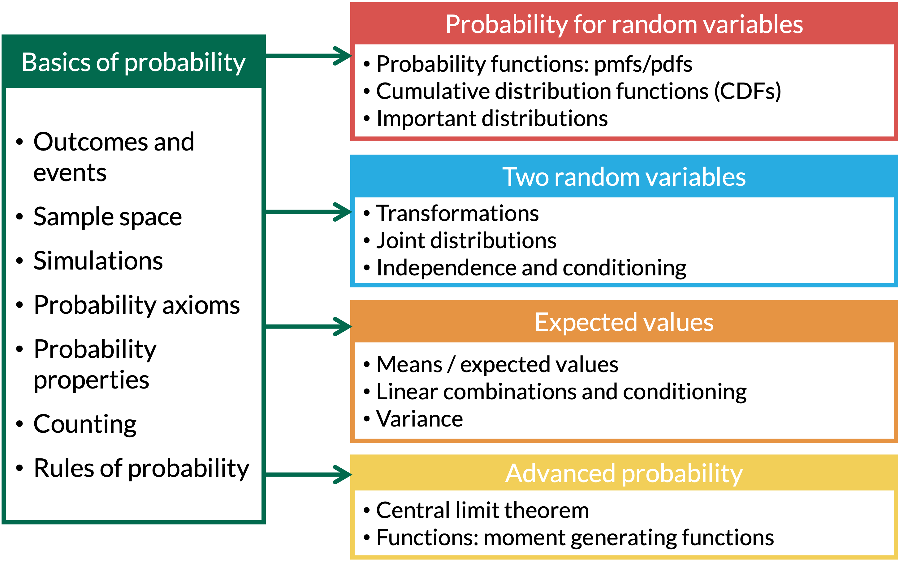

```{r setup, include=FALSE}
library(here)
source(here("class_dates.R"))
```

## Learning Objectives

1. Learn the definition of a moment-generating function.
2. Find the moment-generating function of a random variable.
3. Use a moment-generating function to find the mean and variance of a random variable.
4. Use moment-generating functions to find the distribution of linear transformations and sums of independent random variables.

## Where are we?

{fig-align="center"}


## What are moments?

::: definition
::: def-title
Definition 1
:::
::: def-cont
The $j^{th}$ moment of a r.v. $X$ is $\mathbb{E}[X^j]$
:::
:::

## Okay, but what are they?

::: example
::: ex-title
Example 1
::: 
::: ex-cont
$1^{st}-4^{th}$ moments
:::
:::

1. 1st moment: 

 

2. 2nd moment:

 

3. 3rd moment:

 

4. 4th moment:


## What is a *moment generating function* (MGF)??

::: definition
::: def-title
Definition 3
:::
::: def-cont
If $X$ is a r.v., then the **moment generating function**
(**MGF**) associated with $X$ is:
$$M_X(t)= \mathbb{E}[e^{tX}]$$
:::
:::

**Remarks**

::: columns
::: column
-   For a discrete r.v., the MGF of $X$ is
    $$M_X(t)= \mathbb{E}[e^{tX}]=\sum_{all \ x}e^{tx}p_X(x)$$

-   For a continuous r.v., the MGF of $X$ is
    $$M_X(t)= \mathbb{E}[e^{tX}]=\int_{-\infty}^{\infty}e^{tx}f_X(x)dx$$
:::
::: column
-   The MGF $M_X(t)$ is a function of $t$, not of $X$, and it might not
    be defined (i.e. finite) for all values of $t$. We just need it to
    be defined for $t=0$.
:::
:::

## Example 

::: columns
::: {.column width="30%"}
::: example
::: ex-title
Example 4
:::
::: ex-cont
What is $M_X(t)$ for $t=0$?
:::
:::
:::
:::

## How do MGFs give us moments? 

::: theorem
::: thm-title
Theorem 5
:::
::: thm-cont
The moment generating function uniquely specifies a probability distribution. AKA **all moments can be found from the MGF through its derivatives at $t=0$.**
:::
:::

::: theorem
::: thm-title
Theorem 6
:::
::: thm-cont
$$\mathbb{E}[X^r] = M_X^{(r)}(0)$$

$(r)$ in this equation is the $r$th derivative with respect to $t$. We calculate the derivative at $t=0$
:::
:::

- When $r=1$, we are taking the first derivative
- When $r=4$, we are taking the fourth derivative

## Using the MGF to uniquely describe a probability distribution

::: columns
::: {.column width="30%"}
::: example
::: ex-title
Example 7
:::
::: ex-cont
Let $X \sim Poisson(\lambda)$

1.  Find the MGF of $X$

2.  Find $\mathbb{E}[X]$

3.  Find $Var(X)$
:::
:::

:::
:::


## Theorem

**Remark:** Finding the mean and variance is sometimes easier with the following
trick

::: theorem
::: thm-title
Theorem 8
:::
::: thm-cont
Let $R_X(t) = \ln[M_X(t)]$. Then, 

$$\mu = \mathbb{E}[X] = R_X'(0) \text{, and}$$
$$\sigma^2 = Var(X) = R_X''(0)$$
:::
:::


::: proof
:::


## Using $R_X(t)$ to uniquely describe a probability distribution

::: columns
::: {.column width="30%"}
::: example
::: ex-title
Example 9
:::
::: ex-cont
Let $X \sim Poisson(\lambda)$.

1.  Find $\mathbb{E}[X]$ using $R_X(t)$

2.  Find $Var(X)$ using $R_X(t)$
:::
:::
:::
:::

## Using the MGF to uniquely describe the standard normal distribution

::: columns
::: {.column width="30%"}
::: example
::: ex-title
Example 10
:::
::: ex-cont
Let $Z$ be a standard normal random variable, i.e.
$Z \sim N(0,1)$.

1.  Find the MGF of $Z$

2.  Find $\mathbb{E}[Z]$

3.  Find $Var(Z)$
:::
:::
:::
:::

## Using the MGF to uniquely describe the standard normal distribution

## Finding a distribution from its MGF

::: columns
::: {.column width="30%"}
::: example
::: ex-title
Example 11
:::
::: ex-cont
Let $X$ be a random variable with MGF
$$M_X(t)= \frac{1}{5}e^t + \frac{3}{10}e^{2t} + \frac{1}{2}e^{3t}.$$
Find the pmf or pdf of $X$.
:::
:::
:::
:::

## MGFs of linear transformations

::: theorem
::: thm-title
Theorem 12
:::
::: thm-cont
Let $X$ have MGF $M_X(t)$, and let $Y=aX+b$, where $a$ and $b$ are constants. Then
$$M_Y(t)=$$
:::
:::

::: proof
:::

## Using the MGF to describe the normal distribution

::: columns
::: {.column width="30%"}
::: example
::: ex-title
Example 13
:::
::: ex-cont
Let $X$ be a normal random variable with mean $\mu$ and variance $\sigma^2$, i.e. $X \sim N(\mu,\sigma^2)$.

1.  Find the MGF of $X$

2.  Find $\mathbb{E}[X]$

3.  Find $Var(X)$
:::
:::
:::
:::

## Do linear transformations preserve the distribution type?

**Question:** If $X$ has a certain probability distribution, does $aX+b$ always have the same distribution type?

::: columns
::: {.column width="30%"}
::: example
::: ex-title
Example 14
:::
::: ex-cont
Let $X \sim U[0,1]$, and $Y = 2X+3$. Is $Y$ also a uniform RV? If so, what are its parameters?
:::
:::
:::
:::

## Do linear transformations preserve the distribution type?

::: columns
::: {.column width="30%"}
::: example
::: ex-title
Example 15
:::
::: ex-cont
Let $X \sim Exp(\lambda=5)$, and $Y = 2X+3$. Is $Y$ also an exponential RV? If so, what is its parameter?
:::
:::
:::
:::


## MGFs of sums of independent RV's

::: theorem
::: thm-title
Theorem 16
:::
::: thm-cont
If $X$ and $Y$ are independent RV's with respective MGFs $M_X(t)$ and $M_Y(t)$, then

$$M_{X+Y}(t) = E[e^{t(X+Y)}] = E[e^{tX} e^{tY}] = E[e^{tX}]E[e^{tY}]=M_{X}(t)M_{Y}(t)$$
:::
:::

## MGFs of linear combinations of independent RV's

::: theorem
::: thm-title
Theorem 17
:::
::: thm-cont
Let $X_1, X_2, \ldots, X_n$ be independent RV's with respective MGFs $M_{X_i}(t)$, for $i=1,2,\ldots,n$. Let $Y=\sum_{i=1}^n a_iX_i$, where $a_i$ are constants. Then
$$M_Y(t)= %\Pi_{i=1}^n M_{X_i}(a_it).$$
:::
:::

::: proof
:::

## Sums of independent normal RV's

::: columns
::: {.column width="30%"}
::: example
::: ex-title
Example 18
:::
::: ex-cont
Let $X_i \sim N(\mu_i, \sigma_i^2)$ be independent normal RV's. What is the distribution of $Y=\sum_{i=1}^n X_i$?
:::
:::
:::
:::

## The sample mean of iid normal RV's

::: columns
::: {.column width="30%"}
::: example
::: ex-title
Example 19
:::
::: ex-cont
Let $X_i \sim N(\mu, \sigma^2)$ be iid normal RV's, for $i=1,2,\ldots,n$. What is the distribution of $\bar{X}=\frac{\sum_{i=1}^n X_i}{n}$?
:::
:::
:::
:::

## Connecting the normal and chi-squared distributions

::: columns
::: {.column width="30%"}
::: example
::: ex-title
Example 20
:::
::: ex-cont
Let $Z$ be a standard normal random variable, i.e. $Z \sim N(0,1)$. Show that $Z^2 \sim \chi_1^2$, i.e. is a chi-squared RV with 1 degree of freedom (Lesson 13).
:::
:::
:::
:::

## Main takeaways

- MGFs are a purely mathematically definition
  - We can't really relate it to our real world analysis
  
- They are helpful mathematically because they are unique to a probability distribution
  - We can find the unique MGF from for a probability distribution
  - And we can find a distribution from an MGF
  
- MGFs can *sometimes* make it easier to find the mean and variance of an RV

- MGFs are most helpful when we are finding a joint distribution that is a sum or transformation of two RV's
  - Make the calculation easier!

- MGFs are often used to prove certain distribution are sums of other ones!
  - For example: sums of independent normal RVs are normal, and $Z^2$ is chi-squared
  
## More resources

- <https://online.stat.psu.edu/stat414/book/export/html/676>
- <https://www.youtube.com/watch/ez_vq23xWrQ>
- <https://www.youtube.com/watch/2p9J9ChTeFI>
- <https://www.youtube.com/watch/A5bWU8xcQkE>
- <https://www.youtube.com/watch/QeUrTGFTFm4>
- <https://www.youtube.com/watch/HhrkwyyRtgI>
